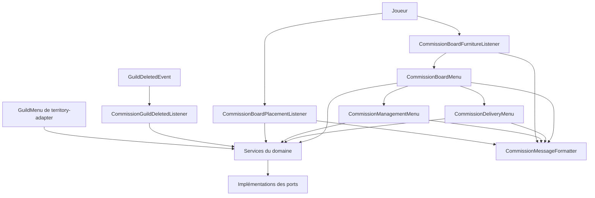
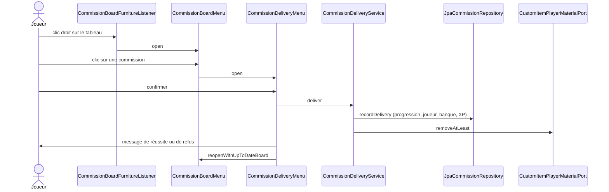

# Documentation du code — `commission-adapter`

Ce document décrit **ce que fait le code** de `commission-adapter` : chaque classe, ses appels et ses cas particuliers. Il complète la spec (`commission-adapter.md`, ce que le module doit faire) et la documentation du domaine (`commission-domain-doc.md`, dont il suppose la lecture).

Rôle du module : implémenter les ports `serverside` du domaine avec le serveur réel (JPA, YAML, ItemsAdder, Bukkit), et exposer les services du domaine aux joueurs (tableau posé, menus). Il ne contient aucune règle métier.

## 1. Carte du module

```
onl.tesseract.srp.commission.adapter
├── furniture/CommissionBoardFurniture                identifiant ItemsAdder du tableau, calcul de sa position
├── serverside                                        implémentations des ports du domaine
│   ├── jpa
│   │   ├── JpaCommissionBoardRepository              → CommissionBoardRepository
│   │   ├── JpaCommissionRepository                   → CommissionRepository
│   │   ├── CommissionBoardMapper, CommissionMapper   conversion domaine ↔ entités
│   │   ├── entity/CommissionBoardEntity, CommissionEntity
│   │   └── repository/CommissionBoardJpaRepository, CommissionJpaRepository   (Spring Data)
│   ├── catalog/SkillCustomItemCommissionCatalogRepository   → CommissionCatalogRepository
│   ├── yaml/YamlCommissionConfigRepository           → CommissionConfigRepository et CommissionCatalogConfig
│   ├── guild/GuildServiceMembershipPort              → GuildMembershipPort
│   │   guild/GuildServiceTerritoryPort               → GuildTerritoryPort
│   │   guild/GuildServiceProgressPort                → GuildProgressPort
│   ├── material/CustomItemPlayerMaterialPort         → PlayerMaterialPort
│   ├── furniture/ItemsAdderBoardFurniturePort        → BoardFurniturePort
│   └── placement/BukkitBoardPlacementSessionPort     → BoardPlacementSessionPort
└── userside
    ├── config/CommissionProvider                     déclaration Spring des services du domaine
    └── controller
        ├── event/CommissionBoardFurnitureListener    clic et casse du tableau
        │   event/CommissionBoardPlacementListener    pose du tableau
        │   event/CommissionGuildDeletedListener      suppression d'une guilde
        ├── menu/CommissionBoardMenu, CommissionDeliveryMenu, CommissionManagementMenu
        │   menu/CommissionDisplay                    textes et lignes de lore
        └── message/CommissionMessageFormatter, CommissionChatFormats
```

Schéma des appels :



## 2. Assemblage : `CommissionProvider`

`@Configuration` Spring. Le domaine n'a aucune annotation Spring ; ce fichier déclare ses cinq services comme beans, et Spring y injecte les implémentations des ports **par type d'interface**. `CommissionBoardRefillService` reçoit un `new Random()` comme source d'aléa.

## 3. Persistance (JPA)

### Tables

`CommissionBoardEntity` → table `t_commission_boards` :

| Colonne | Type | Remarque |
|---|---|---|
| `id` | `Long`, clé auto | |
| `guild_id` | UUID en texte (36), unique | `null` pour le spawn |
| `max_craft_tier`, `max_harvest_tier`, `slots_per_type`, `money_bonus_level` | entier | |
| `max_required_quality` | enum en texte | |
| `usage_tax_rate` | décimal | |
| `completed_commission_count` | entier | incrémenté par une requête dans la transaction de la livraison |
| `position_world`, `position_x`, `position_y`, `position_z` | texte, entiers | vides tant que le tableau n'est pas posé |

`CommissionEntity` → table `t_commissions` :

| Colonne | Type | Remarque |
|---|---|---|
| `id` | `Long`, clé auto | |
| `board_id` | `Long` | indexée, sans relation JPA |
| `part`, `type` | enum en texte | |
| `material` | texte | |
| `quantity`, `delivered_quantity`, `reward` | entier | |
| `minimal_quality` | enum en texte | |

Les tables sont créées automatiquement. Il n'y a pas de colonne d'état : une commission est terminée quand `delivered_quantity = quantity`.

### Mappers

- `CommissionMapper` : `toEntity(draft)` crée une entité sans id ni livraison ; `toDomain(entity)`.
- `CommissionBoardMapper` : `toNewSpawnBoardEntity(levels)` et `toNewGuildBoardEntity(guildId, taxRate)` créent les entités de départ, celle d'une guilde avec `BoardLevels.GUILD_START` ; `copyChanges(board, entity)` recopie niveaux, taxe et position ; `toDomain(entity)` reconstruit le tableau, ou le tableau du spawn si `guild_id` est nul.

### Requêtes

`CommissionBoardJpaRepository` : `findByGuildId`, `findByGuildIdIsNull` (le spawn), et `incrementCompletedCommissionCount`.

`CommissionJpaRepository` : `findByBoardIdOrderById`, et deux requêtes JPQL avec `@Modifying(flushAutomatically = true, clearAutomatically = true)` :

- `deleteByBoardId(boardId)` ;
- `addDeliveredQuantity(id, itemCount)` : ajoute `itemCount` à `delivered_quantity`.

### `JpaCommissionBoardRepository` (→ `CommissionBoardRepository`)

Toutes les méthodes sont `@Transactional` (lecture seule pour les lectures). `save` relit l'entité et y recopie les changements, sans toucher au compteur de commissions terminées, que seule la livraison incrémente. `deleteByGuild` supprime d'abord les commissions du tableau, puis le tableau, dans la même transaction.

### `JpaCommissionRepository` (→ `CommissionRepository`)

**`recordDelivery(delivery)`**, dans une seule transaction :

1. `addDeliveredQuantity` ;
2. `playerService.adjustMoney(joueur, gains)`, qui ne refuse jamais un gain positif ou nul ;
3. si le tableau appartient à une guilde, `guildService.addCommissionIncome(guilde, taxe, xp)` ;
4. si la livraison termine la commission, incrémente le compteur du tableau.

Une panne de base annule toute la transaction. Il n'y a pas de contrôle de concurrence : tout s'exécute sur le thread principal, et la commission est relue juste avant dans le même appel.

## 4. Configuration : `YamlCommissionConfigRepository`

Lit `plugins/Tesseract/commission/commissions.yml` (chemin relatif au dossier du serveur). Le modèle est dans les ressources du plugin, qui le copie sur le serveur au démarrage s'il manque. La classe implémente le port `CommissionConfigRepository` du domaine et l'interface `CommissionCatalogConfig` de l'adapter, qui sert au catalogue.

- **Chargement** : le fichier est lu une fois, à la création du bean ; une modification demande un redémarrage. Fichier absent : valeurs par défaut.
- **Fichier absent** : configuration vide, donc les valeurs par défaut ci-dessous. Avec un poids par défaut de 0, aucune commission n'est générée.
- **Aucune validation** des valeurs lues, sauf celle des records du domaine (`UpgradeStep` refuse un prix ou un niveau négatif).

| Méthode | Clé | Défaut |
|---|---|---|
| `getSpawnRewardRate()` | `spawn-reward-rate` | 1 |
| `getMoneyBonusRate(level)` | `upgrades.money-bonus.<level>.value` | 0 |
| `getGuildXpPerLys()` | `guild-xp-per-lys` | 0 |
| `getDefaultUsageTaxRate()` | `default-usage-tax-rate` | 0,25 |
| `getSpawnSlotsPerType()` | `spawn-slots-per-type` | 6 |
| `findUpgradeStep(type, level)` | voir ci-dessous | vide |
| `findAllHarvestTiers()` | `harvest-tiers` | table vide |
| `getRarityQuantity(rareté)` | `quantity-by-rarity.<RARETÉ>.quantity` et `.variance` | 0 et 0 |
| `getRarityWeight(rareté)` | `rarity-weights.<RARETÉ>` | 0 |

`findUpgradeStep` lit `cost` et `guild-level` dans `upgrades.max-craft-tier.<niveau>`, `upgrades.max-harvest-tier.<niveau>`, `upgrades.slots.<niveau>`, `upgrades.money-bonus.<niveau>` ou `upgrades.max-required-quality.<QUALITÉ>`. Pour la qualité, le niveau est converti en nom : le niveau 1 lit `NORMAL`. Une section absente signifie que le niveau maximal est atteint.

Le nombre de slots configurés ne doit pas dépasser 6 par type, le menu n'en affichant pas plus.

## 5. Implémentations des ports

### 5.1 `SkillCustomItemCommissionCatalogRepository` (→ `CommissionCatalogRepository`)

`findAllCatalogItems(type)` :

- `HARVEST` : les items listés dans `harvest-tiers`, avec leur tier. Un item absent de la liste n'est jamais demandé.
- `CRAFT` : le résultat de toutes les recettes des compétences, lues avec `SkillService.findAllSkills()`. Si plusieurs recettes donnent le même item, le plus petit tier est retenu.

Un item sans prix (`customItemService.hasMoneyValue`) est ignoré avec un warning. Les items mis en configuration sont toujours chargés par ItemsAdder : leur chargement n'est pas vérifié. Pour les autres, le poids et la quantité viennent de la rareté : `customMaterial.rarity()`, ou `COMMON` pour un item vanilla.

`getUnitValue` lit `customItemService.getMoneyValue(material, quality)`. `getItemTier` relit `harvest-tiers` ou les recettes ; un item demandé par une commission y est toujours.

### 5.2 Ports de guilde

Tous s'appuient sur `GuildService` de `territory-domain` :

- `GuildServiceMembershipPort` : `isMember` compare la guilde du joueur à celle du tableau ; `canManageBoard` demande en plus `GuildRole.canManageBoard()` (Adjoint ou chef).
- `GuildServiceTerritoryPort` : `ownsChunk` compare la guilde du chunk.
- `GuildServiceProgressPort` : `getGuildLevel`, `getGuildMoney` et `payFromBank`.

### 5.3 `CustomItemPlayerMaterialPort` (→ `PlayerMaterialPort`)

S'appuie sur `CustomItemService`, en bouclant sur les qualités :

- item custom : qualités de la qualité minimale à `EXCEPTIONAL`, la plus basse d'abord ;
- item vanilla : il n'a pas de qualité, donc une seule lecture en `POOR`, quelle que soit la qualité minimale.

`removeAtLeast` ne recompte pas : le service vient de compter les items dans le même appel.

### 5.4 `ItemsAdderBoardFurniturePort` (→ `BoardFurniturePort`)

`hasFreeSpace` vérifie que les 3 × 2 blocs sont vides. `placeFurniture` appelle `CustomFurniture.spawn`, tourne le tableau vers le joueur et renvoie sa position. `removeFurniture` charge le chunk et retire le tableau `BOARD_ITEM_ID` situé à cette position. Un monde introuvable donne « pas de place » et « rien à poser ».

### 5.5 `BukkitBoardPlacementSessionPort` (→ `BoardPlacementSessionPort`)

Garde en mémoire les joueurs qui posent le tableau, avec un minuteur Bukkit de `BOARD_PLACEMENT_SECONDS` (30 secondes). À l'ouverture de la session, il envoie la consigne ; chaque seconde, il affiche le temps restant dans la barre d'action ; à la fin, il termine la session et prévient le joueur.

## 6. Messages : `CommissionMessageFormatter`

Composant Spring qui construit tous les messages de chat, préfixés par `CommissionChatFormats`, en vert pour une réussite et en rouge pour un refus.

- `formatRefusal(exception)` : un `switch` sur la hiérarchie scellée `CommissionException`, avec un texte par exception. Ajouter une exception au domaine fait échouer la compilation tant qu'elle n'a pas de texte.
- `formatDeliverySucceeded(commission, delivery)` : au livreur, ses items et son gain, taxe déduite (la taxe est détaillée dans le menu avant la livraison), puis un second message si la commission est terminée. Ce que gagne la guilde n'y figure pas.
- `formatGuildDeliveryNotice(livreur, commission, delivery)` : aux membres connectés de la guilde propriétaire, livreur compris, le nom du livreur, ses items et ce que gagne la guilde (taxe d'un externe, XP). Rien n'est envoyé au spawn ni si la guilde ne gagne rien.
- Les messages d'information utilisent `COMMISSION_CHAT_FORMAT` : texte gris, valeurs en couleur (items en blanc, lys en vert, XP en bleu). `COMMISSION_CHAT_SUCCESS` reste pour les confirmations de gestion et de pose.
- Un message par étape de gestion et de pose : amélioration, taxe, consigne, compte à rebours, annulation, fin du temps, tableau posé, clic hors du dessus d'un bloc, casse refusée.

## 7. Entrées : tableau posé, menus, événements

### 7.1 Listeners

`CommissionBoardFurnitureListener` :

- `onFurnitureInteract` (`FurnitureInteractEvent` d'ItemsAdder) réagit au clic sur le tableau `BOARD_ITEM_ID`, sauf pendant une pose. L'événement est annulé, puis le tableau est choisi selon le chunk du tableau : celui de la guilde propriétaire, sinon celui du spawn, quel que soit le monde. `CommissionBoardMenu` s'ouvre ensuite.
- `onFurnitureBreak` annule la casse d'un tableau situé sur le territoire d'une guilde.

`CommissionBoardPlacementListener` traduit le clic droit sur le dessus d'un bloc en `placeGuildBoard`, le fait de s'accroupir en annulation et la déconnexion en annulation silencieuse. Il attrape les `CommissionException` pour les afficher.

`CommissionGuildDeletedListener` (Spring, `GuildDeletedEvent`) appelle `deleteGuildBoard`.

### 7.2 `CommissionBoardMenu`

Étend `ItemAdderMenu`, en 6 lignes sur 9 colonnes, avec le fond `tesseract:commission_board_menu`, déclaré dans `configs/gui/guis.yml` d'ItemsAdder. Sans texture installée, le menu s'ouvre sans fond et un warning est journalisé à chaque ouverture.

| Emplacement | Contenu |
|---|---|
| 0, 8 | Icône de récolte |
| 1, 2, 3, 10, 11, 12 / 7, 6, 5, 16, 15, 14 | Slots de récolte, public puis guilde |
| 27, 35 | Icône d'artisanat |
| 28, 29, 30, 37, 38, 39 / 34, 33, 32, 43, 42, 41 | Slots d'artisanat, public puis guilde |
| 45 | Informations : partage, paiement, public et guilde, taxe du tableau, remplacement des commissions |
| 53 | Gestion, pour les Adjoints et le chef |

Affichage d'un slot :

- au-delà de `slotsPerType` : vitre grise « À débloquer » sur un tableau de guilde, rien au spawn, qui ne s'améliore pas ;
- commission ouverte : l'icône de l'item, avec `CommissionDisplay.describeCommission` en lore. Un clic ouvre `CommissionDeliveryMenu` ;
- slot débloqué sans commission (catalogue vide) : rien, jusqu'à la prochaine ouverture du tableau.

Au spawn, les 12 slots de droite sont des vitres grises « Pas de commissions de guilde au spawn ». Pour un externe, ce sont des vitres grises « Réservé aux membres de la guilde ». Les étiquettes « PUBLIC » et « GUILDE » font partie de la texture.

`reopenWithUpToDateBoard(viewer)` relit le tableau et ouvre un nouveau menu, ce qui rafraîchit l'affichage.

### 7.3 `CommissionDeliveryMenu`

Étend `ItemAdderMenu`, en 3 lignes, avec le fond `tesseract:commission_board_delivery_menu` : « Confirmer » (11), la commission sans indication de clic (13), « Annuler » (15). « Confirmer » appelle `deliver`, affiche le résultat ou le refus dans le chat, puis rouvre le tableau.

### 7.4 `CommissionManagementMenu`

Étend `ItemAdderMenu`, en 5 lignes, avec le fond `tesseract:commission_board_upgrade_menu`. Emplacements : les 5 améliorations (9, 11, 13, 15, 17), la taxe (31), le bouton de retour commun `MENU_BACK_ARROW_BUTTON` (36) et les informations (44).

- Une amélioration affiche sa description, son niveau actuel, le suivant, son prix et le niveau de guilde requis, chaque condition en vert si elle est remplie et en rouge sinon. Au maximum, elle affiche « Niveau maximal atteint ».
- La taxe change de +5 % au clic gauche et de -5 % avec les autres clics. Hors limites, le service refuse et le refus s'affiche.
- Le bouton d'information affiche la banque et le niveau de la guilde.
- Après chaque action, le menu est reconstruit avec le tableau relu.

### 7.5 `CommissionDisplay`

Lignes de lore et libellés : `describeCommission` (type, tier, progression, qualité minimale, récompense, XP de guilde totale pour un membre, puis items, taxe, gain et XP pour un membre), `describeBoard(board, spawnRewardRate)` (au spawn, la part payée affichée vient de `spawn-reward-rate`), `describeUpgrade`, `formatUpgradeLevel(levels, type, taux)`, `formatPercent`, `formatMaterialName` (`FER_BRUT` → « Fer brut »). Les libellés et couleurs de qualité viennent de `QualityAdapter` (`common-adapter`).

## 8. Liens avec les autres modules

- `territory-domain` : `GuildService` fournit `getGuildLevel`, `getGuildMoney`, `addCommissionIncome`, `payFromBank`, et publie `GuildDeletedEvent` à la suppression ; `GuildRole.canManageBoard()`.
- `territory-adapter` : le bouton de `GuildMenu` s'appelle « Poser » ou « Déplacer le tableau de commissions » selon `CommissionBoardPlacementService.isBoardPlaced`, et lance la pose avec `startBoardPlacement` pour un Adjoint ou le chef. `territory-adapter` dépend donc de `commission-domain`, mais `territory-domain` ne connaît pas les commissions.
- `skill-domain` : `SkillService.findAllSkills()` fournit les recettes au catalogue.
- `customItem` : `MoneyRepository.hasValue` et `CustomItemService.hasMoneyValue`.
- `common-adapter` : `ItemAdderMenu` s'ouvre sans fond, avec un warning, si la texture n'existe pas ; `QualityAdapter` y est partagé.
- `plugin` : dépendances vers les deux modules et modèle `Tesseract/commission/commissions.yml`.

## 9. Flux complets

### Livraison



### Remplacement

Quand une livraison termine une commission, `CommissionBoardRefillService` génère la suivante et `replaceCommissions` fait le remplacement dans une transaction. Un joueur qui avait un menu ouvert reçoit « Cette commission n'est plus disponible » s'il confirme ensuite la commission remplacée.

## 10. Points d'attention connus

- **Non testé en jeu ni sur une vraie base** : le module n'a aucun test propre.
- **Transaction de `recordDelivery`** : `PlayerService` et `GuildService` ne sont pas conçus autour de cette transaction. S'ils gardent des objets en mémoire, un retour arrière en base peut ne pas s'y refléter. À vérifier.
- **Warnings répétés** : un item sans prix écrit un warning à chaque lecture du catalogue, donc à chaque génération.
- **Tableau du spawn** : tout tableau posé hors d'une guilde ouvre le tableau du spawn, y compris dans un campement.
- **Permission ItemsAdder** : la configuration ItemsAdder de l'item peut demander une permission, que le code ne gère pas.
- **Limite d'affichage** : le menu affiche au plus 6 slots par type, même si la configuration en permet plus.
