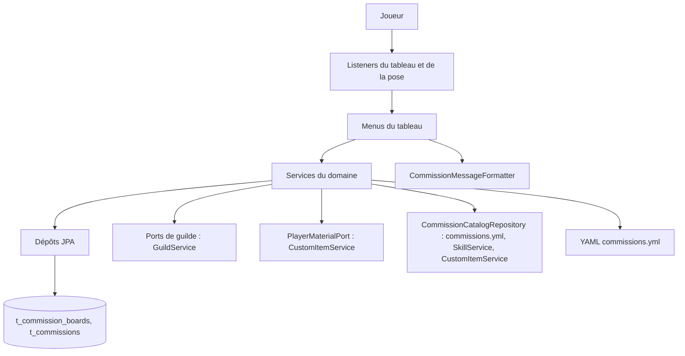

# Spec — `commission-adapter`

*À lire avec `commission-domain.md`.*

## Périmètre

`commission-adapter` relie `commission-domain` au serveur : il implémente les ports `serverside` (JPA, YAML, Bukkit, modules voisins) et expose les services du domaine aux joueurs par le tableau et les menus. Il ne contient aucune règle métier : tier, taxes, accès et concurrence sont décidés par le domaine. Il traduit les refus du domaine, qui sont des exceptions, en messages pour le joueur.



## Organisation

```text
onl.tesseract.srp.commission.adapter
├── furniture/CommissionBoardFurniture
├── serverside
│   ├── jpa/JpaCommissionBoardRepository, JpaCommissionRepository, mappers, entity, repository
│   ├── catalog/SkillCustomItemCommissionCatalogRepository
│   ├── yaml/YamlCommissionConfigRepository
│   ├── guild/GuildServiceMembershipPort, GuildServiceTerritoryPort, GuildServiceProgressPort
│   ├── material/CustomItemPlayerMaterialPort
│   ├── furniture/ItemsAdderBoardFurniturePort
│   └── placement/BukkitBoardPlacementSessionPort
└── userside
    ├── config/CommissionProvider
    └── controller
        ├── event/CommissionBoardFurnitureListener, CommissionBoardPlacementListener, CommissionGuildDeletedListener
        ├── menu/CommissionBoardMenu, CommissionDeliveryMenu, CommissionManagementMenu, CommissionDisplay
        └── message/CommissionMessageFormatter, CommissionChatFormats
```

`CommissionProvider` déclare les services du domaine comme beans Spring. Le module est déclaré dans le `pom.xml` racine et dans les dépendances du plugin.

## Persistance

Il n’y a aucune relation JPA vers un autre module : les joueurs et les guildes sont référencés par leur UUID. La conversion entre le domaine et les entités passe par `CommissionMapper` et `CommissionBoardMapper`.

**`t_commission_boards`** :

| Colonne | Remarque |
|---|---|
| `id` | Clé |
| `guild_id` | UUID, vide pour le spawn, unique |
| `max_craft_tier`, `max_harvest_tier`, `slots_per_type`, `max_required_quality`, `money_bonus_level` | Niveaux d’amélioration |
| `usage_tax_rate` | Choisi par la guilde ; à la création, `default-usage-tax-rate` de la configuration |
| `completed_commission_count` | Commissions terminées sur ce tableau, incrémenté dans la transaction de la livraison |
| `position_world`, `position_x`, `position_y`, `position_z` | Position du tableau, vide tant qu’il n’est pas posé |

**`t_commissions`** :

| Colonne | Remarque |
|---|---|
| `id` | Clé |
| `board_id` | Indexée |
| `part`, `type` | Liste dans laquelle la commission s’affiche, dans l’ordre des `id` |
| `material`, `quantity`, `minimal_quality`, `reward` | Figés à la génération |
| `delivered_quantity` | Progression partagée, entre 0 et `quantity` |

Le détail de qui a livré quoi n’est pas stocké ici : il relève du journal des transactions (B2, #72).

- **Pas de concurrence :** tout s’exécute sur le thread principal du serveur ; une commission ne peut pas changer entre sa lecture et l’enregistrement de la livraison.
- **Crédits atomiques :** la progression, le paiement du joueur, la taxe versée à la banque et l’XP sont dans la même transaction ; un échec annule tout. Les items ne sont retirés qu’ensuite.
- **Remplacement :** suppression des commissions terminées et insertion des nouvelles, dans une seule transaction.
- **Création :** le tableau d’une guilde est créé à son premier accès, ce qui couvre aussi les guildes déjà existantes. Le tableau du spawn est créé au premier clic sur un tableau posé hors des guildes.
- **Suppression d’une guilde :** `GuildService` publie `GuildDeletedEvent`, et `CommissionGuildDeletedListener` supprime alors le tableau, dans le monde et en base, avec ses commissions.

## Configuration

`YamlCommissionConfigRepository` lit `plugins/Tesseract/commission/commissions.yml`, chargé une fois au démarrage. Les valeurs ci-dessous illustrent la structure :

```yaml
quantity-by-rarity: { COMMON: { quantity: 300, variance: 50 }, RARE: { quantity: 60, variance: 50 } }
rarity-weights: { COMMON: 100, RARE: 20 }
spawn-reward-rate: 0.5
guild-xp-per-lys: 0.1
default-usage-tax-rate: 0.25
spawn-slots-per-type: 6
harvest-tiers:
  TITANE: 1
upgrades:
  max-craft-tier:   { 2: { cost: 5000, guild-level: 2 }, 3: { cost: 20000, guild-level: 5 } }
  max-harvest-tier: { 2: { cost: 5000, guild-level: 2 }, 3: { cost: 20000, guild-level: 5 } }
  slots:         { 2: { cost: 5000, guild-level: 2 }, 3: { cost: 20000, guild-level: 5 } }
  max-required-quality:   { NORMAL: { cost: 5000, guild-level: 2 } }
  money-bonus:   { 1: { value: 0.02, cost: 5000, guild-level: 3 } }
```

## Ports et modules voisins

| Port du domaine | Implémentation |
|---|---|
| `GuildMembershipPort`, `GuildTerritoryPort`, `GuildProgressPort` | `GuildService` : appartenance, rôle, territoire, niveau, banque |
| `CommissionCatalogRepository` | `harvest-tiers` et `SkillService.findAllSkills` pour le catalogue, `CustomItemService.getMoneyValue` pour la valeur ; un item sans prix est ignoré avec un warning |
| `PlayerMaterialPort` | `CustomItemService`, boucle sur les qualités jusqu’à A7 (#70) |
| `BoardFurniturePort`, `BoardPlacementSessionPort` | ItemsAdder et le planificateur Bukkit |
| Paiement dans `recordDelivery` | `PlayerService.adjustMoney`, puis `MoneyService` à l’arrivée de B2 (#72) |

L’adapter utilise les services des autres domaines, jamais leurs repositories.

## Interface

### Tableau posé dans le monde

Dans le monde, le tableau est un meuble ItemsAdder gratuit, `tesseract:commission_board`. Ses données existent même s’il n’est pas posé : il n’est que le point d’accès que la guilde installe.

- Une guilde a un seul tableau, sans item à placer. Un Adjoint ou le chef clique sur le bouton du menu de guilde, dont le lore prévient qu’il faut se placer avant. Le menu se ferme, un compte à rebours de 30 s s’affiche, et un clic droit sur le dessus d’un bloc pose le tableau face au joueur. S’accroupir annule.
- L’ancien tableau est retiré à la pose, même si son chunk n’est pas chargé. Un tableau de guilde ne peut pas être cassé.
- Une fois posé, un clic droit ouvre le tableau de la guilde propriétaire du chunk.
- Le tableau du spawn utilise le même item, posé par le staff : un item posé hors de toute guilde, quel que soit le monde, ouvre le tableau du spawn. `NatureProtectionListener` autorise cette pose dans la nature pour ce seul item, avec la permission `staff`.
- Le chunk est calculé depuis la position du tableau avec `ChunkCoordMapper`.

Le menu de guilde est dans `territory-adapter`. `GuildMenu` appelle directement `CommissionBoardPlacementService` : `territory-adapter` dépend donc de `commission-domain`. `GuildService` et `territory-domain` ne connaissent pas les commissions.

Il n’y a aucune commande joueur.

### Menu du tableau

`CommissionBoardMenu` étend `ItemAdderMenu`, comme les menus de `skill-adapter`, avec un fond personnalisé de 6 lignes sur 9 colonnes (`tesseract:commission_board_menu`, déclaré dans `configs/gui/guis.yml` d’ItemsAdder ; sans lui, le menu s’ouvre sans fond). Le fond montre un tableau d’affichage coupé verticalement : **public à gauche, guilde à droite**. Tout tient sur un seul écran, sans page.

| Ligne | Moitié gauche (colonnes 0 à 3) | Colonne 4 | Moitié droite (colonnes 5 à 8) |
|---|---|---|---|
| 0 | Récolte : icône en 0, slots en 1, 2, 3 | Séparation | Récolte : slots en 7, 6, 5, icône en 8 |
| 1 | Récolte : slots en 1, 2, 3 | Séparation | Récolte : slots en 7, 6, 5 |
| 2 | Barre de séparation entre les types | Séparation | Barre de séparation entre les types |
| 3 | Artisanat : icône en 0, slots en 1, 2, 3 | Séparation | Artisanat : slots en 7, 6, 5, icône en 8 |
| 4 | Artisanat : slots en 1, 2, 3 | Séparation | Artisanat : slots en 7, 6, 5 |
| 5 | Informations en 0 | Séparation | Gestion en 8, pour les Adjoints et le chef |

Les étiquettes « Public » et « Guilde » font partie de la texture. Un tableau peut monter à 6 slots par type, de chaque côté.

- Un membre voit les deux moitiés. Pour un externe, la moitié droite affiche des vitres grises, avec le message « Réservé aux membres de la guilde ».
- Le tableau du spawn a la même apparence : ses slots par type (`spawn-slots-per-type`, 6 par défaut) sont tous disponibles à gauche, sans slot à débloquer, et la moitié droite affiche des vitres grises, avec le message « Pas de commissions de guilde au spawn ».
- Chaque commission affiche son type, son tier s’il est connu, son item, sa progression (par exemple 5 / 10), sa qualité minimale et sa récompense.
- Le montant affiché est **net pour ce joueur** ; la taxe est indiquée à l’externe avant de livrer.
- Un slot verrouillé indique qu’il reste à débloquer.
- Les libellés et couleurs de qualité viennent de `QualityAdapter` (`common-adapter`), partagé avec les items custom et les contrats.

### Livraison

Le clic sur une commission ouvre `CommissionDeliveryMenu`, qui récapitule la progression, ce qui sera réellement livré et le montant net correspondant, puis demande confirmation. Le joueur livre tout ce qu’il peut d’un coup. Le message dans le chat, préfixé par `CommissionChatFormats`, indique la quantité livrée et le montant touché, ou la cause du refus : déjà terminée, aucun item, qualité insuffisante, accès refusé. Après la livraison, le menu du tableau se rafraîchit.

### Gestion du tableau

`CommissionManagementMenu` n’est proposé qu’aux Adjoints et au chef et n’existe pas au spawn. Il affiche :

- pour chaque amélioration, le niveau actuel, le suivant, le coût payé par la banque et le niveau de guilde requis ;
- le taux de taxe d’usage, modifiable entre 0 et 50 %.

## Remplacement des commissions

Il n’y a aucune tâche périodique : une commission est remplacée quand elle est terminée. Si un autre joueur a un menu ouvert à ce moment-là, sa livraison est refusée proprement puisque la commission n’existe plus. Les livraisons déjà faites restent payées.

## Critères d’acceptation

1. Un clic droit sur le tableau ouvre le bon tableau ; un autre meuble ItemsAdder n’est pas intercepté.
2. Un externe et un membre voient les bonnes parties et le bon montant net pour la même commission.
3. Deux joueurs qui confirment l’un après l’autre : la progression ne dépasse jamais la quantité demandée, et le second ne livre que ce qui reste.
4. Une panne de base pendant la livraison ne laisse ni progression sans paiement, ni banque créditée seule, et ne retire aucun item.
5. Après un redémarrage, tableaux, commissions et progressions sont identiques.
6. Sur une base vide, le tableau du spawn et celui d’une guilde sont créés à leur premier accès.
7. Un changement de `commissions.yml` s’applique après un redémarrage, aux prochaines générations ; les commissions déjà générées ne changent pas.
8. Fichier de configuration absent ou item sans prix : la génération ne plante pas, et un warning est journalisé.
9. Le menu de gestion n’apparaît qu’aux rôles autorisés, et un taux changé s’affiche aussitôt aux externes.
