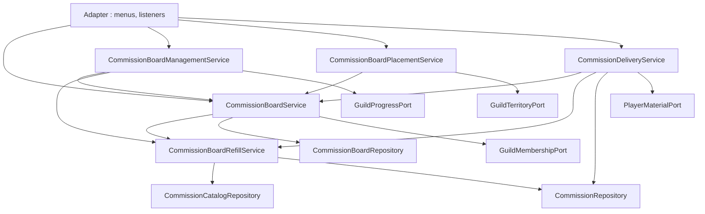
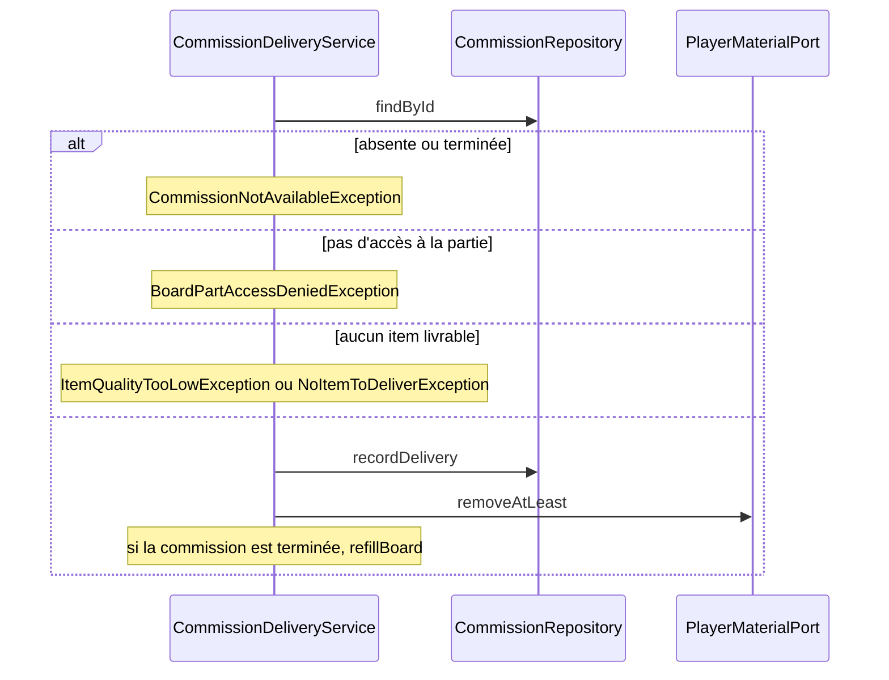

# Documentation du code — `commission-domain`

Ce document décrit **ce que fait le code** : classes, méthodes, ordre des appels, cas d'erreur. Il complète la spec (`commission-domain.md`), qui décrit ce que le code **doit** faire. En cas de différence, le code fait foi pour le comportement actuel.

Le module n'a aucune dépendance Bukkit, Spring ou JPA. Il dépend de `common-domain` (`PlayerId`, `MaterialName`, `MoneyValue`, `Quality`, `Coordinate`) et de Lombok. Tout ce qui touche au serveur passe par les interfaces de `port.serverside`.

## 1. Vue d'ensemble

```
commission-domain
├── model
│   ├── board
│   │   ├── CommissionBoard          le tableau (agrégat)
│   │   ├── BoardId, GuildId         identifiants (records)
│   │   ├── BoardLevels              niveaux d'amélioration (record)
│   │   ├── BoardPart                PUBLIC | GUILD
│   │   ├── BoardSpot, BoardFacing   emplacement et orientation du tableau posé
│   │   ├── UpgradeType              MAX_CRAFT_TIER | MAX_HARVEST_TIER | SLOTS | MAX_REQUIRED_QUALITY | MONEY_BONUS
│   │   └── UpgradeStep              prix et niveau de guilde d'un palier (record)
│   ├── commission
│   │   ├── Commission               une commission enregistrée (record)
│   │   ├── CommissionDraft          une commission générée, pas encore enregistrée (record)
│   │   ├── CommissionId             identifiant (record)
│   │   ├── CommissionType           HARVEST | CRAFT
│   │   ├── CatalogItem              un item qu'une commission peut demander (record)
│   │   └── Delivery                 une livraison calculée : items, gains, taxe, XP (record)
│   └── exception                    refus métier, sous la racine scellée CommissionException
└── port
    ├── userside                     ce que le jeu appelle, un service par cas d'usage
    │   ├── CommissionBoardService             lecture des tableaux, droits des joueurs, suppression
    │   ├── CommissionBoardManagementService   améliorations et taxe d'usage
    │   ├── CommissionBoardPlacementService    pose du tableau d'une guilde
    │   ├── CommissionDeliveryService          commissions visibles et livraison
    │   └── CommissionBoardRefillService       tirage et remplacement des commissions
    └── serverside                   ce dont le domaine a besoin, implémenté par l'adapter
        ├── CommissionBoardRepository, CommissionRepository     persistance
        ├── CommissionCatalogRepository, CommissionConfigRepository
        ├── GuildMembershipPort, GuildTerritoryPort, GuildProgressPort
        ├── PlayerMaterialPort
        └── BoardFurniturePort, BoardPlacementSessionPort
```

Schéma des appels :



Un refus métier est une **exception** de la hiérarchie `CommissionException`. Le domaine ne formate aucun message : l'adapter attrape l'exception et la traduit pour le joueur. La hiérarchie est scellée, si bien que le compilateur oblige l'adapter à traiter chaque cas.

## 2. Modèle

### `CommissionBoard` (agrégat)

Classe et non record : ses niveaux, sa taxe et la position où il est posé changent, mais seulement par des méthodes métier.

| Élément | Rôle |
|---|---|
| `getId()` | Identifiant du tableau |
| `findGuildId()` | Guilde propriétaire ; vide pour le spawn |
| `getLevels()` | Niveaux d'amélioration (`BoardLevels`) |
| `getUsageTaxRate()` | Taxe payée par les externes, entre 0 et `MAX_USAGE_TAX_RATE` (50 %) |
| `findFurniturePosition()` | Position du tableau d'une guilde ; vide tant qu'il n'est pas posé, toujours vide au spawn |

- `spawnBoard(id, levels)` : le tableau du spawn, sans taxe ; ses niveaux sont ceux de `BoardLevels.spawn(slots)`.
- `guildBoard(id, guildId, levels, taxRate)` : un tableau de guilde, pas encore posé.
- `isSpawn()`, `findAllParts()` : `PUBLIC` seule au spawn, `PUBLIC` et `GUILD` sur une guilde.
- `computeUsageTaxOn(montant)` : `montant × usageTaxRate`, arrondi à l'inférieur.
- `upgrade(type)` : monte l'amélioration d'un palier. Le prix et les conditions sont vérifiés par le service.
- `changeUsageTax(taux)` : lève `InvalidUsageTaxRateException` hors de [0, 50 %]. Le constructeur vérifie la même chose.
- `placeFurnitureAt(position)`.

### `BoardLevels` (record)

`maxCraftTier`, `maxHarvestTier`, `slotsPerType`, `maxRequiredQuality` et `moneyBonusLevel`. Le constructeur refuse un tier ou un nombre de slots sous 1, et un bonus négatif.

- `GUILD_START` : tiers à 1, 1 slot par type, qualité `POOR`, pas de bonus. `spawn(slots)` : la même chose avec le nombre de slots de la configuration.
- `getLevel(type)` : niveau actuel ; pour `MAX_REQUIRED_QUALITY`, le rang de la qualité (`POOR` = 0, `NORMAL` = 1…).
- `upgrade(type)` : les niveaux avec un palier de plus. `Quality.next()` reste sur `EXCEPTIONAL` une fois au maximum.

### `Commission` et `CommissionDraft` (records)

Une commission porte son tableau (`boardId`), `part`, `type`, `material`, `quantity`, `deliveredQuantity`, `minimalQuality` et `reward` (`MoneyValue`, figée à la génération). Un `CommissionDraft` a les mêmes champs sans identifiant ni livraison : c'est ce que produit le tirage, et le dépôt en fait une `Commission`.

- Le constructeur refuse `quantity < 1` et `deliveredQuantity` hors de `0..quantity`.
- `getRemainingQuantity()`, `isCompleted()`, `isInList(part, type)`.
- `computeShareFor(total, itemCount)` : la part de `total` gagnée par les `itemCount` prochains items. Elle se calcule sur la progression cumulée :

```
computeShareFor = arrondi(total × (livré + itemCount) / quantity) − arrondi(total × livré / quantity)
```

La somme des parts vaut donc exactement `total`, quel que soit le découpage des livraisons. Exemple avec 100 lys pour 7 items livrés un par un : 14, 15, 14, 14, 14, 15, 14. `computeRewardShareFor(itemCount)` l'applique à la récompense ; la même méthode sert à l'XP.

### `Delivery` (record)

Une livraison calculée : `commissionId`, `boardId`, `deliverer`, `itemCount`, `playerEarnings`, `guildTax`, `guildXp`, `isGuildMember`, `completesCommission`. Elle sert à l'affichage dans les menus et à l'enregistrement.

Les montants sont des `int` et non des `MoneyValue` : une petite livraison peut rapporter zéro lys, et `MoneyValue` n'accepte que des montants strictement positifs.

### `CatalogItem` (record)

`material`, `tier` (celui de la recette pour l'artisanat, celui de la configuration pour la récolte), `weight` (poids de tirage, zéro exclut l'item), `quantity` (quantité de base) et `quantityVariancePercent` (écart maximal autour de la base, en %).

### Exceptions

| Exception | Cas |
|---|---|
| `CommissionNotAvailableException` | Commission absente ou déjà terminée |
| `CommissionBoardNotFoundException` | Tableau absent |
| `BoardPartAccessDeniedException` | Un externe livre sur la partie guilde |
| `NoItemToDeliverException` | Le joueur n'a pas l'item |
| `ItemQualityTooLowException` | Le joueur n'a l'item que sous la qualité minimale |
| `BoardManagementNotAllowedException` | Le joueur n'est pas Adjoint ou chef, ou le tableau est celui du spawn |
| `UpgradeMaxLevelReachedException`, `GuildLevelTooLowException`, `NotEnoughBankMoneyException` | Refus d'amélioration |
| `InvalidUsageTaxRateException` | Taxe hors de [0, 50 %] |
| `BoardPlacementNotStartedException`, `BoardOutsideTerritoryException`, `BoardSpotNotFreeException`, `BoardFurnitureUnavailableException` | Refus de pose |

## 3. Ports `serverside`

| Port | Méthode | Contrat |
|---|---|---|
| `CommissionBoardRepository` | `createSpawnBoard(levels)`, `createGuildBoard(guildId, taxRate)` | Enregistre un tableau neuf et le renvoie avec son id ; un tableau de guilde part de `BoardLevels.GUILD_START` |
| | `save(board)` | Enregistre niveaux, taxe et position du tableau |
| | `findById`, `findSpawnBoard`, `findByGuild` | `Optional` vide si absent |
| | `deleteByGuild(guildId)` | Supprime le tableau d'une guilde et ses commissions |
| `CommissionRepository` | `findById`, `findAllByBoard` | `findAllByBoard` renvoie les plus anciennes d'abord, ce qui donne l'ordre d'affichage |
| | `recordDelivery(delivery)` | En une transaction : progression, gain du livreur, taxe et XP de la guilde, compteur |
| | `replaceCommissions(removed, added)` | Retire et ajoute des commissions en une transaction |
| `CommissionCatalogRepository` | `findAllCatalogItems(type)`, `getUnitValue`, `getItemTier` | Catalogue et valeur des items ; le catalogue ne contient que des items avec un prix |
| `CommissionConfigRepository` | `getSpawnRewardRate`, `getMoneyBonusRate`, `getGuildXpPerLys`, `getDefaultUsageTaxRate`, `getSpawnSlotsPerType`, `findUpgradeStep` | Valeurs de configuration ; `findUpgradeStep` vide au niveau maximal |
| `GuildMembershipPort` | `isMember`, `canManageBoard`, `findAllMembers` | Appartenance, rôle et membres |
| `GuildTerritoryPort` | `ownsChunk` | Territoire |
| `GuildProgressPort` | `getGuildLevel`, `getBankBalance`, `withdrawFromBank` | Niveau et banque ; `withdrawFromBank` renvoie `false` sans rien retirer si les fonds manquent |
| `PlayerMaterialPort` | `countAtLeast`, `removeAtLeast` | Comptage et retrait à partir d'une qualité ; l'appelant compte avant de retirer |
| `BoardFurniturePort` | `hasFreeSpace`, `placeFurniture`, `removeFurniture` | Tableau posé dans le monde |
| `BoardPlacementSessionPort` | `startSession`, `findGuildOfPlacingPlayer`, `endSession` | Joueurs en train de choisir l'emplacement du tableau |

## 4. `CommissionBoardRefillService`

`refillBoard(board)` lit les commissions du tableau, génère celles qui manquent et appelle `replaceCommissions` s'il y a quelque chose à changer.

1. Pour chaque type (`HARVEST`, puis `CRAFT`), il compte les commissions en cours de chaque partie. S'il n'en manque aucune pour atteindre `slotsPerType`, il ne lit pas le catalogue.
2. Il garde les items du catalogue dont le tier ne dépasse pas celui du tableau pour ce type et dont le poids est positif. S'il n'en reste aucun, le slot reste vide : la génération n'échoue jamais.
3. Il retire les commissions terminées. Une commission en cours n'est jamais remplacée : un item mis en configuration reste toujours disponible.

Pour une commission tirée :

- l'item est tiré selon son poids ;
- la qualité minimale est tirée uniformément entre `POOR` et `maxRequiredQuality` ;
- la quantité est tirée uniformément entre `base × (1 − variance)` et `base × (1 + variance)`, bornes arrondies et comprises, au moins 1 ; la base et la variance viennent du `CatalogItem` (50 % sur une base de 50 donne [25 ; 75]) ;
- la récompense est figée :

```
récompense = valeur de l'item à la qualité minimale × quantité × part payée au spawn (100 % sur une guilde) × (1 + bonus d'argent)
```

Elle est arrondie à l'unité et vaut au moins 1 lys. Le tirage ne regarde ni le joueur, ni les recettes que la guilde sait fabriquer.

## 5. Services

### 5.1 `CommissionBoardService`

- `getSpawnBoard()`, `getGuildBoard(guildId)` : lisent le tableau, ou le créent s'il n'existe pas, puis appellent `refillBoard`. Le tableau d'une guilde est créé avec la taxe `getDefaultUsageTaxRate()` ; la changer en configuration ne modifie pas les tableaux existants. Le tableau du spawn suit `getSpawnSlotsPerType()` à chaque appel : un slot ajouté est rempli aussitôt, et les commissions d'un slot retiré restent en base sans être affichées.
- `getSpawnRewardRate()` : part payée au spawn, pour le bouton d'information du menu.
- `getBoard(boardId)` : lève `CommissionBoardNotFoundException` s'il n'existe pas.
- `canAccessPart(player, board, part)` : `PUBLIC` pour tout le monde, `GUILD` pour les membres.
- `isGuildMember`, `canManageBoard` : toujours faux au spawn. `canManageGuildBoard(player, guildId)`.
- `findAllGuildMembers(board)` : les membres de la guilde propriétaire, à prévenir des gains de la guilde ; liste vide au spawn.
- `getCommissionTier(commission)` : tier de l'item, pour l'affichage ; rien n'est stocké sur la commission.
- `deleteGuildBoard(guildId)` : retire le tableau du monde, puis le supprime en base et ses commissions.

### 5.2 `CommissionDeliveryService`

`findAllVisibleCommissions(player, board)` : les commissions auxquelles le joueur a accès.

`computeDelivery(player, board, commission)` ne modifie rien et sert à l'affichage comme à la livraison :

1. `itemCount = min(items possédés à la qualité minimale ou au-dessus, quantité restante)` ;
2. `itemsValue = commission.computeRewardShareFor(itemCount)` ;
3. `guildTax = 0` pour un membre, sinon `board.computeUsageTaxOn(itemsValue)` ; au spawn, le taux vaut 0 ;
4. `guildXp = commission.computeShareFor(computeTotalGuildXp(board, commission), itemCount)` ;
5. `playerEarnings = itemsValue − guildTax`.

`computeTotalGuildXp(board, commission)` : l'XP que la commission donne à la guilde une fois terminée, `arrondi(reward × guild-xp-per-lys)`, 0 au spawn. Le menu l'affiche aux membres sous la récompense totale.

`deliver(player, commissionId)` :



- La progression et les gains sont enregistrés **avant** le retrait des items : si la base échoue, rien n'a été retiré au joueur et il n'y a jamais d'items à rendre.
- Tout s'exécute sur le thread principal du serveur : entre la lecture de la commission, le comptage des items et leur retrait, rien ne peut changer. Il n'y a donc ni contrôle de concurrence, ni cas « items manquants au retrait ».
- Un gain n'est jamais négatif : `PlayerService.adjustMoney` ne refuse jamais le versement.
- Risque accepté : si le retrait échoue après l'enregistrement, le joueur est payé et garde ses items. C'est limité à la quantité de cette livraison, puisque la progression a déjà avancé.
- La livraison n'est pas en tout ou rien : le joueur donne ce qu'il peut, jusqu'à la quantité restante.
- Sans item livrable, c'est `ItemQualityTooLowException` si le joueur a l'item à une qualité plus basse, sinon `NoItemToDeliverException`.

### 5.3 `CommissionBoardManagementService`

`upgradeBoard(player, boardId, type)` relit le tableau, car celui d'un menu ouvert peut être dépassé. Dans l'ordre :

1. le tableau doit être celui d'une guilde que le joueur gère, sinon `BoardManagementNotAllowedException` ;
2. le palier suivant doit exister (`findNextUpgradeStep`), sinon `UpgradeMaxLevelReachedException` ;
3. la guilde doit avoir le niveau du palier, sinon `GuildLevelTooLowException` ;
4. la banque doit payer (`withdrawFromBank`), sinon `NotEnoughBankMoneyException` ;
5. le tableau est amélioré, enregistré, puis `refillBoard` remplit un éventuel slot débloqué.

Une amélioration ne touche pas aux commissions en cours : elle s'applique à la prochaine génération. Le bonus d'argent ne change pas les récompenses déjà figées.

`changeUsageTax(player, boardId, taux)` : même vérification du rôle, puis `changeUsageTax` du tableau. Le nouveau taux s'applique dès la livraison suivante, y compris aux commissions déjà générées.

`findNextUpgradeStep`, `getMoneyBonusRate`, `getGuildLevel` et `getBankBalance` servent à l'affichage du menu de gestion.

### 5.4 `CommissionBoardPlacementService`

- `canPlaceBoard(player, guildId)` et `startBoardPlacement(player, guildId)` : ce dernier lève `BoardManagementNotAllowedException` sans le rôle, sinon démarre une session.
- `isPlacingBoard(player)`, `cancelBoardPlacement(player)`.
- `placeGuildBoard(player, spot)` vérifie dans l'ordre la session, le territoire de chaque chunk occupé et la place libre. Il charge ensuite le tableau de la guilde, pose le nouveau dans le monde, retire l'ancien, enregistre la position et termine la session. Le chargement a lieu avant la pose : s'il échoue, rien n'est posé dans le monde. En cas de refus, l'ancien tableau reste en place et la session continue.
- `isBoardPlaced(guildId)` : état du tableau pour le bouton du menu de guilde.

## 6. Cycle de vie

| Événement | Effet sur le tableau | Effet sur les commissions |
|---|---|---|
| Premier accès au tableau | Créé | Générées |
| Livraison partielle | Rien | `deliveredQuantity` augmente |
| Livraison qui termine une commission | Compteur augmenté | Retirée ; les suivantes remontent et une nouvelle arrive à la fin |
| Amélioration | Niveau augmenté, banque débitée | Slot débloqué rempli, les autres inchangées |
| Changement de taxe | Taux modifié | Rien |
| Suppression de la guilde | Supprimé, dans le monde et en base | Supprimées |

## 7. Points d'attention

- `upgradeBoard` n'est pas atomique : si l'enregistrement du tableau échoue après le débit, la banque reste débitée.
- La création d'un tableau et la génération de ses commissions se font en deux temps : une panne entre les deux laisse un tableau vide jusqu'à sa prochaine ouverture.
- Une commission que personne ne livre reste indéfiniment sur le tableau.
- Si la taxe ou la progression change entre l'affichage et la confirmation, `deliver` recalcule tout : le gain réel peut différer de celui affiché.
- Les tests unitaires (`model/board`, `model/commission`, un test par service dans `port/userside`) mockent les ports : ils ne vérifient pas les transactions.

## 8. Ce que le domaine ne fait pas

- Aucune limite de commissions par joueur.
- Aucun filtre selon le joueur ou les recettes connues de la guilde.
- Aucun événement de domaine publié à la livraison : l'XP et la taxe passent par `recordDelivery`.
