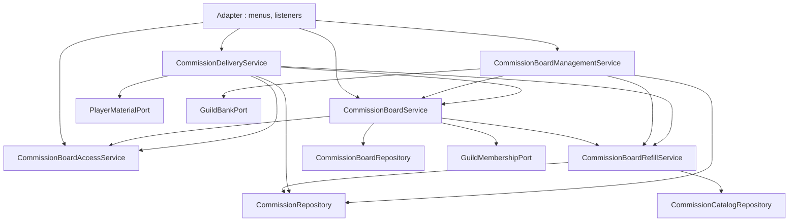
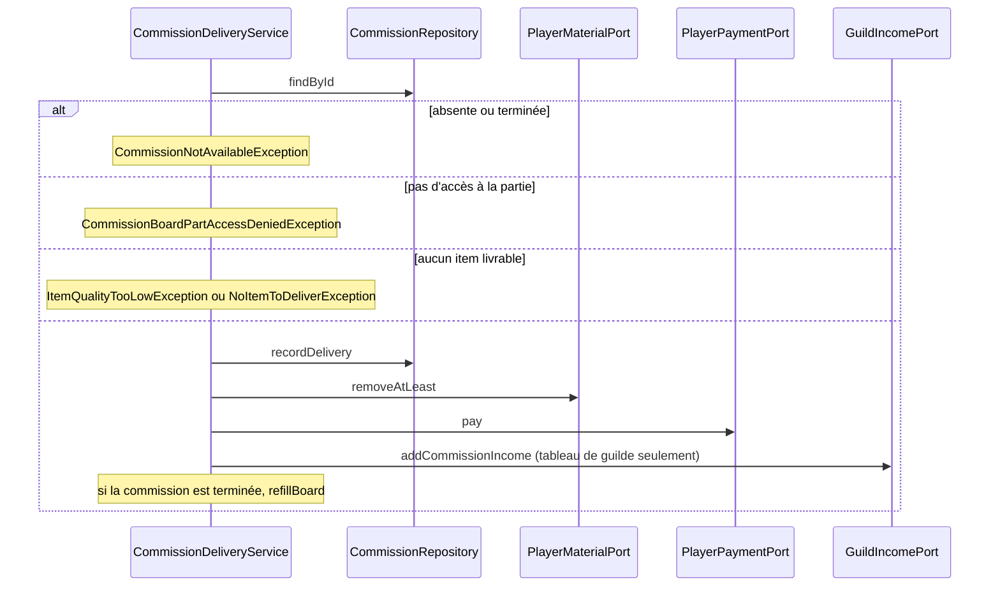

# Documentation du code — `commission-domain`

Ce document décrit **ce que fait le code** : classes, méthodes, ordre des appels, cas d'erreur. Il complète la spec (`commission-domain.md`), qui décrit ce que le code **doit** faire. En cas de différence, le code fait foi pour le comportement actuel.

Le module n'a aucune dépendance Bukkit, Spring ou JPA. Il dépend de `common-domain` (`PlayerId`, `MaterialName`, `MoneyValue`, `Quality`, `Coordinate`) et de Lombok. Tout ce qui touche au serveur passe par les interfaces de `port.serverside`.

## 1. Vue d'ensemble

```
commission-domain
├── model
│   ├── board
│   │   ├── CommissionBoard          le tableau (agrégat)
│   │   ├── CommissionBoardId, GuildId         identifiants (records)
│   │   ├── CommissionBoardLevels              niveaux d'amélioration (record)
│   │   ├── CommissionBoardPart                PUBLIC | GUILD
│   │   ├── CommissionBoardUpgradeType              BOARD_TIER | MAX_HARVEST_TIER | MAX_CRAFT_TIER | HARVEST_SLOTS | CRAFT_SLOTS | MONEY_BONUS
│   │   ├── CommissionBoardUpgradeStep              prix, tier de tableau et livraisons demandés par un palier (record)
│   │   └── CommissionBoardDeliveryRequirement      livraisons à avoir faites pour monter de tier (record)
│   ├── commission
│   │   ├── Commission               une commission enregistrée (record)
│   │   ├── CommissionDraft          une commission générée, pas encore enregistrée (record)
│   │   ├── CommissionId             identifiant (record)
│   │   ├── CommissionType           HARVEST | CRAFT
│   │   ├── CommissionCatalogItem              un item qu'une commission peut demander (record)
│   │   └── CommissionDelivery                 une livraison calculée : items, gains, taxe, XP (record)
│   └── exception                    refus métier, sous la racine scellée CommissionException
└── port
    ├── userside                     ce que le jeu appelle, un service par cas d'usage
    │   ├── CommissionBoardService             ouverture des tableaux, commissions visibles, suppression
    │   ├── CommissionBoardAccessService       accès aux parties du tableau et membres de la guilde propriétaire
    │   ├── CommissionBoardManagementService   améliorations et taxe d'usage
    │   ├── CommissionDeliveryService          commissions visibles et livraison
    │   └── CommissionBoardRefillService       tirage et remplacement des commissions
    └── serverside                   ce dont le domaine a besoin, implémenté par l'adapter
        ├── CommissionBoardRepository, CommissionRepository     persistance
        ├── CommissionCatalogRepository, CommissionConfigRepository
        ├── GuildMembershipPort, GuildBankPort, GuildIncomePort
        └── PlayerMaterialPort, PlayerPaymentPort
```

Schéma des appels :



Un refus métier est une **exception** de la hiérarchie `CommissionException`. Le domaine ne formate aucun message : l'adapter attrape l'exception et la traduit pour le joueur. La hiérarchie est scellée, si bien que le compilateur oblige l'adapter à traiter chaque cas.

## 2. Modèle

### `CommissionBoard` (agrégat)

Classe et non record : ses niveaux et sa taxe changent, mais seulement par des méthodes métier. La pose du tableau dans le monde n'est pas gérée ici : c'est le moteur des structures qui s'en charge.

| Élément | Rôle |
|---|---|
| `getId()` | Identifiant du tableau |
| `findGuildId()` | Guilde propriétaire ; vide pour le spawn |
| `getLevels()` | Niveaux d'amélioration (`CommissionBoardLevels`) |
| `getUsageTaxRate()` | Taxe payée par les externes (`UsageTaxRate`), `UsageTaxRate.ZERO` au spawn |

- `spawnBoard(id, slotsPerType)` : le tableau du spawn, sans taxe ; ses niveaux sont ceux de `CommissionBoardLevels.forSpawnBoard(slotsPerType)`, il ne peut pas en avoir d'autres.
- `guildBoard(id, guildId, levels, usageTaxRate)` : un tableau de guilde.
- `isSpawnBoard()`, `findAllParts()` : `PUBLIC` seule au spawn, `PUBLIC` et `GUILD` sur une guilde.
- `computeUsageTaxOn(montant)` : délègue à `UsageTaxRate.computeTaxOn`.
- `upgrade(type)` : monte l'amélioration d'un palier. Le prix et les conditions sont vérifiés par le service. Lève `IllegalStateException` au spawn.
- `changeUsageTax(usageTaxRate)` : lève `IllegalStateException` au spawn, qui ne taxe jamais.
- `changeSpawnSlots(slotsPerType)` : lève `IllegalStateException` sur un tableau de guilde.

### `UsageTaxRate` (record)

La taxe d'usage, en pourcentage entier entre 0 et `MAX_PERCENT` (50). Le constructeur lève `InvalidUsageTaxRateException` hors de cet intervalle : c'est la seule vérification de la limite, pour la configuration comme pour le menu. `computeTaxOn(montant)` vaut `montant × percent / 100`, arrondi à l'inférieur. Le pourcentage entier rend les paliers de 5 % exacts, sans erreur d'arrondi sur des décimaux.

### `CommissionBoardUpgradeConditions` et `CommissionBoardDeliveryProgress` (records)

L'état des conditions du prochain palier d'une amélioration : le palier visé, `hasEnoughMoney`, `hasBoardTier` et un `CommissionBoardDeliveryProgress` (condition, items livrés, `isMet()`) par condition de livraison. `areAllMet()` les combine. C'est la seule évaluation de ces conditions : le menu l'affiche, `upgradeBoard` l'applique.

### `CommissionBoardLevels` (record)

`boardTier`, `maxHarvestTier`, `maxCraftTier`, `harvestSlots`, `craftSlots` et `moneyBonusLevel`. Le constructeur refuse un tier ou un nombre de slots sous 1, et un bonus négatif.

- `GUILD_BOARD_START` : tout à 1, sans bonus. `spawn(slots)` : tiers à 1 et le nombre de slots de la configuration pour les deux types.
- `getMaxTierFor(type)`, `getSlotsFor(type)` : le tier et le nombre de slots d'un type de commission.
- `getLevel(type)` : niveau actuel d'une amélioration. `upgrade(type)` : les niveaux avec un palier de plus.

### `CommissionBoardUpgradeStep` et `CommissionBoardDeliveryRequirement` (records)

Un palier a un coût en lys, un tier de tableau minimal (1 pour le tier du tableau lui-même) et une liste de `CommissionBoardDeliveryRequirement` : type de commission, qualité minimale et nombre d'items. Seul le tier du tableau a des conditions de livraison.

### `Commission` et `CommissionDraft` (records)

Une commission porte son tableau (`boardId`), `part`, `type`, `material`, `quantity`, `deliveredQuantity`, `minimalQuality` et `reward` (`MoneyValue`, figée à la génération). Un `CommissionDraft` a les mêmes champs sans identifiant ni livraison : c'est ce que produit le tirage, et le dépôt en fait une `Commission`.

- Le constructeur refuse `quantity < 1` et `deliveredQuantity` hors de `0..quantity`.
- `getRemainingQuantity()`, `isCompleted()`, `belongsTo(part, type)`.
- `computeProgressShareOf(total, itemCount)` : la part de `total` (la récompense ou l'XP de guilde) gagnée par les `itemCount` prochains items. Elle se calcule sur la progression cumulée :

```
computeProgressShareOf = arrondi(total × (livré + itemCount) / quantity) − arrondi(total × livré / quantity)
```

La somme des parts vaut donc exactement `total`, quel que soit le découpage des livraisons. Exemple avec 100 lys pour 7 items livrés un par un : 14, 15, 14, 14, 14, 15, 14. `computeRewardShareFor(itemCount)` l'applique à la récompense ; la même méthode sert à l'XP.

### `CommissionDelivery` (record)

Une livraison calculée : `commissionId`, `boardId`, `itemCount`, `playerEarnings`, `guildTax`, `guildXp`, `isGuildMember`, `completesCommission`. Elle sert à l'affichage dans les menus et à l'enregistrement.

Les montants sont des `int` et non des `MoneyValue` : une petite livraison peut rapporter zéro lys, et `MoneyValue` n'accepte que des montants strictement positifs.

### `CommissionCatalogItem` (record)

`material`, `tier` (celui de la recette pour l'artisanat, celui de la configuration pour la récolte), `weight` (poids de tirage, zéro exclut l'item), `quantity` (quantité de base) et `quantityVariancePercent` (écart maximal autour de la base, en %).

### Exceptions

| Exception | Cas |
|---|---|
| `CommissionNotAvailableException` | Commission absente ou déjà terminée |
| `CommissionBoardNotFoundException` | Tableau absent |
| `CommissionBoardPartAccessDeniedException` | Un externe livre sur la partie guilde |
| `NoItemToDeliverException` | Le joueur n'a pas l'item |
| `ItemQualityTooLowException` | Le joueur n'a l'item que sous la qualité minimale |
| `CommissionBoardManagementNotAllowedException` | Le joueur n'est pas Adjoint ou chef, ou le tableau est celui du spawn |
| `CommissionBoardUpgradeMaxLevelReachedException`, `CommissionBoardTierTooLowException`, `NotEnoughDeliveredItemsException`, `NotEnoughBankMoneyException` | Refus d'amélioration |
| `InvalidUsageTaxRateException` | Taxe hors de [0, 50 %], levée par `UsageTaxRate` |

## 3. Ports `serverside`

| Port | Méthode | Contrat |
|---|---|---|
| `CommissionBoardRepository` | `createSpawnBoard(slotsPerType)`, `createGuildBoard(guildId, usageTaxRate)` | Enregistre un tableau neuf et le renvoie avec son id ; un tableau de guilde part de `CommissionBoardLevels.GUILD_BOARD_START` |
| | `save(board)` | Enregistre niveaux et taxe du tableau |
| | `findById`, `findSpawnBoard`, `findByGuild` | `Optional` vide si absent |
| | `deleteByGuild(guildId)` | Supprime le tableau d'une guilde, ses commissions et ses compteurs |
| `CommissionRepository` | `findById`, `findAllByBoard` | `findAllByBoard` renvoie les plus anciennes d'abord, ce qui donne l'ordre d'affichage |
| | `recordDelivery(delivery)` | En une transaction : progression, compteur de commissions terminées et compteur d'items livrés (à la qualité demandée par la commission). Les gains n'y passent pas |
| | `countDeliveredItemsAtLeast(board, type, minimalQuality)` | Items livrés sur des commissions de ce type qui demandaient cette qualité ou une qualité supérieure |
| | `replaceCommissions(removed, added)` | Retire et ajoute des commissions en une transaction |
| `CommissionCatalogRepository` | `findAllCatalogItems(type)`, `getUnitValue`, `findItemTier` | Catalogue et valeur des items ; le catalogue ne contient que des items avec un prix. `findItemTier` est vide pour un item sorti du catalogue depuis la génération de la commission |
| `CommissionConfigRepository` | `getSpawnRewardRate`, `getMoneyBonusRate`, `getGuildXpPerLys`, `getDefaultUsageTaxRate`, `getQualityWeights`, `getQuantityRate(qualité)`, `getSpawnSlotsPerType`, `findUpgradeStep` | Valeurs de configuration ; `findUpgradeStep` vide au niveau maximal |
| `GuildMembershipPort` | `isMember`, `canManageBoard`, `findAllMembers` | Appartenance, rôle et membres |
| `GuildBankPort` | `getBankBalance`, `withdrawFromBank` | Banque ; `withdrawFromBank` renvoie `false` sans rien retirer si les fonds manquent |
| `GuildIncomePort` | `addCommissionIncome(guildId, usageTax, xp)` | Verse à la guilde la taxe et l'XP d'une livraison |
| `PlayerPaymentPort` | `pay(player, amount)` | Verse un gain de livraison, positif ou nul, au joueur |
| `PlayerMaterialPort` | `countAtLeast`, `removeAtLeast` | Comptage et retrait à partir d'une qualité ; l'appelant compte avant de retirer |

## 4. `CommissionBoardRefillService`

`refillBoard(board)` lit les commissions du tableau, génère celles qui manquent et appelle `replaceCommissions` s'il y a quelque chose à changer.

1. Pour chaque type (`HARVEST`, puis `CRAFT`), il compte les commissions en cours de chaque partie. S'il n'en manque aucune pour atteindre le nombre de slots de ce type (`getSlotsFor`), il ne lit pas le catalogue.
2. Il garde les items du catalogue dont le tier ne dépasse pas celui du tableau pour ce type et dont le poids est positif. S'il n'en reste aucun, le slot reste vide : la génération n'échoue jamais.
3. Il retire les commissions terminées. Une commission en cours n'est jamais remplacée : un item mis en configuration reste toujours disponible.

Pour une commission tirée :

- l'item est tiré selon son poids ;
- la qualité minimale est tirée selon `CommissionQualityWeights` (`quality-weights`) : une qualité sort proportionnellement à son poids, les hautes qualités sont donc plus rares ;
- la quantité tirée est ensuite multipliée par le `QuantityRate` de cette qualité (`quantity-rate-by-quality`), arrondie avec un minimum de 1 : une haute qualité demande moins d'items. C'est le même tirage que pour les contrats ;
- la quantité est tirée uniformément entre `base × (1 − variance)` et `base × (1 + variance)`, bornes arrondies et comprises, au moins 1 ; la base et la variance viennent du `CommissionCatalogItem` (50 % sur une base de 50 donne [25 ; 75]) ;
- la récompense est figée :

```
récompense = valeur de l'item à la qualité minimale × quantité × part payée au spawn (100 % sur une guilde) × (1 + bonus d'argent)
```

Elle est arrondie à l'unité et vaut au moins 1 lys. Le tirage ne regarde ni le joueur, ni les recettes que la guilde sait fabriquer.

## 5. Services

### 5.1 `CommissionBoardService`

- `openSpawnBoard()`, `openGuildBoard(guildId)` : préparent le tableau qu'un joueur ouvre. Ils lisent le tableau, ou le créent s'il n'existe pas, puis appellent `refillBoard`. Le tableau d'une guilde est créé avec la taxe `getDefaultUsageTaxRate()` ; la changer en configuration ne modifie pas les tableaux existants. Le tableau du spawn suit `getSpawnSlotsPerType()` à chaque appel : un slot ajouté est rempli aussitôt, et les commissions d'un slot retiré restent en base sans être affichées.
- `getSpawnRewardRate()` : part payée au spawn, pour le bouton d'information du menu.
- `getBoard(boardId)` : lève `CommissionBoardNotFoundException` s'il n'existe pas.
- `findAllVisibleCommissions(player, board)` : les commissions des parties auxquelles le joueur a accès, dans l'ordre d'affichage.
- `findCommissionTier(commission)` : tier de l'item, pour l'affichage ; rien n'est stocké sur la commission. Vide si l'item a quitté le catalogue : le menu n'affiche alors que le type.
- `deleteGuildBoard(guildId)` : supprime le tableau en base, ses commissions et ses compteurs. Le retrait de l'item du monde relève du moteur des structures.

### 5.1 bis `CommissionBoardAccessService`

- `canAccessPart(player, board, part)` : `PUBLIC` pour tout le monde, `GUILD` pour les membres.
- `isGuildMember` : toujours faux au spawn.
- `findAllGuildMembers(board)` : les membres de la guilde propriétaire, à prévenir des gains de la guilde ; liste vide au spawn.

### 5.2 `CommissionDeliveryService`

`computeDelivery(player, board, commission)` ne modifie rien et sert à l'affichage comme à la livraison :

1. `itemCount = min(items possédés à la qualité minimale ou au-dessus, quantité restante)` ;
2. `itemsValue = commission.computeRewardShareFor(itemCount)` ;
3. `guildTax = 0` pour un membre, sinon `board.computeUsageTaxOn(itemsValue)` ; au spawn, le taux vaut 0 ;
4. `guildXp = commission.computeProgressShareOf(computeTotalGuildXp(board, commission), itemCount)` ;
5. `playerEarnings = itemsValue − guildTax`.

`computeTotalGuildXp(board, commission)` : l'XP que la commission donne à la guilde une fois terminée, `arrondi(reward × guild-xp-per-lys)`, 0 au spawn. Le menu l'affiche aux membres sous la récompense totale.

`deliver(player, commissionId)` :



- La progression est enregistrée **avant** le retrait des items et les paiements : si la base échoue, rien n'a été retiré ni versé, et il n'y a jamais d'items à rendre.
- Tout s'exécute sur le thread principal du serveur : entre la lecture de la commission, le comptage des items et leur retrait, rien ne peut changer. Il n'y a donc ni contrôle de concurrence, ni cas « items manquants au retrait ».
- Un gain n'est jamais négatif : `PlayerPaymentPort.pay` ne refuse jamais le versement.
- Risque accepté : la progression, le retrait et les paiements ne sont pas dans une même transaction. Si le retrait ou un paiement échoue après l'enregistrement, la progression a avancé sans que tout soit appliqué ; c'est limité à la quantité de cette livraison.
- La livraison n'est pas en tout ou rien : le joueur donne ce qu'il peut, jusqu'à la quantité restante.
- Sans item livrable, c'est `ItemQualityTooLowException` si le joueur a l'item à une qualité plus basse, sinon `NoItemToDeliverException`.

### 5.3 `CommissionBoardManagementService`

`canManageBoard(player, board)` : vrai pour un Adjoint ou le chef de la guilde propriétaire, toujours faux au spawn. Le menu s'en sert pour afficher le bouton de gestion, et `upgradeBoard` comme `changeUsageTax` appliquent la même règle.

`findNextUpgradeConditions(board, type)` : les conditions du prochain palier (`CommissionBoardUpgradeConditions`), vides au niveau maximal. Les livraisons sont comptées par `countDeliveredItemsAtLeast`, qui inclut les qualités supérieures à celle demandée.

`upgradeBoard(player, boardId, type)` relit le tableau, car celui d'un menu ouvert peut être dépassé. Dans l'ordre :

1. le tableau doit être celui d'une guilde que le joueur gère, sinon `CommissionBoardManagementNotAllowedException` ;
2. les conditions du palier suivant sont évaluées (`findNextUpgradeConditions`) ; s'il n'existe pas, `CommissionBoardUpgradeMaxLevelReachedException` ;
3. le tableau doit avoir le tier demandé par le palier, sinon `CommissionBoardTierTooLowException` ;
4. pour le tier du tableau, chaque condition de livraison doit être remplie, sinon `NotEnoughDeliveredItemsException` ;
5. la banque doit payer (`withdrawFromBank`, qui vérifie lui-même le solde), sinon `NotEnoughBankMoneyException` ;
6. le tableau est amélioré, enregistré, puis `refillBoard` remplit un éventuel slot débloqué.

Risque accepté : la banque est débitée avant l'enregistrement du tableau, sans transaction commune. Si l'enregistrement échoue, la guilde a payé sans être améliorée.

Une amélioration ne touche pas aux commissions en cours : elle s'applique à la prochaine génération. Le bonus d'argent ne change pas les récompenses déjà figées.

`changeUsageTax(player, boardId, usageTaxPercent)` : même vérification du rôle, puis `changeUsageTax` du tableau avec un `UsageTaxRate`, qui refuse un taux hors limites. Le nouveau taux s'applique dès la livraison suivante, y compris aux commissions déjà générées.

`findNextUpgradeConditions`, `getMaxLevelAtBoardTier` (le plus haut niveau qu'une amélioration peut atteindre au tier actuel du tableau), `getMoneyBonusRate` et `getBankBalance` servent à l'affichage du menu de gestion.

## 6. Cycle de vie

| Événement | Effet sur le tableau | Effet sur les commissions |
|---|---|---|
| Premier accès au tableau | Créé | Générées |
| Livraison partielle | Compteur d'items livrés augmenté | `deliveredQuantity` augmente |
| Livraison qui termine une commission | Compteurs augmentés | Retirée ; les suivantes remontent et une nouvelle arrive à la fin |
| Amélioration | Niveau augmenté, banque débitée | Slot débloqué rempli, les autres inchangées |
| Changement de taxe | Taux modifié | Rien |
| Suppression de la guilde | Supprimé en base, avec ses compteurs | Supprimées |

## 7. Points d'attention

- `upgradeBoard` n'est pas atomique : si l'enregistrement du tableau échoue après le débit, la banque reste débitée.
- La création d'un tableau et la génération de ses commissions se font en deux temps : une panne entre les deux laisse un tableau vide jusqu'à sa prochaine ouverture.
- Une commission que personne ne livre reste indéfiniment sur le tableau.
- Si la taxe ou la progression change entre l'affichage et la confirmation, `deliver` recalcule tout : le gain réel peut différer de celui affiché.
- Les tests unitaires (`model/board`, `model/commission`, un test par service dans `port/userside`) mockent les ports : ils ne vérifient pas les transactions.

## 8. Ce que le domaine ne fait pas

- Aucune limite de commissions par joueur.
- Aucun filtre selon le joueur ou les recettes connues de la guilde.
- Aucun événement de domaine publié à la livraison : l'XP et la taxe passent par `GuildIncomePort`.
