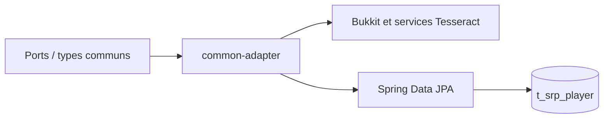

# Spécification — `common-adapter`

## Périmètre et dépendances

Ce module implémente des intégrations réutilisables des ports de `commun-domain` avec Bukkit, Spring, JPA et les services Tesseract. Il contient les conversions de coordonnées, l’accès JPA au profil SRP, l’adaptation de la téléportation, des utilitaires d’entités et les composants de menus partagés.

## Publication d’événements et commandes

- `DomainEventPublisher` implémente le port commun `EventPublisher` en transmettant chaque objet événement à Spring `ApplicationEventPublisher`.
- `SrpCommandInstanceProvider` implémente `CommandInstanceProvider` et résout les instances de classes via le contexte Spring, afin que le framework de commandes puisse obtenir des composants gérés et leurs dépendances injectées.

## Coordonnées

- `CoordinateMapper.toCoordinate(Location)` copie les coordonnées flottantes X/Y/Z et ajoute le chunk calculé à partir du bloc et du monde Bukkit.
- `ChunkCoordMapper.toChunkCoord(Location)` calcule X/Z de chunk par décalage de quatre bits des coordonnées de bloc; la surcharge `Chunk` prend directement les indices Bukkit. Les deux incluent le nom du monde.
- `LocationMapper.toLocation(Coordinate)` résout le monde par son nom via `Bukkit.getWorld` et reconstruit la `Location`. Il ne vérifie pas que le monde a été trouvé.

## Persistance du profil SRP

`SrpPlayerEntity` mappe la table `t_srp_player`: UUID (clé), rang stocké comme chaîne d’enum, argent, identifiant de titre et points d’illumination. L’entité est cacheable avec la stratégie Hibernate `READ_WRITE`. `toDomain` et `fromDomain` convertissent entre l’entité et `SrpPlayer`.

`SrpPlayerJpaRepository` est le dépôt Spring Data JPA. `SrpPlayerJpaRepositoryAdapter` implémente `PlayerRepository`: `getById` cherche par UUID et retourne `null` en l’absence de ligne; `save` mappe vers l’entité, persiste, puis retourne le modèle reconstruit.

## Téléportation Bukkit

`TeleportationPortImpl` fournit au service du domaine les opérations concrètes suivantes :

- Lire la position actuelle d’un joueur, retourner sa présence en ligne et vérifier si le chunk de destination est chargé.
- Appliquer cécité pendant `duration + 20` ticks et nausée pendant `duration * 1,75`, niveau d’effet 1.
- Jouer le son `BLOCK_PORTAL_TRIGGER` à volume et hauteur 1.
- Résoudre `animationId` en `TeleportationAnimation` par `valueOf`, puis lancer l’animation au lieu ciblé.
- Téléporter le joueur vers la `Location` reconstruite, retirer la cécité, ou envoyer le message d’annulation.
- Planifier un timer récurrent avec `TaskScheduler`; l’objet `Cancellable` annule la tâche Bukkit associée.

Les opérations dépendant du joueur utilisent une recherche Bukkit par UUID et deviennent sans effet si le joueur est absent. La lecture de position retourne `null` lorsqu’il ne peut être résolu. L’accès à un monde de destination absent n’est pas protégé par `LocationMapper`.

`TeleportationSettingsPortImpl` combine le délai de téléportation du rang SRP et le nom de l’animation active dans les informations de boutique du joueur. `TeleportationServiceProvider` assemble le service domaine avec ces deux ports.

## Monde

`WorldServiceProvider` publie un bean `WorldService` du domaine. La résolution effective des mondes SRP est définie par le service dans `commun-domain`.

## Menus partagés

- `BiMenu` gère un menu à inventaire supérieur et inférieur, l’ouverture, les clics, la fermeture, la boucle de rafraîchissement (`run`), les boutons du bas et les actions retour/fermer. Il permet d’ajouter un `AButton` à l’inventaire supérieur ou inférieur, de vider les deux zones séparément et de déléguer le cycle de vie aux hooks de menu.
- `CustomInventoryView` implémente Bukkit `InventoryView` autour de deux inventaires et d’un joueur, en exposant les inventaires, le type, le titre, le curseur, les lectures/écritures d’items et les conversions de slots. Les propriétés d’inventaire non prises en charge retournent `false`.
- `ItemAdderMenu` et `ItemAdderBiMenu` spécialisent les menus pour les fonds et boutons graphiques définis par namespace ItemAdder. Les boutons prédéfinis (`CustomMenuButton`) couvrent navigation, retour/fermeture, quantité, incréments/décréments et aides de recette/structure/information; leurs tags ont le préfixe `tesseract:`.

## Utilitaires Bukkit

- `EntityUtils.isSaddlable` et `isLivingMount` reconnaissent Pig, Strider, Horse, Donkey, Mule et Camel.
- `PlayerUtils.asPlayer` retourne directement un `Player`, ou le tireur joueur d’un projectile, sinon `null`.
- `PlayerUtils.tryFreeChestplateSlot` considère le slot libéré si vide ou si l’ajout du plastron à l’inventaire ne laisse aucun surplus. Le code tente une copie via l’ajout d’item, sans vider explicitement le slot d’armure.

## Limites

Les menus graphiques supposent les APIs ItemAdder et Tesseract disponibles. La conversion vers `Location` ne valide pas la résolution du monde. L’adaptateur JPA ne crée pas ici de profil lors d’une lecture absente; cette politique est à la charge du service appelant.
