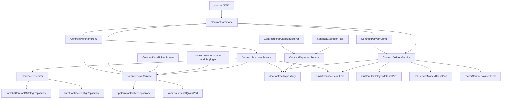
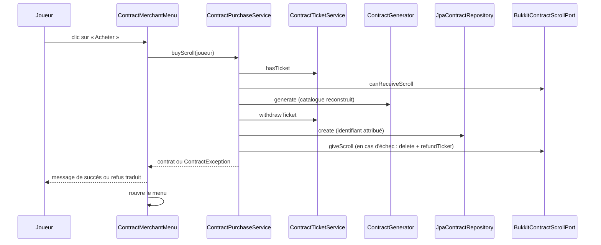
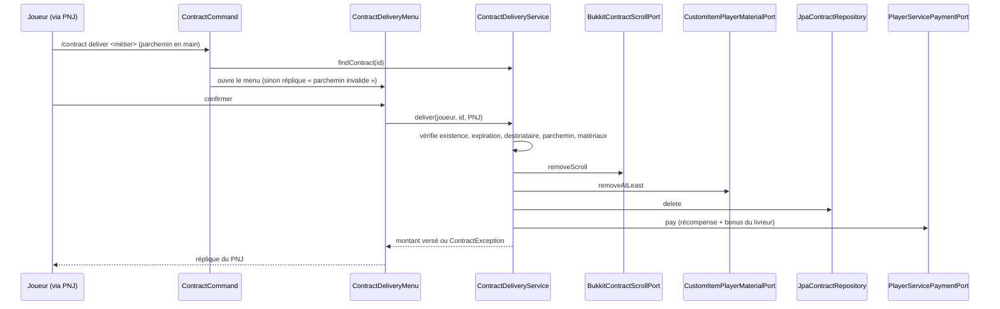

# Documentation du code — `contract-adapter`

Ce document décrit ce que fait le code actuel : chaque classe, ses appels et ses cas particuliers. La spec `contract-adapter.md` décrit l'intention. La documentation du domaine (`contract-domain/spec`) décrit les services, les ports et les exceptions métier dont il est question ici.

## 1. Carte du module

```
onl.tesseract.srp.contract.adapter
├── scroll/                      ContractScrollItems, ContractScrollReader
├── serverside/                  implémentations des ports du domaine
│   ├── catalog/                 JobSkillContractCatalogRepository   → ContractCatalogRepository
│   ├── job/                     JobServiceMoneyBonusPort            → JobMoneyBonusPort
│   ├── jpa/                     JpaContractRepository               → ContractRepository
│   │   ├── ContractMapper
│   │   ├── entity/              ContractEntity, ContractTicketEntity
│   │   └── repository/          ContractJpaRepository, ContractTicketJpaRepository (Spring Data)
│   ├── material/                CustomItemPlayerMaterialPort        → PlayerMaterialPort
│   ├── payment/                 PlayerServicePaymentPort            → PaymentPort
│   ├── scroll/                  BukkitContractScrollPort            → ContractScrollPort
│   ├── skill/                   SkillCatalogPort, SkillConfigSkillCatalogPort (dette A-1)
│   ├── ticket/                  JpaContractTicketRepository         → ContractTicketRepository
│   │                            YamlDailyTicketQuotaPort            → DailyTicketQuotaPort
│   └── yaml/                    YamlContractConfigRepository        → ContractConfigRepository
│                                + ContractNpcNameConfig, ContractRarityConfig, DailyTicketConfig
└── userside/
    ├── config/                  ContractProvider
    └── controller/
        ├── commands/            ContractCommand, args/ContractJobArgument, args/ContractJobCatalog
        ├── event/               ContractDailyTicketListener, ContractScrollCleanupListener
        ├── menu/                ContractMerchantMenu, ContractDeliveryMenu
        ├── message/             ContractMessageFormatter, ContractChatFormats
        └── task/                ContractExpirationTask
```

Schéma des appels :



Les menus, la commande et les listeners passent tous leurs textes par `ContractMessageFormatter`.

## 2. Assemblage : `ContractProvider`

`ContractProvider` est une `@Configuration` Spring. Les adapters sont des `@Component`. Spring les injecte dans les beans du domaine par type de port, avec un seul candidat par port. Le domaine n'a aucune annotation Spring : c'est ce fichier qui en fait des beans.

- Une horloge partagée `Clock.systemUTC()` est passée à `ContractGenerator`, `ContractDeliveryService` et `ContractExpirationService`.
- `contractGenerator` : `ContractConfigRepository`, `ContractCatalogRepository`, un `new Random()` et l'horloge.
- `contractTicketService` : `ContractTicketRepository`, `DailyTicketQuotaPort`.
- `contractPurchaseService` : `ContractRepository`, `ContractGenerator`, `ContractScrollPort`, `ContractTicketService`.
- `contractDeliveryService` : `ContractRepository`, `ContractScrollPort`, `PlayerMaterialPort`, `JobMoneyBonusPort`, `PaymentPort` et l'horloge.
- `contractExpirationService` : `ContractRepository` et l'horloge.
- `contractStartup` est un `SmartInitializingSingleton` exécuté une fois tous les beans créés. Il enregistre `ContractJobCatalog` dans le `ServiceContainer`, ce dont `ContractJobArgument` a besoin parce qu'il n'est pas un bean Spring. Puis il démarre `ContractExpirationTask`.

## 3. Persistance (JPA)

### Tables

`ContractEntity` correspond à la table `t_contracts` :

| Colonne | Type | Remarque |
|---|---|---|
| `id` | `Long`, clé auto (`IDENTITY`) | attribuée à l'insertion |
| `type` | enum en texte | `HARVEST` ou `CRAFT` |
| `job` | texte | nom du destinataire (`ContractClient`) |
| `material` | texte | |
| `quantity` | entier | |
| `minimalQuality` | enum en texte | `Quality` de common-domain |
| `reward` | entier | récompense de base en lys |
| `expires_at` | `Instant` | indexée (`idx_contracts_expires_at`) |
| `version` | `long`, `@Version` | verrou optimiste |

`ContractTicketEntity` correspond à `t_contract_player_state` (nom hérité d'un ancien modèle) : `player_id` (UUID en texte, 36 caractères, clé) et `tickets`.

Les tables sont créées automatiquement. Les colonnes des anciens modèles qui subsistent en base (par exemple `issued_to`, `issuedAt`, `discovery_given`, `tier`, `tickets_day`, `delivered_count`) et la table `t_job_missions` sont à supprimer à la main.

### Conversion : `ContractMapper`

- `toEntity(ContractDraft)` crée une entité sans identifiant. La récompense est convertie par `intValueExact()`, qui lève une exception si elle n'est pas entière.
- `toDomain(ContractEntity)` recrée le `Contract` avec son `ContractId`, son `ContractClient`, son `MaterialName` et un `MoneyValue`.

L'entité ne sert qu'à créer des contrats : aucun contrat n'est mis à jour en base.

### `JpaContractRepository` (→ `ContractRepository`)

Toutes les méthodes sont `@Transactional`, en lecture seule pour `findById`.

- `create` : enregistre l'entité issue du brouillon et renvoie le contrat avec l'identifiant attribué.
- `findById` : `Optional` converti en domaine.
- `delete` : `deleteById`.
- `deleteExpired(now)` : requête JPQL `delete ... where expiresAt <= :now`, avec `@Modifying(flushAutomatically = true, clearAutomatically = true)` pour ne garder aucune entité périmée dans le contexte. Renvoie le nombre de lignes supprimées.

### `JpaContractTicketRepository` (→ `ContractTicketRepository`)

- `findTickets` : lit la ligne par UUID en texte. `OptionalInt.empty()` si elle n'existe pas : le joueur est nouveau pour le domaine.
- `saveTickets` : crée ou remplace la ligne.

## 4. Configuration : `YamlContractConfigRepository`

La classe lit `plugins/Tesseract/contract/contracts.yml`, avec un chemin relatif au dossier du serveur. Elle implémente le port du domaine `ContractConfigRepository` et trois interfaces internes à l'adapter, pour que chaque consommateur ne voie que ce qu'il utilise :

- `ContractRarityConfig`, pour le catalogue ;
- `DailyTicketConfig`, pour le quota ;
- `ContractNpcNameConfig`, pour le parchemin et les messages.

Chaque lecture passe par `currentYaml()`, une méthode synchronisée qui compare la date de modification du fichier à celle du dernier chargement et relit le fichier si elle a changé. Si le fichier est absent, la configuration est vide et les valeurs par défaut s'appliquent. Aucune valeur n'est validée.

| Méthode | Clé | Défaut |
|---|---|---|
| `getScrollLifetime()` | `scroll-lifetime-hours` | 72 heures |
| `getQuantityByRarity(rareté)` | `quantity-by-rarity.<RARETÉ>` | 300 |
| `getRarityWeight(rareté)` | `rarity-weights.<RARETÉ>` | 0 |
| `getDailyTickets(grade)` | `daily-tickets.<grade>` | 0 |
| `findNpcName(client)` | `npc-names.<métier>` | vide |

`findNpcName` cherche la clé sans tenir compte de la casse et ignore une valeur vide ou blanche.

## 5. Adapters des ports

### 5.1 Catalogue : `JobSkillContractCatalogRepository` (→ `ContractCatalogRepository`)

`findAllCatalogItems()` reconstruit le catalogue à chaque appel, donc à chaque achat :

1. Pour chaque métier de `JobService.listJobs()`, chaque matériau produit par ses sources (dédoublonné au sein du métier) devient un `CatalogItem` `HARVEST` dont le client est le métier.
2. Pour chaque compétence de `SkillCatalogPort.findAllSkills()`, le résultat de chaque recette de chaque palier (dédoublonné au sein de la compétence) devient un `CatalogItem` `CRAFT`.

Un matériau produit par deux métiers apparaît donc deux fois.

Avant l'ajout d'un item :

- s'il n'a pas de valeur dans `itemValue.yml` (`CustomItemService.hasMoneyValue`), il est ignoré avec un avertissement ;
- sa rareté vient de `CustomItemService.getCustomMaterial`, ou vaut `COMMON` s'il n'est pas déclaré ;
- un poids de rareté inférieur ou égal à zéro l'exclut ;
- sa quantité vaut `max(1, round(quantity-by-rarity))`.

`getUnitValue(material, quality)` renvoie `CustomItemService.getMoneyValue`. Cette valeur dépend de la qualité : le prix de base est multiplié par le coefficient de la section `QualityRate` de `itemValue.yml`.

`SkillCatalogPort` isole la dette A-1. Son implémentation `SkillConfigSkillCatalogPort` lit `SkillConfigRepository` de skill-domain, en attendant que skill-domain expose la liste des compétences par un service.

### 5.2 Quota : `YamlDailyTicketQuotaPort` (→ `DailyTicketQuotaPort`)

Le quota est lu dans `daily-tickets.<rank.name()>` à partir du grade donné par `PlayerService.getPlayer(...).getRank()`. Un joueur sans grade a un quota nul. La clé du YAML suit la casse de l'enum du grade (`Survivant`, pas `SURVIVANT`).

### 5.3 Bonus : `JobServiceMoneyBonusPort` (→ `JobMoneyBonusPort`)

Le port appelle `JobService.getBonusValue(JobName, PlayerId, Material, Bonus.MONEY)` et renvoie un taux, ou 0 si le service ne renvoie rien. C'est le domaine qui transforme ce taux en montant (`Contract.computeMoneyBonus`).

### 5.4 Paiement : `PlayerServicePaymentPort` (→ `PaymentPort`)

Le port appelle `PlayerService.adjustMoney(uuid, montant)` avec le montant converti par `intValueExact()`. Si le versement est refusé, il journalise une erreur avec le joueur et le montant, pour que le staff puisse dédommager le joueur, puis lève `PaymentFailedException`. Les matériaux et le parchemin sont déjà retirés à ce moment-là.

### 5.5 Matériaux : `CustomItemPlayerMaterialPort` (→ `PlayerMaterialPort`)

Ce port utilise uniquement `CustomItemService`.

- `countAtLeast(player, material, minimalQuality)` additionne les quantités de chaque qualité, de la qualité minimale jusqu'à `EXCEPTIONAL`. Les matériaux non custom ne sont plus traités à part.
- `removeAtLeast(player, material, minimalQuality, quantity)`, en deux temps :
  - si le joueur n'en possède pas assez, la méthode lève `NotEnoughMaterialException` sans rien retirer ;
  - sinon, elle retire en commençant par la qualité admissible la plus basse et en montant jusqu'à atteindre la quantité.

  Une erreur en cours de retrait n'est pas compensée.

### 5.6 Parchemin : `BukkitContractScrollPort` (→ `ContractScrollPort`)

Toutes les opérations exigent un joueur en ligne. Pour un joueur hors ligne, elles renvoient `false`.

- `canReceiveScroll` : l'inventaire a un emplacement vide.
- `giveScroll(player, contract)` part de l'item de base (`ContractScrollItems.BASE_SCROLL`).
  - Le nom est « Contrat · <matériau> ».
  - Le lore contient le type et le destinataire, la quantité, la qualité minimale, le gain, la date d'expiration, puis « » Apporte-le à <PNJ> ».
  - Il écrit dans les données persistantes l'identifiant du contrat et sa date d'expiration, et impose une taille de pile de 1.
  - Il renvoie `true` si l'item a tenu dans l'inventaire.
- `hasScroll` et `removeScroll` parcourent l'inventaire et repèrent le premier emplacement dont le parchemin porte cet identifiant. `removeScroll` vide cet emplacement.

## 6. Le parchemin

- `ContractScrollItems` regroupe les ressources Bukkit des parchemins :
  - l'item ItemsAdder `tesseract:contract_scroll` (`BASE_SCROLL`) ;
  - les clés persistantes `srp:contract_id` et `srp:contract_expires_at`, en `LONG` ;
  - le format de date `dd/MM HH:mm` dans le fuseau du serveur, et la puce `• ` ;
  - `hasScrollType`, qui compare le type Bukkit d'un item à celui de l'item de base.
- `ContractScrollReader.readContractId(item)` renvoie l'identifiant de contrat porté par un item, ou `Optional.empty()` s'il n'en porte pas ou s'il est `null`.

La base fait foi : seul l'identifiant sert à retrouver le contrat. La date d'expiration écrite dans l'item n'est lue par aucun code.

## 7. Entrées joueur

### 7.1 Commande : `ContractCommand` (`/contract`, joueur uniquement)

- `merchant` (`openMerchantMenu`) : ouvre `ContractMerchantMenu`.
- `deliver <métier>` (`deliverHeldScroll`) lit l'identifiant sur l'item en main principale.
  - Sans identifiant, le PNJ répond par `formatNpcNoScrollInHand`.
  - Si le contrat est introuvable, il répond par `formatNpcInvalidScroll`.
  - Sinon, la commande ouvre `ContractDeliveryMenu`. Le contrat peut encore être expiré ou destiné à un autre PNJ : c'est `deliver` qui refusera à la confirmation.
- `tickets` (`showTickets`) : affiche le solde et le quota.

`ContractJobArgument` résout le texte saisi en `ContractClient` grâce à `ContractJobCatalog.findByName`, sans tenir compte de la casse. Il renvoie le nom tel que le catalogue l'écrit, ce qui garantit que la comparaison `Contract.isFor`, sensible à la casse, fonctionne. La complétion utilise `findAllNames()`, c'est-à-dire les métiers puis les compétences. Un nom inconnu produit « Métier X introuvable ».

### 7.2 Menus

Les deux menus sont des `ItemAdderMenu` de trois lignes, avec une texture de fond.

- `ContractMerchantMenu` :
  - Emplacement 11 : les tickets restants et le quota. La taille de la pile reflète le solde, entre 1 et 64.
  - Emplacement 13 : « Acheter un parchemin ». Le clic appelle `buyScroll`, envoie le succès ou le refus traduit, puis rouvre un nouveau menu pour rafraîchir le solde.
  - Emplacement 15 : les informations sur le fonctionnement.
- `ContractDeliveryMenu` :
  - Emplacement 11 : « Confirmer la livraison ». Le clic ferme le menu, puis appelle `deliver(joueur, id, PNJ)`. La réussite donne `formatNpcDeliverySucceeded`, un refus donne `formatNpcRefusal`.
  - Emplacement 13 : l'aperçu du contrat. Il reprend le détail du parchemin et y ajoute ce que le joueur possède (`countOwnedItems`, en vert s'il en a assez, en rouge sinon) et son bonus de métier (`findMoneyBonus`, 0 s'il n'en a pas).
  - Emplacement 15 : « Annuler », qui ferme le menu.

### 7.3 Messages : `ContractMessageFormatter`

C'est le seul endroit où se trouvent les textes du module.

| Famille | Format |
|---|---|
| Achat, tickets, parchemins expirés, refus génériques | préfixe `[Contrat]` de `ContractChatFormats`, en gris, rouge pour les erreurs ou vert pour les succès |
| Livraison | réplique du PNJ : nom en or et en gras, « » », puis une réplique tirée au hasard. Le nom vient de `findNpcName`, ou à défaut du nom du métier avec sa première lettre en majuscule |
| Staff | préfixes `STAFF_CHAT_*` de `SrpChatFormats` |

- `formatRefusal` traduit chaque `ContractException` par un `switch` exhaustif, rendu possible par la hiérarchie scellée. Ajouter une exception sans la traduire fait échouer la compilation.
- `formatNpcRefusal` fait parler le PNJ pour les refus propres à la livraison : contrat introuvable, mauvais destinataire, contrat expiré, parchemin absent, matériaux manquants. Les autres refus passent par `formatRefusal`.

### 7.4 Événements

- `ContractDailyTicketListener` appelle `ContractTicketService.renewDaily` sur `PlayerServerDailyConnectionEvent`, la première connexion du jour, émise par le module `core`.
- `ContractScrollCleanupListener` est décrit au §8.

### 7.5 Tâche : `ContractExpirationTask`

`start()` programme `run()` toutes les 12 000 ticks, soit dix minutes. Le premier passage a donc lieu dix minutes après le démarrage. `run()` appelle `purgeExpired()` et journalise le nombre supprimé au niveau `INFO`, seulement s'il est positif. La tâche ne tourne que lorsque le serveur est allumé.

## 8. Retrait des parchemins invalides : `ContractScrollCleanupListener`

Un item est un parchemin invalide quand trois conditions sont réunies :

- il a le type de l'item de base ;
- il porte un identifiant de contrat ;
- `ContractExpirationService.isScrollValid` renvoie `false` pour cet identifiant, parce que le contrat est absent de la base ou a expiré.

| Événement | Action |
|---|---|
| `PlayerJoinEvent` | retire les parchemins invalides de l'inventaire du joueur |
| `InventoryOpenEvent` (tout inventaire : coffre, tonneau, shulker posé, menu…) | les retire du conteneur ouvert, puis de l'inventaire du joueur |
| `EntityPickupItemEvent` (joueur) | si l'item au sol est un parchemin invalide, annule le ramassage et supprime l'entité |

Si au moins un parchemin a été retiré de l'inventaire d'un joueur, ou au ramassage, le listener appelle `purgeExpired()` puis envoie `formatScrollsExpired(nombre)`. Les retraits dans un conteneur ne déclenchent ni purge ni message.

Chaque parchemin examiné coûte une lecture en base (`findById`).

Limites :

- le contenu d'une boîte de shulker portée dans l'inventaire n'est pas inspecté ;
- un parchemin qui devient invalide pendant que le joueur joue n'est retiré qu'à sa prochaine connexion ou ouverture d'inventaire, ou quand il le ramasse.

## 9. Flux complets

### Achat



### Livraison



### Renouvellement quotidien

`PlayerServerDailyConnectionEvent` → `ContractDailyTicketListener` → `ContractTicketService.renewDaily` → `YamlDailyTicketQuotaPort.getDailyQuota` (grade → `daily-tickets`) → `JpaContractTicketRepository.saveTickets`.

## 10. Points d'attention connus

- Un matériau sans valeur dans `itemValue.yml` est exclu du catalogue. Il faut surveiller les avertissements au démarrage des achats.
- La livraison n'est pas atomique : un échec du paiement après le retrait des objets est journalisé en erreur et demande une intervention du staff.
- Le pied de page du parchemin sans nom de PNJ configuré affiche « PNJ du métier » ou « PNJ de la compétence », sans le préfixe « » Apporte-le à ».
- La date d'expiration écrite dans l'item n'est plus lue. Elle pourrait être retirée, ou servir à éviter une lecture en base lors du nettoyage.
- Tout le module (Bukkit, JPA) s'exécute sur le thread principal du serveur.
- Dette A-1 : `SkillConfigSkillCatalogPort` dépend du repository de skill-domain.
