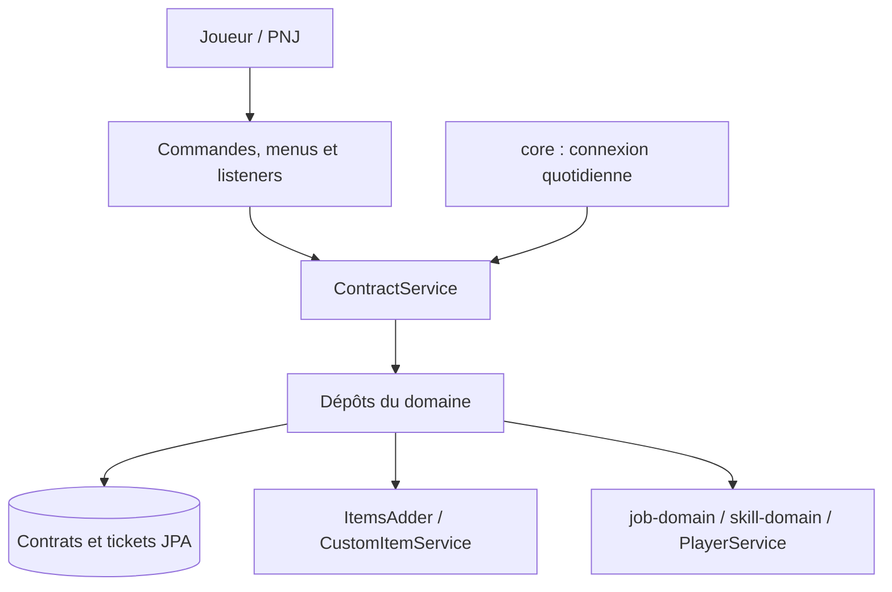

# Spécification — `contract-adapter`

## Périmètre

`contract-adapter` relie `contract-domain` au serveur : base de données, configuration YAML, items ItemsAdder, menus, commandes, écouteurs et tâche d’expiration. `ContractProvider` assemble les services du domaine avec les dépôts correspondants. Les règles métier restent dans le domaine ; l’adaptateur convertit les types et traduit les résultats en messages, menus et items.



## Persistance

`ContractEntity` (`t_contracts`) stocke un contrat par ligne, avec un index sur `expires_at` et un verrou optimiste `@Version`. `ContractTicketEntity` (`t_contract_player_state`, nom de table conservé) stocke le nombre de tickets par joueur. Les UUID sont stockés en texte (`VARCHAR(36)`), pas en `BINARY(16)`. La conversion entité ↔ domaine se fait dans `ContractEntity` (`fromDomain`, `toDomain`). La suppression passe par une requête `DELETE` qui retourne le nombre de lignes : `settle` s’en sert pour empêcher deux livraisons simultanées d’être payées. `ContractPlayerInfoRepository.findTickets` retourne vide si le joueur n’a pas de ligne : le domaine le traite alors comme un joueur nouveau. `ContractJpaRepositoryAdapter.settle` est `@Transactional` : il supprime le contrat puis appelle `PlayerService.adjustMoney`, et lève `PaymentFailedException` (rollback) si le paiement est refusé.

Les tables sont créées automatiquement. Les colonnes `issued_to` et `player_id` étaient en `BINARY(16)` avant le passage au texte : les lignes existantes sont à migrer à la main. Les anciennes colonnes (`discovery_given`, `tier`, `tickets_day`, `delivered_count`) et l’ancienne table `t_job_missions` sont à supprimer à la main.

## Configuration

`YamlContractConfigRepository` lit `plugins/Tesseract/contract/contracts.yml`, relu dès que sa date de modification change. S’il est absent, les valeurs par défaut s’appliquent (aucun ticket, aucune rareté tirée) : la copie initiale depuis les ressources du plugin n’est pas faite par ce module. `npc-names` associe un métier ou une compétence (sans tenir compte de la casse) au nom de son PNJ : il apparaît sur le parchemin et devant les dialogues, à défaut le nom du métier est utilisé. Les poids par rareté n’ont pas de valeur par défaut : une rareté sans poids n’est jamais tirée.

```yaml
scroll-lifetime-hours: 72
npc-names:
  Fonte: Fondeur
  Mineur: Chef mineur
quantity-by-rarity:
  COMMON: 600
  SPECIAL: 300
  RARE: 120
  EPIC: 40
  LEGENDARY: 10
rarity-weights:
  COMMON: 100
  SPECIAL: 50
  RARE: 20
  EPIC: 5
  LEGENDARY: 1
daily-tickets:
  Survivant: 2
  Explorateur: 3
  Aventurier: 4
  Noble: 5
  Baron: 6
  Seigneur: 7
  Vicomte: 8
  Comte: 8
  Duc: 9
  Roi: 9
  Empereur: 10
```

`daily-tickets` associe le nom d’un `PlayerRank` à son quota quotidien de tickets : le grade vient de `common-domain`, mais le quota appartient au module contrat. Un grade absent du fichier a un quota de 0 ticket (comme les poids par rareté, il n’y a pas de valeur par défaut).

La rareté et la valeur d’un item (`customitem.yml`), les talents et les recettes restent dans leurs modules.

## Adaptateurs de ports

- `ContractItemInfoRepository` reconstruit le catalogue à chaque achat : matériaux produits par chaque métier et objets de chaque recette de chaque compétence, sans doublon, en écartant les items sans valeur. Le poids et la quantité viennent de la rareté (`COMMON` si l’item n’est pas déclaré), lus directement dans `YamlContractConfigRepository` (`getRarityWeight`, `getQuantityByRarity`), qui ne font pas partie du port du domaine. Il donne aussi la valeur de l’item (`getValue`), lue dans `customitem.yml`.
- `ContractPlayerInfoRepository` lit et écrit les tickets en base (JPA), convertit le grade du joueur (`PlayerRank`) en quota via `daily-tickets` de `YamlContractConfigRepository`, et lit le bonus `MONEY` dans `job-domain`.
- `TesseractPlayerInventoryRepository` gère les items du joueur : il compte, retire (de la plus basse qualité admissible vers la plus haute, tout ou rien) et rend les matériaux avec `CustomItemService`, et fabrique, remet, détecte et retire le parchemin.
- `BukkitContractMessagingRepository` contient tous les textes, avec `ContractChatFormats` (package `utils`) pour le préfixe `[Contrat]` et `SrpChatFormats` pour le préfixe staff. Les livraisons sont des dialogues du PNJ, avec plusieurs variantes tirées au hasard.

## Parchemin

Le parchemin est l’item ItemsAdder `tesseract:contract_scroll`, non empilable. Son identifiant de contrat est dans les données persistantes de l’item (`srp:contract_id`), lu et écrit par `ContractScrollItem` (package `utils`, comme `ContractDisplay`) ; la base fait foi. L’item porte aussi sa date d’expiration (`srp:contract_expires_at`, en millisecondes) pour qu’on puisse le nettoyer sans interroger la base. `ContractDisplay` génère son nom et son lore. `ContractScrollListener` annule la pose et le craft, et à l’utilisation appelle `ContractService.useScroll`. `ContractScrollCleanupListener` retire les parchemins expirés (date lue dans l’item) de l’inventaire du joueur à sa connexion et à l’ouverture d’un conteneur, du conteneur ouvert, et refuse le ramassage d’un parchemin expiré ; le joueur est prévenu quand le parchemin vient de lui. Les parchemins émis avant l’ajout de la date n’en ont pas : ils ne sont pas nettoyés et restent refusés à la livraison.

## Commandes et interface

Les PNJ sont créés à part et configurés avec des commandes exécutées comme le joueur. Le module ne lit rien sur le PNJ.

- `/contract merchant` ouvre `ContractMerchantMenu` : tickets restants, quota et achat (`ContractService.buyScroll`).
- `/contract deliver <métier>` lit le parchemin en main, appelle `checkDeliverable` puis ouvre `ContractDeliveryMenu`, dont la confirmation appelle `deliver`. `<métier>` est un métier ou une compétence (`ContractJobArg`, complétion par `ContractJobCatalog`).
- `/contract tickets` affiche les tickets restants.
- Côté staff, `/staffSrp contract tickets give|get` est dans le module `plugin` (`ContractStaffCommand`).

## Tâche et assemblage

`ContractExpirationTask` appelle `purgeExpired` toutes les dix minutes. `ContractDailyTicketListener` appelle `renewDaily` à `PlayerServerDailyConnectionEvent` (`core`). `ContractProvider` déclare `ContractGenerator` et `ContractService`, enregistre `ContractJobCatalog` dans le `ServiceContainer` et démarre la tâche d’expiration.

## Limites

Plusieurs adaptateurs sont provisoires : la valeur des items (`ContractItemInfoRepository.getValue`), le paiement (`settle` n’enregistre pas la raison du paiement) et le comptage par qualité (`TesseractPlayerInventoryRepository`). Le catalogue est reconstruit à chaque achat. Les appels Bukkit et JPA se font sur le thread principal. Le fichier `contracts.yml` n’est pas validé : une valeur invalide est lue telle quelle.