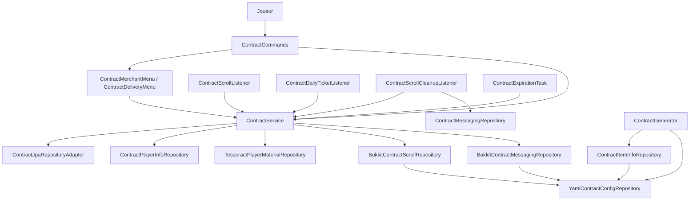
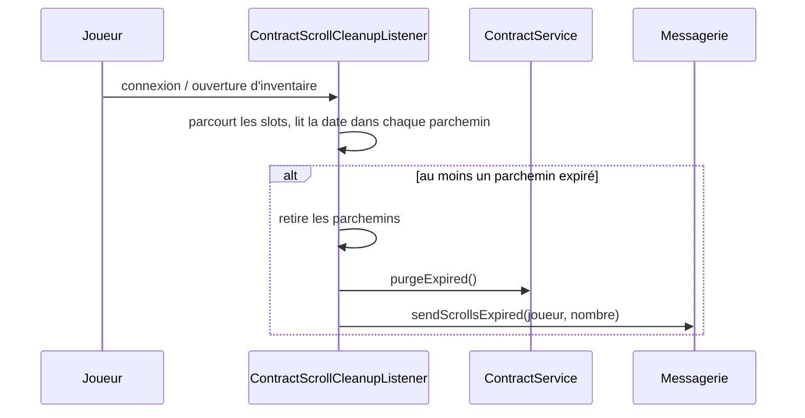
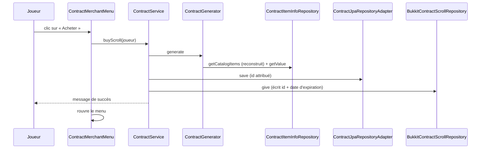
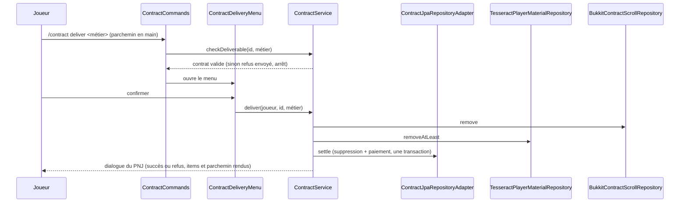

# Documentation du code — `contract-adapter`

Ce document décrit **ce que fait le code** de `contract-adapter` : chaque classe, ses appels et ses cas particuliers. Il complète la spec (`contract-adapter.md`, ce que le module doit faire) et la documentation du domaine (`contract-domain-doc.md`, dont il suppose la lecture : `ContractService`, les ports, `Contract`, `DeliveryRefusal`).

Rôle du module : implémenter les ports `serverside` du domaine avec le serveur réel (JPA, YAML, ItemsAdder, Bukkit), et exposer `ContractService` aux joueurs (commandes, menus, événements, tâche). Il ne contient aucune règle métier.

## 1. Carte du module

```
onl.tesseract.srp.contract.adapter
├── serverside                              implémentations des ports du domaine
│   ├── jpa
│   │   ├── entity/ContractEntity, ContractTicketEntity
│   │   ├── repository/ContractJpaRepository, ContractTicketJpaRepository   (Spring Data)
│   │   └── adapter/ContractJpaRepositoryAdapter      → ContractRepository
│   ├── yaml/YamlContractConfigRepository             → ContractConfigRepository
│   ├── ContractItemInfoRepository                    → ItemInfoRepository
│   ├── ContractPlayerInfoRepository                  → PlayerInfoRepository
│   ├── TesseractPlayerMaterialRepository             → PlayerMaterialRepository
│   ├── BukkitContractScrollRepository                → ContractScrollRepository
│   ├── messaging/BukkitContractMessagingRepository   → ContractMessagingRepository
│   └── task/ContractExpirationTask                   purge périodique
├── userside
│   ├── config/ContractProvider                       assemblage Spring
│   └── controller
│       ├── commands/ContractCommands (+ args/ContractJobArg, ContractJobCatalog)
│       ├── menu/ContractMerchantMenu, ContractDeliveryMenu
│       └── event/ContractScrollListener, ContractScrollCleanupListener, ContractDailyTicketListener
└── utils/ContractDisplay, ContractScrollItem, ContractChatFormats, QualityConverter
```

Schéma des appels :



## 2. Assemblage : `ContractProvider`

`@Configuration` Spring. Les adaptateurs sont des `@Component` ; Spring les injecte dans les beans du domaine **par type d'interface** (un seul candidat par port).

- Bean `contractGenerator(contractConfigRepository, itemInfoRepository)` : `new ContractGenerator(contractConfigRepository, itemInfoRepository, new Random())`.
- Bean `contractService(contractRepository, playerMaterialRepository, contractScrollRepository, contractGenerator, playerInfoRepository, contractMessagingRepository)` : `new ContractService(...)`.
- Bean `contractStartup` (`SmartInitializingSingleton`) : exécuté **une fois tous les beans créés**. Il enregistre `ContractJobCatalog` dans le `ServiceContainer` (nécessaire à `ContractJobArg`, qui n'est pas un bean Spring) et démarre `ContractExpirationTask`.

Le domaine n'a aucune annotation Spring ; c'est ce fichier qui en fait des beans.

## 3. Persistance (JPA)

### Tables
`ContractEntity` → table `t_contracts` :

| Colonne | Type | Remarque |
|---|---|---|
| `id` | `Long`, clé auto (`IDENTITY`) | |
| `issued_to` | `String` (UUID en texte, 36 caractères) | |
| `type` | enum en texte | `HARVEST` / `CRAFT` |
| `job`, `material` | texte | |
| `quantity`, `reward` | entier | |
| `minimalQuality` | enum en texte | nom de colonne en camelCase (non renommé) |
| `issuedAt` | `Instant` | nom de colonne en camelCase |
| `expires_at` | `Instant` | indexée (`idx_contracts_expires_at`) |
| `version` | `long`, `@Version` | verrou optimiste |

`ContractTicketEntity` → table `t_contract_player_state` (nom conservé d'un ancien modèle) : `player_id` (`String`, UUID en texte, clé) et `tickets`.

Les UUID (`issued_to`, `player_id`) sont stockés en texte (`VARCHAR(36)`) : `ContractEntity.fromDomain` appelle `toString()` et `toDomain` relit avec `UUID.fromString`.

Les tables sont créées automatiquement. Les anciennes colonnes (`discovery_given`, `tier`, `tickets_day`, `delivered_count`) et la table `t_job_missions` sont à supprimer à la main.

### Conversion
`ContractEntity.fromDomain(contract)` crée l'entité (avec `version = 0`) ; `toDomain()` recrée le `Contract` avec l'id attribué. `fromDomain` met toujours `version` à 0 : il n'est donc prévu que pour **créer** un contrat, pas pour en mettre à jour un.

### Requêtes `ContractJpaRepository`
Deux requêtes `DELETE` JPQL, avec `@Modifying(flushAutomatically = true, clearAutomatically = true)` (le contexte est vidé après chaque suppression pour ne pas garder d'entité périmée) :
- `deleteByIdCounting(id)` : `delete ... where id = :id`, renvoie le nombre de lignes supprimées (0 ou 1) ;
- `deleteExpired(now)` : `delete ... where expiresAt <= :now`, renvoie le nombre supprimé.

### `ContractJpaRepositoryAdapter` (→ `ContractRepository`)
Toutes les méthodes sont `@Transactional` (lecture seule pour `findById`).
- `save` : `jpaRepo.save(fromDomain(...))` puis `toDomain()` sur l'entité enregistrée (donc avec son id).
- `findById` : `Optional` converti en domaine.
- `delete` : `deleteByIdCounting` (le nombre est ignoré).
- `deleteExpired` : renvoie le nombre de lignes.
- **`settle(contractId, deliverer, payout)`** : 1) `deleteByIdCounting(contractId)` ; si 0 ligne, renvoie `false` (contrat déjà livré ou supprimé) ; 2) `playerService.adjustMoney(uuid, payout)` ; si refusé, lève `PaymentFailedException`, ce qui **annule la transaction et donc la suppression** ; 3) renvoie `true`. C'est le `DELETE` qui compte les lignes qui empêche deux livraisons simultanées du même contrat d'être payées : la seconde supprime 0 ligne.

`ContractTicketJpaRepository` est un `JpaRepository<ContractTicketEntity, String>` sans requête propre.

## 4. Configuration : `YamlContractConfigRepository`

Lit `plugins/Tesseract/contract/contracts.yml` (chemin relatif au dossier du serveur).

- **Rechargement automatique** : chaque lecture passe par `currentYaml()` (synchronisée), qui compare `lastModified` du fichier à la date du dernier chargement et relit si elle a changé. Modifier le fichier suffit, sans redémarrage.
- **Fichier absent** : `currentYaml()` renvoie une configuration vide, donc les valeurs par défaut ci-dessous. Le module ne copie pas de fichier initial.
- **Aucune validation** : une valeur invalide est lue telle quelle (`getLong`, `getInt` et `getDouble` renvoient leur valeur par défaut si la clé est absente ou illisible).

| Méthode | Clé | Défaut |
|---|---|---|
| `getScrollTtl()` | `scroll-lifetime-hours` | 72 (heures) |
| `getQuantityByRarity(rarity)` | `quantity-by-rarity.<RARETÉ>` | 300 |
| `getRarityWeight(rarity)` | `rarity-weights.<RARETÉ>` | 0 (une rareté sans poids n'est jamais tirée) |
| `getDailyTickets(rank)` | `daily-tickets.<GRADE>` | 0 (un grade sans quota n'a aucun ticket) |
| `getNpcName(job)` | `npc-names.<métier>` | vide ; clé comparée sans tenir compte de la casse, valeur blanche ignorée |

La durée de vie n'est lue **qu'à l'achat** : elle est ensuite figée dans le contrat et dans l'item.

## 5. Adaptateurs de ports

### 5.1 `ContractItemInfoRepository` (→ `ItemInfoRepository`)

**`getCatalogItems()`** reconstruit le catalogue à **chaque appel** (donc à chaque achat) :
1. pour chaque métier de `jobService.listJobs()` : chaque matériau produit (`job.sources().value()` : table de sources → liste de matériaux, valeurs dédoublonnées au sein du métier) devient un `CatalogItem` de type `HARVEST` ;
2. pour chaque compétence de `skills.getSkills()` : le résultat de chaque recette de chaque palier devient un `CatalogItem` `CRAFT`, dédoublonné au sein de la compétence.

Un même matériau produit par deux métiers apparaît donc deux fois (une par métier).

**`addIfEligible(...)`** applique un filtre avant d'ajouter un item :
- `rarity-weights` de sa rareté `<= 0` → écarté (une rareté sans poids n'est jamais tirée).
  Puis `quantity = max(1, round(quantity-by-rarity[rareté]))`. La rareté vient de `customItems.getCustomMaterial(...)` ; si le matériau n'est pas déclaré, `COMMON`.

**`getValue(material, quality)`** : appelle `customItemService.getMoneyValue(new MaterialName(material), QualityConverter.toCommon(quality))` et renvoie `value().doubleValue()` du `MoneyValue`. Le code suppose que **chaque matériau de métier ou de recette a un prix dans `itemValue.yml`** et que `QualityRate` est complet : il ne teste pas l'absence de valeur. Un matériau sans prix ferait échouer `getCatalogItems`, donc l'achat.

La valeur dépend de la qualité : `YamlMoneyRepository.getValue` multiplie le prix de base par le coefficient de la section `QualityRate` de `itemValue.yml` (`POOR` 0.5, `NORMAL` 1.0, `GOOD` 1.25, `VERY_GOOD` 1.60, `EXCEPTIONAL` 2.0). Par exemple `IRON_ORE` à 2.0 vaut 1.0 en `POOR` et 4.0 en `EXCEPTIONAL`, donc un contrat de qualité minimale `EXCEPTIONAL` rapporte quatre fois plus qu'un contrat `POOR`.

### 5.2 `ContractPlayerInfoRepository` (→ `PlayerInfoRepository`)

- `findTickets` : lit `ContractTicketEntity` par UUID converti en texte ; `OptionalInt.empty()` si absente (joueur nouveau pour le domaine).
- `saveTickets` : `contractTicketJpaRepository.save(new ContractTicketEntity(uuid.toString(), tickets))` : crée la ligne ou la remplace.
- `getDailyTickets` : `playerService.getPlayer(uuid).getRank()` ; grade `null` → 0 ; sinon `yamlContractConfigRepository.getDailyTickets(rank.name())`. **La clé du YAML est `rank.name()`**, donc dépend de la casse de l'enum (`Survivant`, pas `SURVIVANT`).
- `getMoneyBonus(player, job, material)` : `jobService.getBonusValue(new JobName(job), <PlayerID de job-domain>, new Material(material), Bonus.MONEY)`. Renvoie un **taux**.

### 5.3 `TesseractPlayerMaterialRepository` (→ `PlayerMaterialRepository`)

Utilise `CustomItemService` uniquement (pas de Bukkit, pas de config YAML) :
- `countAtLeast(player, material, minimalQuality)` : si le matériau n'est **pas** un matériau custom, renvoie la quantité en qualité `POOR` (la qualité n'a pas de sens pour lui) ; sinon additionne les quantités de chaque qualité de `min` à `EXCEPTIONAL`.
- `removeAtLeast(player, material, minimalQuality, amount)` :
    1. `amount <= 0` ou pas assez d'items → renvoie une **map vide** sans rien retirer ;
    2. parcourt les qualités **de la plus basse admissible à la plus haute** (`qualitiesFrom(min)`) et retire à chacune `min(disponible, reste)` ;
    3. si une exception survient en cours de route, **rend ce qui a déjà été retiré** puis relance l'exception ;
    4. si, au final, il reste des items à retirer, rend tout et renvoie une map vide.
       Renvoie la map `qualité → quantité retirée`.
- `giveBack(player, material, items)` : `customItems.addItem` pour chaque qualité de la map.
- Les qualités du domaine sont converties en `common.domain.model.enums.Quality` par leur nom, avec `QualityConverter.toCommon` (package `utils`, partagé avec `ContractItemInfoRepository`). Les deux enums doivent garder les mêmes constantes.

### 5.4 `BukkitContractScrollRepository` (→ `ContractScrollRepository`)

Bukkit, joueur **en ligne** obligatoire. Utilise `ContractScrollItem`, `ContractDisplay` et `YamlContractConfigRepository` (nom du PNJ pour le pied de page du lore) :
- `canReceive` : joueur en ligne et `firstEmpty() != -1`.
- `give(player, contract)` : `false` si le joueur est hors ligne, si le contrat n'a pas d'id ou si l'item ItemsAdder est introuvable. Sinon, sur l'item de base (`ContractScrollItem.create()`) : écrit l'**id du contrat** et la **date d'expiration** dans les données persistantes, définit le lore (`ContractDisplay.details` + pied de page avec le nom du PNJ ou, à défaut, « PNJ du métier » / « PNJ de la compétence »), force `maxStackSize = 1`, puis `addItem(...)`. Renvoie `true` si l'item a tenu dans l'inventaire.
- `has` / `remove` : parcourent `getContents()` et repèrent le slot dont l'item porte cet id (`slotOf`). `remove` met ce slot à `null`. Joueur hors ligne → `false`.

### 5.5 `BukkitContractMessagingRepository` (→ `ContractMessagingRepository`)

Tous les textes du module sont ici. `send(...)` ne fait rien si le joueur est hors ligne.

| Famille | Format |
|---|---|
| Achat, parchemin, tickets | préfixe `[Contrat]` de `ContractChatFormats` : `error` (rouge), `success` (vert), `info` (gris) |
| Livraison et `sendNoScrollInHand` | **dialogue du PNJ** : nom en or et gras, « » », puis la réplique ; plusieurs répliques par cas, **tirées au hasard** (`pickRandom`). Le nom vient de `config.getNpcName(npc)`, sinon `ContractDisplay.capitalize(npc)` |
| Staff | préfixes `STAFF_CHAT_*` de `SrpChatFormats` |

Messages notables :
- `sendDeliveryRefused` aiguille selon `DeliveryRefusal` vers une méthode par cause ; `missing` n'est utilisé que pour `MISSING_ITEMS` et `NOT_ENOUGH_QUALITY`.
- `sendScrollDestroyed` : un parchemin détruit à l'utilisation (invalide).
- `sendScrollsExpired(count)` : « un / N de tes parchemins ont expiré… » (singulier et pluriel), envoyé par le nettoyage.
- `sendPurchaseSucceeded` : détail du contrat acheté (sans bonus métier, qui dépend du joueur qui livre).
- Le nom d'un joueur ciblé par le staff vient de `Bukkit.getOfflinePlayer(...).getName()`, `?` si inconnu.

## 6. Le parchemin

### `ContractScrollItem` (utils)
Deux clés de données persistantes sur l'item :
- `srp:contract_id` (`LONG`) : l'id du contrat en base. **La base fait foi** ; l'item ne porte que cette référence.
- `srp:contract_expires_at` (`LONG`, millisecondes depuis l'époque) : la date d'expiration copiée du contrat à l'achat.

Méthodes : `create()` (item ItemsAdder, `Optional.empty()` s'il n'existe pas), `writeContractId` / `readContractId`, `writeExpiry` / `readExpiry`, et `isExpired(stack, now)` qui n'est vrai que si l'item porte un id de contrat, porte une date, et que `now` est **après** cette date. Un parchemin sans date (acheté avant son introduction) n'est jamais considéré expiré par cette méthode.

La date de l'item est une **copie** : modifier `expires_at` en base ne change pas le parchemin déjà remis.

### `ContractDisplay` (utils)
- `details(contract, bonus)` / `scrollDetails(contract, hasJobBonus)` : lignes de lore (type, métier ou compétence, demande, qualité minimale colorée, récompense, date d'expiration au format `dd/MM HH:mm` dans le fuseau du serveur). Pour la récompense : artisanat → montant seul ; récolte → montant + `N bonus métier` seulement si `bonus > 0` (menu de livraison, bonus réel du livreur). Sur le parchemin, `scrollDetails` ajoute « + bonus métier » sans montant seulement si le joueur qui reçoit le parchemin a un bonus au moment où il le reçoit ; ce texte est figé sur l'item.
- `footer(contract)` / `footer(npcName)` : « Apporte-le à … » (avec « PNJ du métier » ou « PNJ de la compétence » quand le nom du PNJ n'est pas configuré).
- `capitalize(raw)` : `FER_BRUT` → « Fer Brut ».
- Noms français et couleurs des qualités : ceux de `QualityAdapter` (`common-adapter`), partagés avec les items custom.

### `ContractChatFormats` (utils)
Préfixe `[Contrat]` (`CONTRACT_CHAT_FORMAT`) et ses variantes `_ERROR` et `_SUCCESS`.

### `QualityConverter` (utils)
`toCommon(quality)` convertit la `Quality` du domaine en `Quality` de `common` par son nom (`valueOf`).

## 7. Entrées : commandes, menus, événements, tâche

### 7.1 Commandes (`ContractCommands`, racine `/contract`, joueur uniquement)
- `merchant` : ouvre `ContractMerchantMenu`.
- `deliver <metier>` : lit l'id du contrat sur l'**item tenu en main principale**. Sans parchemin → `ContractService.noScrollInHand`. Sinon `checkDeliverable(...)` ; si le contrat est valide, ouvre `ContractDeliveryMenu`. Les refus sont déjà envoyés par `checkDeliverable`.
- `tickets` : `showTickets`.

`ContractJobArg` convertit le texte saisi en nom canonique : il cherche dans `ContractJobCatalog.names()` (métiers + compétences) **sans tenir compte de la casse** et renvoie le nom tel que le catalogue l'écrit. C'est ce qui garantit que `Contract.isForJob` (sensible à la casse) fonctionne. Complétion par `names()`. Erreur : « Métier X introuvable ».

Les PNJ sont créés ailleurs et exécutent ces commandes comme le joueur ; le module ne lit rien sur le PNJ.

### 7.2 Menus
- **`ContractMerchantMenu`** (3 lignes) : slot 11 = tickets restants et quota (lecture seule) ; slot 15 = « Acheter un parchemin ». Un clic sur l'achat appelle `buyScroll` **puis rouvre un nouveau menu** pour rafraîchir les tickets.
- **`ContractDeliveryMenu`** (3 lignes) : slot 11 = détail du contrat avec le bonus calculé par `moneyBonus` ; slot 14 = « Confirmer » (ferme le menu puis `deliver(player, contract.id(), npcJob)`) ; slot 15 = « Annuler » (ferme).

### 7.3 Événements
- **`ContractScrollListener`** : `BlockPlaceEvent` annulé pour un parchemin ; `PrepareItemCraftEvent` vide le résultat si un ingrédient est un parchemin ; `PlayerInteractEvent` (clic droit, main principale uniquement) : refuse l'usage normal de l'item (`setUseItemInHand(DENY)`) puis `discardScrollIfInvalid`.
- **`ContractDailyTicketListener`** : sur `PlayerServerDailyConnectionEvent` (module `core`, première connexion du jour), appelle `renewDaily`.
- **`ContractScrollCleanupListener`** : retire les parchemins expirés, sans interroger la base pour décider (la date est dans l'item). Voir §8.

### 7.4 Tâche : `ContractExpirationTask`
`start()` programme `runTaskTimer(plugin, this, 12000, 12000)` (10 minutes ; **le premier passage a lieu 10 minutes après le démarrage**). `run()` appelle `purgeExpired()` et journalise le nombre de contrats supprimés s'il est positif. Elle ne tourne que serveur allumé.

## 8. Nettoyage des parchemins expirés (`ContractScrollCleanupListener`)

Dépendances : `ContractMessagingRepository` et `ContractService`.

| Événement | Action |
|---|---|
| `PlayerJoinEvent` | nettoie l'inventaire du joueur |
| `InventoryOpenEvent` (**tout** inventaire : coffre, tonneau, shulker posé, menu du marchand…) | nettoie le conteneur ouvert, puis l'inventaire du joueur |
| `EntityPickupItemEvent` (joueur) | si l'item au sol est un parchemin expiré : annule le ramassage, supprime l'item, `purgeExpired()`, message « 1 parchemin expiré » |

`removeExpiredScrolls(inventory)` parcourt tous les slots, met à `null` ceux dont `ContractScrollItem.isExpired(stack, now)` est vrai, et renvoie le nombre retiré. Pour l'inventaire du joueur, si au moins un parchemin a été retiré : `contractService.purgeExpired()` (supprime les lignes expirées en base) puis `sendScrollsExpired(count)`. Pour un conteneur, la purge en base est faite aussi mais **aucun message** n'est envoyé.

Limites : un parchemin sans date n'est pas détecté ; le contenu d'un shulker **porté dans l'inventaire** (stocké dans les métadonnées de l'item) n'est pas inspecté ; un parchemin qui expire pendant que le joueur joue n'est retiré qu'à sa prochaine connexion ou ouverture d'inventaire.



## 9. Flux complets

### Achat


### Livraison


### Renouvellement quotidien
`PlayerServerDailyConnectionEvent` → `ContractDailyTicketListener` → `renewDaily` → `getDailyTickets` (grade → `daily-tickets` du YAML) → `saveTickets`.

## 10. Points d'attention connus
- Chaque matériau de métier ou de recette doit avoir un prix dans `itemValue.yml`, et `QualityRate` doit être complet : le module ne gère pas leur absence (§5.1).
- La durée de vie des parchemins et la date écrite dans l'item sont figées à l'achat ; les parchemins d'avant l'ajout de la date n'en ont pas.
- `settle` ne journalise pas la raison du paiement ; le comptage par qualité est provisoire (voir `todo.md`).
- Tout le module (Bukkit, JPA) s'exécute sur le thread principal du serveur.
- `ContractScrollItem.create()` s'appuie sur `CustomMenuButton.MENU_CONTRACT_SCROLL_BUTTON` pour trouver l'item ItemsAdder du parchemin (la spec parle de `tesseract:contract_scroll`).