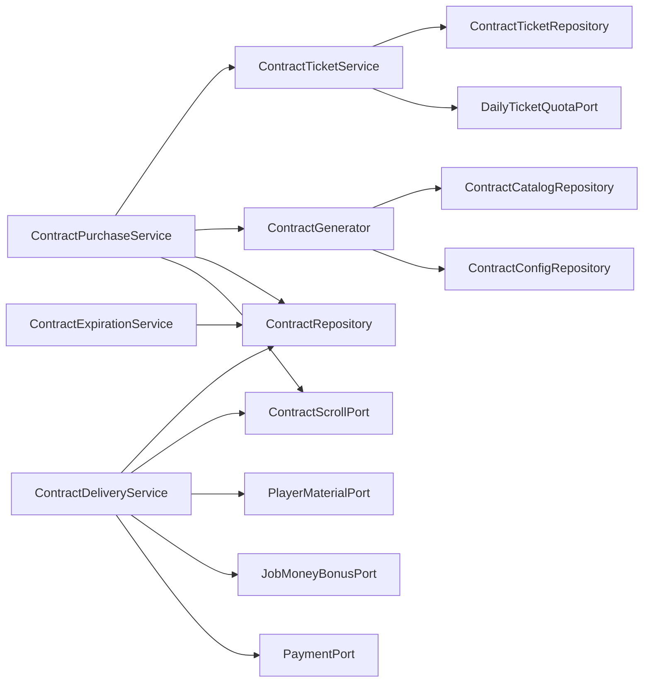
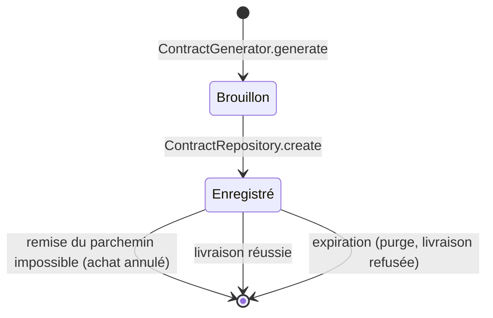

# Documentation du code — `contract-domain`

Ce document décrit le comportement du code actuel. La spec `contract-domain.md` décrit l'intention fonctionnelle. En cas d'écart, c'est le code qui fait foi pour le comportement observé.

Le domaine dépend uniquement de `common-domain`, pour `PlayerId`, `MaterialName`, `Quality` et `MoneyValue`. Il ne dépend ni de Bukkit, ni de Spring, ni de JPA, mais utilise Lombok (`@NonNull`). Les accès au serveur passent par les ports `serverside`, implémentés dans `contract-adapter`. Les services `userside` sont des classes concrètes, une par cas d'usage, que l'adapter assemble dans `ContractProvider`.

## 1. Carte du module

```
onl.tesseract.srp.contract.domain
├── model/
│   ├── contract/     Contract, ContractDraft, ContractId, ContractClient, ContractType, CatalogItem
│   └── exception/    ContractException (scellée) et ses 11 sous-classes
└── port/
    ├── serverside/   ContractRepository, ContractTicketRepository, ContractCatalogRepository,
    │                 ContractConfigRepository, ContractScrollPort, PlayerMaterialPort,
    │                 DailyTicketQuotaPort, JobMoneyBonusPort, PaymentPort
    └── userside/     ContractPurchaseService, ContractDeliveryService, ContractTicketService,
                      ContractExpirationService, ContractGenerator
```



## 2. Modèle

### Value objects

Les value objects sont des `record` validés dans leur constructeur. Un champ `@NonNull` à `null` lève une `NullPointerException`, une valeur hors règle une `IllegalArgumentException`.

| Type | Contenu | Validation |
|---|---|---|
| `ContractId` | `long value` | strictement positif |
| `ContractClient` | `String name` : métier (récolte) ou compétence (artisanat) dont le PNJ accepte la livraison | non nul et non blanc |
| `ContractType` | enum `HARVEST` ou `CRAFT` | |
| `CatalogItem` | type, client, matériau, poids, quantité | poids strictement positif, quantité au moins 1 |
| `ContractDraft` | type, client, matériau, quantité, qualité minimale, récompense, expiration | quantité au moins 1 |

`ContractDraft` est un contrat généré mais pas encore enregistré, donc sans identifiant. C'est `ContractRepository.create` qui le transforme en `Contract`.

### `Contract`

C'est un record qui contient `id` (`ContractId`), `type`, `client` (`ContractClient`), `material`, `quantity`, `minimalQuality`, `reward` (`MoneyValue`) et `expiresAt`. Tous les champs objets sont non nuls et la quantité vaut au moins 1. Le contrat ne connaît pas son acheteur : celui qui livre touche la récompense.

- `isExpiredAt(now)` est vrai si `expiresAt` est atteint ou dépassé : un contrat est donc expiré à l'instant exact de son échéance.
- `isFor(candidate)` compare les `ContractClient`. La comparaison est sensible à la casse ; l'adapter garantit les noms canoniques.
- `computeMoneyBonus(bonusRate)` calcule le bonus de métier, `reward × taux`, arrondi à l'unité (`HALF_UP`). Il renvoie `Optional.empty()` dans trois cas :
  - le contrat est un contrat d'artisanat ;
  - le taux est négatif ou nul ;
  - le bonus arrondi vaut 0.

  Cette règle vit dans le modèle parce qu'elle sert à la fois à l'aperçu de livraison et au paiement.

### Exceptions métier

Tous les refus héritent de `ContractException`, une classe abstraite scellée qui étend `RuntimeException`. Comme la hiérarchie est fermée, l'adapter qui traduit les refus en messages peut utiliser un `switch` exhaustif : ajouter une exception sans la traduire fait échouer la compilation. Chaque exception expose ses données par des getters.

| Exception | Données | Levée par |
|---|---|---|
| `NoContractTicketLeftException` | joueur | `buyScroll` |
| `ScrollInventoryFullException` | joueur | `buyScroll` |
| `NoContractAvailableException` | acheteur | `buyScroll` |
| `ContractNotFoundException` | contrat | `deliver` |
| `ContractExpiredException` | contrat | `deliver` |
| `WrongContractClientException` | contrat, client attendu, client réel | `deliver` |
| `ContractScrollNotOwnedException` | joueur, contrat | `deliver` |
| `MissingContractItemsException` | joueur, contrat, quantité manquante | `deliver` |
| `InvalidTicketAmountException` | montant | `giveTickets` |
| `PaymentFailedException` | joueur, montant | `PaymentPort.pay` (adapter) |
| `NotEnoughMaterialException` | joueur, matériau, quantité demandée, quantité possédée | `PlayerMaterialPort.removeAtLeast` (adapter) |

## 3. Génération : `ContractGenerator`

Le générateur reçoit `ContractConfigRepository`, `ContractCatalogRepository`, un `RandomGenerator` et une `Clock`. L'aléa et l'horloge étant injectés, les tests contrôlent les tirages et la date.

`generate()` renvoie un `Optional<ContractDraft>` :

1. Il lit le catalogue par `findAllCatalogItems()`. Si le catalogue est vide, il renvoie `Optional.empty()`.
2. Il tire un élément proportionnellement à son poids (`pickWeighted`). Le dernier élément sert de repli si les arrondis empêchent la sélection.
3. Il tire une qualité minimale uniformément parmi `Quality.values()`.
4. La récompense vaut `getUnitValue(matériau, qualité minimale) × quantité`, arrondie à l'unité (`HALF_UP`), avec un minimum de 1.
5. L'expiration vaut `clock.instant() + getScrollLifetime()`.

Le contenu ne dépend pas de l'acheteur.

## 4. Services `userside`

### 4.1 `ContractTicketService`

- `getTickets(player)` : le solde enregistré, ou le quota quotidien si le joueur n'a jamais eu de solde.
- `getDailyQuota(player)` : le quota fourni par `DailyTicketQuotaPort`.
- `hasTicket(player)` : vrai si le solde vaut au moins 1.
- `withdrawTicket(player)` : enregistre le solde moins 1. La méthode ne vérifie pas le solde : c'est `buyScroll` qui le contrôle avant.
- `refundTicket(player)` : ajoute 1.
- `giveTickets(target, amount)` : ajoute `amount`, sans plafond. Il lève `InvalidTicketAmountException` si `amount` est inférieur ou égal à 0.
- `renewDaily(player)` : remet le solde au quota s'il en diffère. Un solde supérieur au quota, par exemple après un don du staff, est donc ramené au quota.

### 4.2 `ContractPurchaseService`

Le service reçoit `ContractRepository`, `ContractGenerator`, `ContractScrollPort` et `ContractTicketService`.

`buyScroll(buyer)` renvoie le contrat acheté :

1. Sans ticket, il lève `NoContractTicketLeftException`.
2. Si le joueur ne peut pas recevoir de parchemin, il lève `ScrollInventoryFullException`.
3. Si le catalogue ne permet de générer aucun contrat, il lève `NoContractAvailableException`.
4. Il dépense le ticket.
5. Il enregistre le contrat. Si l'enregistrement lève une exception, il rend le ticket puis relance l'exception d'origine.
6. Il remet le parchemin. En cas d'échec, il supprime le contrat, rend le ticket et lève `ScrollInventoryFullException`.

Les trois premières vérifications ont lieu avant toute écriture.

### 4.3 `ContractDeliveryService`

Le service reçoit `ContractRepository`, `ContractScrollPort`, `PlayerMaterialPort`, `JobMoneyBonusPort`, `PaymentPort` et une `Clock`.

Consultation, utilisée par le menu de livraison :

- `findContract(contractId)` : `Optional<Contract>`.
- `countOwnedItems(player, contract)` : le nombre de matériaux du contrat que possède le joueur, à la qualité minimale ou au-dessus.
- `hasEnoughItems(player, contract)` : vrai si ce nombre atteint la quantité demandée.
- `findMoneyBonus(deliverer, contract)` : le bonus que toucherait ce joueur, calculé à partir du taux de `JobMoneyBonusPort` et de `Contract.computeMoneyBonus`.

`deliver(deliverer, contractId, npcClient)` renvoie la somme versée. Les vérifications se font dans cet ordre :

1. Contrat introuvable : `ContractNotFoundException`.
2. Contrat expiré : il est supprimé, puis `ContractExpiredException` est levée.
3. PNJ qui n'est pas le destinataire : `WrongContractClientException`.
4. Parchemin absent de l'inventaire du livreur : `ContractScrollNotOwnedException`.
5. Matériaux insuffisants : `MissingContractItemsException`, avec la quantité manquante.

Puis, dans l'ordre :

1. Il retire le parchemin. Si le retrait échoue, il lève `ContractScrollNotOwnedException`.
2. Il retire les matériaux (`removeAtLeast`), en commençant par la qualité admissible la plus basse ; c'est l'adapter qui choisit cet ordre.
3. Il supprime le contrat.
4. Il verse la récompense, à laquelle s'ajoute le bonus du livreur s'il y en a un.

Les vérifications 1 à 5 sont faites avant toute modification. Les étapes suivantes ne sont pas atomiques : si le paiement échoue, le parchemin et les matériaux sont déjà retirés et le contrat supprimé. L'adapter journalise alors une erreur et `PaymentFailedException` remonte.

### 4.4 `ContractExpirationService`

Le service reçoit `ContractRepository` et une `Clock`.

- `purgeExpired()` supprime les contrats dont l'échéance est atteinte et renvoie leur nombre.
- `isScrollValid(contractId)` est vrai si le contrat existe et n'a pas expiré. Un parchemin dont le contrat a disparu est donc invalide.

## 5. Ports `serverside`

| Port | Méthodes | Rôle |
|---|---|---|
| `ContractRepository` | `create(ContractDraft)`, `findById`, `delete`, `deleteExpired(now)` | persistance des contrats ; `create` attribue l'identifiant |
| `ContractTicketRepository` | `findTickets` (`OptionalInt`), `saveTickets` | solde de tickets ; vide pour un joueur jamais vu |
| `DailyTicketQuotaPort` | `getDailyQuota` | quota quotidien selon le grade |
| `JobMoneyBonusPort` | `getMoneyBonusRate(player, client, material)` | taux de bonus d'argent du joueur (0,05 pour 5 %) |
| `PaymentPort` | `pay(player, MoneyValue)` | versement ; lève `PaymentFailedException` si refusé |
| `PlayerMaterialPort` | `countAtLeast`, `removeAtLeast` | matériaux du joueur à une qualité minimale ; le retrait lève `NotEnoughMaterialException` si le stock manque |
| `ContractScrollPort` | `canReceiveScroll`, `giveScroll`, `hasScroll`, `removeScroll` | parchemin physique ; `false` si le joueur est hors ligne |
| `ContractCatalogRepository` | `findAllCatalogItems`, `getUnitValue(material, quality)` | catalogue et valeur unitaire d'un matériau |
| `ContractConfigRepository` | `getScrollLifetime` | durée de vie d'un parchemin |

## 6. Cycle de vie d'un contrat



Un contrat n'est jamais modifié après sa création. Il disparaît dans trois cas :

- la livraison réussit ;
- il est découvert expiré, lors d'une livraison ou d'une purge ;
- son parchemin n'a pas pu être remis à l'achat.

## 7. Tests

Chaque règle métier a un test JUnit 5 + Mockito dans `src/test`, nommé `methode_comportementAttendu`. Les ports sont mockés avec `Mockito.mock`, sans extension.

| Classe de test | Tests | Sujet |
|---|---|---|
| `ContractModelTest` | 15 | validation des records, `isExpiredAt`, `isFor`, `computeMoneyBonus` |
| `ContractGeneratorTest` | 7 | tirage pondéré, récompense, expiration, catalogue vide |
| `ContractPurchaseServiceTest` | 6 | achat, refus, remboursement du ticket |
| `ContractDeliveryServiceTest` | 12 | ordre des refus, retraits, suppression, bonus du livreur |
| `ContractTicketServiceTest` | 10 | solde, quota, dépense, don staff, renouvellement |
| `ContractExpirationServiceTest` | 4 | purge, validité d'un parchemin |

Sous JDK 26, Mockito a besoin de `-Dnet.bytebuddy.experimental=true`, que le `pom.xml` configure dans `argLine` de Surefire.

## 8. Limites

- La livraison n'est pas transactionnelle entre la base, l'inventaire et le paiement.
- Le domaine ne gère pas la concurrence : deux livraisons simultanées du même contrat ne sont protégées que par les vérifications de l'adapter (parchemin unique, verrou optimiste JPA).
- Aucun gain de tickets n'existe en dehors de la commande staff, et la quantité demandée n'a pas de plafond.
