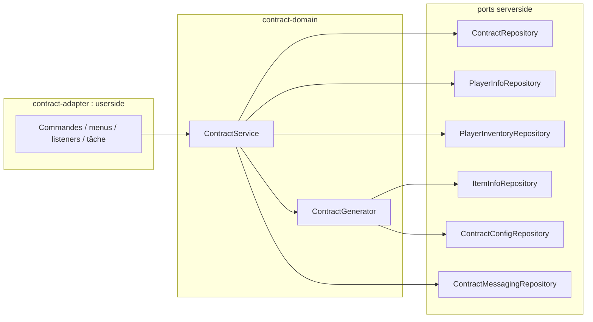
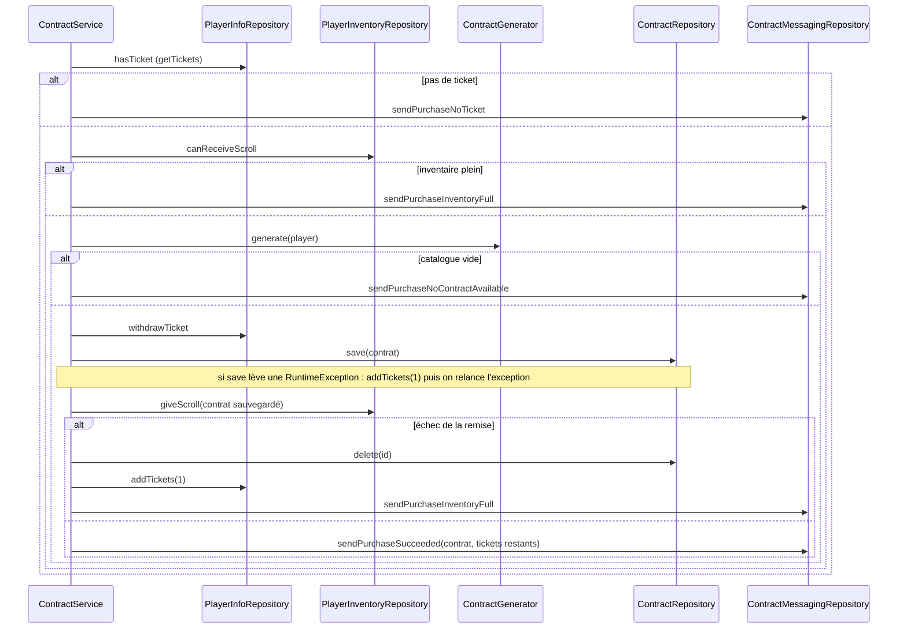
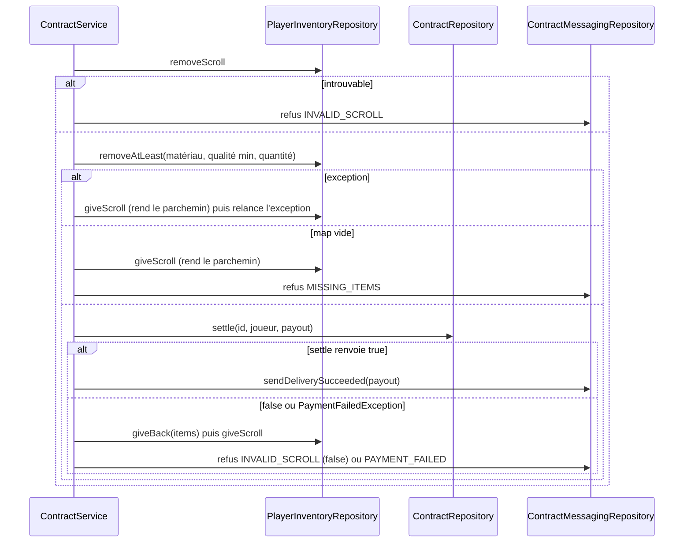

# Documentation du code — `contract-domain`

Ce document décrit **ce que fait le code** : classes, méthodes, ordre des appels, cas d'erreur. Il complète la spec (`contract-domain.md`), qui décrit ce que le code **doit** faire. En cas de différence, c'est le code qui fait foi pour le comportement actuel et la spec pour l'intention : toute différence est un bug ou une spec à mettre à jour.

Le module est du Java pur : aucune dépendance Bukkit, Spring ou JPA. Seule dépendance de bibliothèque : Lombok (`@NonNull`, scope `provided`). Tout ce qui touche au serveur passe par les interfaces du package `port.serverside`, implémentées dans `contract-adapter`.

## 1. Vue d'ensemble

```
contract-domain
├── model
│   ├── PlayerID                    identifiant joueur (UUID), propre au module
│   ├── Quality                     qualité d'un item, ordonnée de la plus basse à la plus haute
│   ├── exception.PaymentFailedException
│   └── contract
│       ├── Contract                le contrat (record)
│       ├── ContractType            HARVEST | CRAFT
│       ├── CatalogItem             un item qu'un contrat peut demander (record)
│       └── DeliveryRefusal         raisons d'un refus de livraison
└── port
    ├── userside                    ce que le jeu appelle
    │   ├── ContractService         achat, livraison, tickets, parchemin, purge
    │   └── ContractGenerator       tirage d'un contrat
    └── serverside                  ce dont le domaine a besoin (implémenté par l'adapter)
        ├── ContractRepository
        ├── PlayerInfoRepository
        ├── PlayerInventoryRepository
        ├── ItemInfoRepository
        ├── ContractConfigRepository
        └── ContractMessagingRepository
```

Qui appelle qui :



`ContractService` a 5 dépendances (contrats, inventaire, générateur, infos joueur, messagerie). `ContractGenerator` en a 3 (config, infos items, `Random`).

## 2. Modèle

### `PlayerID`
Record d'un `UUID`. Le constructeur lève `IllegalArgumentException` si l'UUID est `null`. Le module a son propre `PlayerID` (il ne réutilise pas celui de `job-domain`) pour ne dépendre d'aucun autre module SRP ; l'adapter convertit.

### `Quality`
`POOR < NORMAL < GOOD < VERY_GOOD < EXCEPTIONAL`. **L'ordre de déclaration compte** : le code utilise `ordinal()` et `values()` pour « toutes les qualités à partir de X » (adapter) et pour tirer une qualité au hasard (générateur). Ne pas réordonner les valeurs.

### `Contract` (record)
| Champ | Type | Sens |
|---|---|---|
| `id` | `Long` | `null` tant que le contrat n'est pas sauvegardé ; attribué par `ContractRepository.save` |
| `issuedTo` | `PlayerID` | l'acheteur. Information seulement : **n'importe quel porteur du parchemin peut livrer** et touche la récompense |
| `type` | `ContractType` | `HARVEST` (métier) ou `CRAFT` (compétence) |
| `job` | `String` | nom du métier (récolte) ou de la compétence (craft) dont le PNJ est le client |
| `material` | `String` | nom du matériau demandé |
| `quantity` | `int` | nombre d'items demandés, ≥ 1 |
| `minimalQuality` | `Quality` | qualité minimale acceptée |
| `reward` | `int` | récompense de base en lys, ≥ 0, **figée à l'achat** |
| `issuedAt`, `expiresAt` | `Instant` | émission et expiration |

Invariants vérifiés dans le constructeur : `issuedTo`, `type`, `job`, `material`, `minimalQuality`, `issuedAt`, `expiresAt` non nuls (`@NonNull` Lombok, `NullPointerException`) ; `quantity >= 1` et `reward >= 0` (`IllegalArgumentException`).

Méthodes :
- `isExpired(now)` : `now.isAfter(expiresAt)`. Un contrat est expiré **strictement après** `expiresAt`.
- `isForJob(npcJob)` : `job.equals(npcJob)`. La comparaison est **sensible à la casse** ; l'adapter garantit que `npcJob` est le nom canonique du catalogue (voir `ContractJobCatalog`).

### `CatalogItem` (record)
Un item qu'un contrat peut demander : `type`, `job`, `material`, `weight` (poids de tirage, > 0), `quantity` (quantité demandée, ≥ 1). Construit par l'adapter à partir de la rareté de l'item.

### `DeliveryRefusal` (enum)
`WRONG_CLIENT` (mauvais PNJ), `INVALID_SCROLL` (contrat introuvable ou parchemin absent), `EXPIRED`, `MISSING_ITEMS`, `NOT_ENOUGH_QUALITY`, `PAYMENT_FAILED`. Passé à la messagerie pour choisir le texte du PNJ.

### `PaymentFailedException`
`RuntimeException` levée par `ContractRepository.settle` quand le paiement est refusé. `ContractService.payOrRefuse` l'attrape.

## 3. Ports `serverside`

| Port | Méthode | Contrat |
|---|---|---|
| `ContractRepository` | `save(contract)` | enregistre et renvoie le contrat **avec son id** |
| | `findById(id)` | `Optional` |
| | `delete(id)` | supprime, sans erreur si absent |
| | `deleteExpired(now)` | supprime les contrats expirés, renvoie le nombre supprimé |
| | `settle(id, deliverer, payout)` | **en une transaction** : supprime le contrat puis verse `payout`. `false` si le contrat n'existe plus ; lève `PaymentFailedException` si le paiement échoue, ce qui annule la suppression |
| `PlayerInfoRepository` | `findTickets(player)` | `OptionalInt` vide si le joueur n'a pas de stock enregistré |
| | `saveTickets(player, n)` | enregistre le stock |
| | `getDailyTickets(player)` | quota quotidien de tickets selon son grade |
| | `getMoneyBonus(player, job, material)` | **taux** de bonus `MONEY` (0.25 = +25 %) |
| `PlayerInventoryRepository` | `countAtLeast(player, material, minimalQuality)` | nombre d'items de qualité ≥ `minimalQuality` |
| | `removeAtLeast(player, material, minimalQuality, amount)` | retire `amount` items de qualité ≥ `minimalQuality`, de la plus basse à la plus haute, **tout ou rien** ; renvoie ce qui a été retiré par qualité, **map vide** si impossible |
| | `giveBack(player, material, items)` | rend des items retirés |
| | `canReceiveScroll(player)` | place disponible pour un parchemin |
| | `giveScroll(player, contract)` | crée et remet le parchemin ; `false` si impossible |
| | `hasScroll(player, id)` / `removeScroll(player, id)` | détecte / retire le parchemin portant cet id |
| `ItemInfoRepository` | `getCatalogItems()` | liste des `CatalogItem` possibles |
| | `getValue(material, quality)` | valeur d'un item en lys pour cette qualité |
| `ContractConfigRepository` | `getScrollTtl()` | durée de vie d'un parchemin |
| `ContractMessagingRepository` | `send…` | un envoi de message par situation (achat, livraison, parchemin, tickets, staff) |

## 4. `ContractGenerator`

`generate(PlayerID buyer)` renvoie un `Optional<Contract>` :

1. `itemInfo.getCatalogItems()` ; liste vide → `Optional.empty()`.
2. **Tirage de l'item pondéré par `weight`** (`pickWeighted`) : somme des poids `total`, `r = random.nextDouble() * total`, puis on parcourt la liste en retranchant chaque poids jusqu'à passer sous 0. Repli sur le dernier élément en cas d'arrondi flottant. Plus le poids est grand, plus l'item sort souvent.
3. **Qualité minimale uniforme** : `Quality.values()[random.nextInt(5)]`, soit 20 % chacune entre `POOR` et `EXCEPTIONAL`.
4. `now = Instant.now()` (horloge système, **non injectable** : le générateur n'est donc pas testable à date fixe).
5. **Récompense** : `max(1, round(itemInfo.getValue(material, minimalQuality) × quantity))`, convertie en `int`. Un item sans valeur rapporte donc 1 lys au minimum.
6. Construit le `Contract` (`id = null`, `issuedTo = buyer`, `issuedAt = now`, `expiresAt = now + getScrollTtl()`).

Le contenu du contrat ne dépend pas de l'acheteur : seul `issuedTo` le mentionne.

## 5. `ContractService`

Les champs portent le nom de leur type : `contractRepository`, `playerInventoryRepository`, `contractGenerator`, `playerInfoRepository`, `contractMessagingRepository`. Les méthodes publiques sont en haut du fichier, les méthodes privées en bas.

### 5.1 Tickets

Un joueur sans ligne de tickets est **nouveau** : son stock effectif est son quota de grade.

| Méthode | Comportement |
|---|---|
| `getTickets(player)` | `findTickets` ; à défaut le quota (`getDailyQuota`) |
| `getDailyQuota(player)` | relaie `PlayerInfoRepository.getDailyTickets` |
| `showTickets(player)` | envoie `sendTicketsShown(tickets, quota)` |
| `renewDaily(player)` | si `getTickets != quota`, `saveTickets(quota)`. **Remet le stock au quota, même s'il était supérieur** (des tickets ajoutés par le staff au-delà du quota sont perdus au renouvellement). Appelée par l'adapter à la première connexion du jour ; le service ne vérifie pas lui-même la date |
| `giveTicketsAsStaff(staff, target, amount)` | `amount <= 0` → `sendStaffInvalidAmount`. Sinon `addTickets(target, amount)` (pas de plafond) puis `sendStaffTicketsGiven`. Pour un joueur nouveau, on ajoute donc au quota |
| `showTicketsAsStaff(staff, target)` | envoie `sendStaffTicketsShown` |

Trois méthodes privées encapsulent le stock : `hasTicket(player)` (au moins 1 ticket), `addTickets(player, amount)` et `withdrawTicket(player)` (un ticket de moins). Elles lisent le stock avec `getTickets` puis l'enregistrent avec `saveTickets`, ce qui couvre aussi le joueur nouveau. Il n'existe pas encore de commande staff pour retirer des tickets (voir `todo.md`).

### 5.2 Achat : `buyScroll(player)`



Ordre voulu : on **vérifie tout avant de dépenser** (ticket, place, contrat générable), on dépense le ticket, puis chaque étape suivante qui échoue défait les précédentes. Le remboursement est un `addTickets(player, 1)`, il ne réécrit pas l'ancien stock. Deux méthodes privées portent ces annulations : `saveContractOrRefundTicket` (sauvegarde, ticket rendu si elle lève une exception) et `cancelPurchase` (contrat supprimé, ticket rendu). Le nombre de tickets restants du message est relu avec `getTickets` après la dépense.

### 5.3 Livraison : `deliver(player, contractId, npcJob)`

`npcJob` est le métier ou la compétence du PNJ à qui le joueur livre.

1. **`checkDeliverable`** (voir 5.4). Vide → arrêt (le refus est déjà envoyé). La commande l'a déjà appelée avant d'ouvrir le menu ; on la rappelle car le contrat a pu changer avant la confirmation.
2. `playerInventoryRepository.hasScroll(player, contractId)` ; sinon refus `INVALID_SCROLL`.
3. `itemsOwned = countAtLeast(material, minimalQuality)`. Si `itemsOwned < quantity`, `refuseMissingItems` choisit le motif : `NOT_ENOUGH_QUALITY` si le joueur a plus d'items toutes qualités confondues (`countAtLeast(material, POOR) > itemsOwned`), sinon `MISSING_ITEMS`. Le message reçoit `quantity - itemsOwned` comme nombre manquant. Rien n'est retiré.
4. **`withdrawAndPay`** : calcule `payout = reward + moneyBonus` **avant** de toucher à l'inventaire (si ce calcul échoue, rien n'a été retiré), appelle `takeScrollAndItemsOrRefuse`, puis `payOrRefuse`, et envoie `sendDeliverySucceeded(payout)` seulement si le paiement a eu lieu.



Points précis :
- **`takeScrollAndItemsOrRefuse`** retire le parchemin puis les items. Si le retrait du parchemin échoue, elle envoie `INVALID_SCROLL`. Si le retrait des items échoue (map vide) ou lève une exception, elle rend le parchemin ; dans le cas de la map vide elle envoie aussi `MISSING_ITEMS`. Elle renvoie les items retirés par qualité, ou une **map vide** quand le refus est déjà envoyé.
- **`payOrRefuse`** appelle `settle` et renvoie `true` si le paiement a eu lieu. Dans les trois cas où il n'a pas eu lieu, elle rend les items et le parchemin avec `giveBackToPlayer` : `PaymentFailedException` (message `PAYMENT_FAILED`), `settle` renvoyant `false` (message `INVALID_SCROLL`), et toute autre `RuntimeException` (relancée après la restitution, sans message). Le message de succès est envoyé hors de cette méthode, donc une exception d'envoi ne peut pas annuler un paiement déjà fait.
- `settle` renvoyant `false` signifie que le contrat n'existe plus (déjà livré par un autre parchemin dupliqué) : rien n'est versé.
- **`giveBackToPlayer`** rend les items (`giveBack`) puis le parchemin (`giveScroll`).
- Limite connue : le résultat de `giveScroll` est **ignoré** aux trois endroits où on rend le parchemin (deux dans `takeScrollAndItemsOrRefuse`, un dans `giveBackToPlayer`). Dans `buyScroll`, le résultat de `giveScroll` est bien testé. Si l'inventaire est plein à ce moment-là, le parchemin est perdu et le contrat reste en base jusqu'à expiration.

### 5.4 `checkDeliverable(player, contractId, npcJob)`
Vérifie le contrat **avant** la confirmation de l'interface. Ordre :
1. contrat introuvable → refus `INVALID_SCROLL` ;
2. `!isForJob(npcJob)` → refus `WRONG_CLIENT` ;
3. `isExpired(now)` → refus `EXPIRED` **et suppression du contrat** (faite par `refuse`) ;
4. sinon renvoie le contrat.

### 5.5 Autres méthodes
- `moneyBonus(deliverer, contract)` : renvoie `0` pour un contrat d'artisanat. Pour une récolte : `bonusRate = max(0, getMoneyBonus(deliverer, job, material))`, résultat `round(reward × bonusRate)` en lys. **Le bonus est celui du livreur**, pas de l'acheteur. Sert au paiement et à l'affichage avant livraison.
- `noScrollInHand(player, npcJob)` : relaie `sendNoScrollInHand`.
- `useScroll(player, contractId)` : appelé quand le joueur utilise (clic droit) un parchemin. Si le contrat n'existe plus **ou** est expiré (`contractStillValid` faux), retire le parchemin et envoie `sendScrollDestroyed`. Si le contrat est valide, ne fait rien.
- `purgeExpired()` : `deleteExpired(now)`, renvoie le nombre de contrats supprimés.

## 6. Qui supprime quoi (cycle de vie d'un contrat)

| Événement | Ligne en base | Parchemin en inventaire |
|---|---|---|
| Achat réussi | créée | remis |
| Livraison réussie | supprimée (par `settle`) | retiré |
| Livraison refusée (hors `EXPIRED`) | conservée | conservé / rendu |
| Livraison d'un contrat expiré | supprimée | conservé (inutilisable) |
| `discardScrollIfInvalid` sur contrat expiré ou absent | non modifiée | retiré |
| `purgeExpired` | supprimée si expirée | non modifié |

## 7. Ce que le domaine ne fait pas
- Il ne sait pas ce qu'est un item, un inventaire ou un message : tout passe par les ports.
- Il ne lit pas l'heure autrement que par `Instant.now()` (générateur, service).
- Il ne gère pas la concurrence : il compte sur `settle` (suppression + paiement atomiques) pour qu'un contrat ne soit payé qu'une fois. Le reste suppose une exécution sur le thread principal du serveur.
- Il n'a pas de tests unitaires à ce jour.