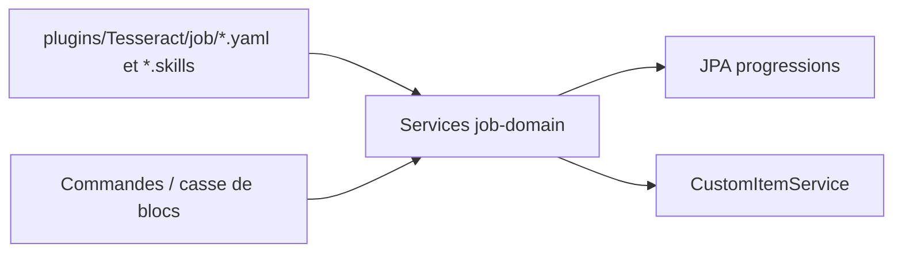

# Spécification — `job-adapter`

## Périmètre

L’adaptateur relie les services du domaine des métiers aux fichiers du serveur, à JPA, aux objets personnalisés et à Bukkit. `JobProvider` assemble `JobTalentTreeService`, `JobPlayerProgressionService` et `JobService` avec les dépôts correspondants.

## Chargement de métiers et talents

`JobYamlRepository` lit les fichiers `*.yaml` directement sous `plugins/Tesseract/job` et met les `Job` en cache à la première lecture. Les champs lus sont `name`, `display-name`, `talents` et `break`.

Chaque entrée de talent fournit sa clé/nom, `maxLevel` (défaut 1), `bonus`, `parents`, `prices`, `item` et `values`. La liste `prices` est indexée en niveaux à partir de 1. Chaque entrée `break` associe un nom de matériau source à la liste des matériaux de sortie; le type de source est fixé à `BLOCK`. `findAll` retourne une copie immuable de la collection des valeurs; `findByName` retourne l’entrée ou `null`. La map est uniquement chargée lorsqu’elle est vide et n’est pas rechargée dynamiquement.

`JobSkillTreeYamlRepository` lit `plugins/Tesseract/job/<jobName>.skills`. Les lignes de correspondance caractère=talent précèdent les lignes du dessin; le dessin se termine à `END`. Il construit une matrice de cellules avec cases vides, racine, cellules de talent et flèches typées. Un fichier absent ou un nom nul déclenche `IllegalArgumentException`; les erreurs de lecture deviennent `RuntimeException`. Bien qu’une map statique soit présente, la condition de cache contient `&& false`, donc le fichier est relu à chaque appel.

## Progressions JPA

- `JobPlayerProgressionEntity` et ses classes associées représentent une progression par joueur/métier et les niveaux de talents, avec une clé composée. L’adaptateur lit une progression pour `(PlayerID, JobName)` et la convertit en `PlayerJobProgression`.

## Objets et déclencheurs Bukkit

`TesseractJobItemRepository` traduit un matériau métier, un joueur, une quantité et une qualité en appel `CustomItemService.addItem`. Il utilise le système d’objets partagés, qui choisit entre item personnalisé et vanilla.

`BlockBreakListener` capte `BlockBreakEvent` et transmet au `JobService` une `Source` constituée du type du bloc cassé et de `SourceType.BLOCK`, avec l’UUID du joueur. Le traitement de récompense, incluant les tirages de loot et de qualité, est délégué au domaine.

## Interface joueur

- `/jobskill` ouvre un sélecteur de métier à deux rangées. Il liste les métiers chargés, avec un bouton par nom; cliquer ouvre l’arbre de talents du métier choisi.
- `JobSkillMenu` dessine la matrice renversée verticalement, affiche les racines, flèches et talents, et permet de faire défiler verticalement. Une cellule de talent montre sa description de bonus, son état acquis ou son coût prochain, indique si les points disponibles suffisent et si les prérequis bloquent l’achat. Le clic appelle `upgradeSkill`; le menu se rafraîchit uniquement si la méthode retourne vrai. Une erreur de chargement de l’arbre est journalisée, notifiée au joueur et ferme le menu.

## Limites

Le domaine `JobPlayerProgressionService.upgradeSkill` retourne actuellement toujours `false`; le clic d’achat ne peut donc pas aboutir avec cette implémentation. Le dépôt YAML n’observe pas les modifications de fichiers à chaud. La configuration invalide (enum de bonus, champs manquants, matériaux) peut interrompre le chargement. Les détails des annotations JPA et des relations sont définis par les entités; les garanties métier restent celles du domaine.
