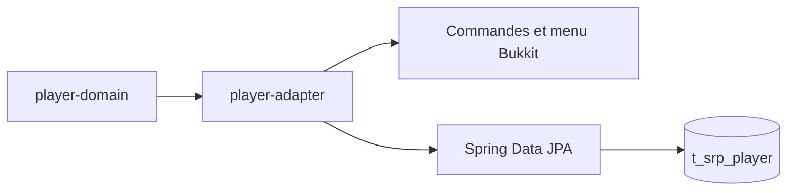

# Spécification — `player-adapter`

## Périmètre et dépendances

Ce module branche `player-domain` sur Bukkit, Spring et JPA. Il déclare les services du domaine dans `PlayerProvider`, implémente la persistance du profil SRP et porte les commandes et le menu des grades.

## Assemblage

`PlayerProvider` déclare un bean par service du domaine : `SrpPlayerProfileService`, `PlayerRankService`, `PlayerMoneyService` et `PlayerIlluminationService`. Le port `PlayerLedgerPort` est fourni par `plugin` (`MoneyLedgerPlayerLedgerPort`), et `EventPublisher` par `common-adapter`.

## Persistance du profil SRP

`SrpPlayerEntity` mappe la table `t_srp_player` : UUID (clé), grade stocké comme chaîne d’enum, argent, identifiant de titre et points d’illumination. L’entité est cacheable avec la stratégie Hibernate `READ_WRITE`. `toDomain` et `fromDomain` convertissent entre l’entité et `SrpPlayer`.

`SrpPlayerJpaRepository` est le dépôt Spring Data JPA. `JpaPlayerRepository` implémente `PlayerRepository` : `findById` cherche par UUID et retourne un `Optional` vide en l’absence de ligne ; `save` mappe vers l’entité, persiste, puis retourne le modèle reconstruit.

## Commandes et menu

- `/rank` (`RankCommand`) ouvre `PlayerRankProgressMenu`, qui affiche les grades en ligne défilante avec la progression du solde vers le grade suivant. Un clic sur le grade suivant appelle `PlayerRankService.buyNextRank` ; en cas de succès, un son de montée de niveau est joué et la vue défile vers le nouveau grade.
- Sous-commandes de `/staffSrp`, déclarées dans `SrpStaffCommand` (plugin) :
  - `rank set <joueur> <grade>` (`PlayerRankStaffCommand`) appelle `PlayerRankService.changeRank`. `PlayerRankArg` analyse le nom du grade et propose la complétion.
  - `money get|give|take` (`MoneyStaffCommand`) lit le solde ou appelle `PlayerMoneyService.addMoneyAsStaff` ou `removeMoneyAsStaff`, qui journalisent le mouvement.
  - `illumination get|give|take` (`IlluminationPointStaffCommand`) lit les points ou appelle `PlayerIlluminationService.addIlluminationPoints` ou `removeIlluminationPoints`.
