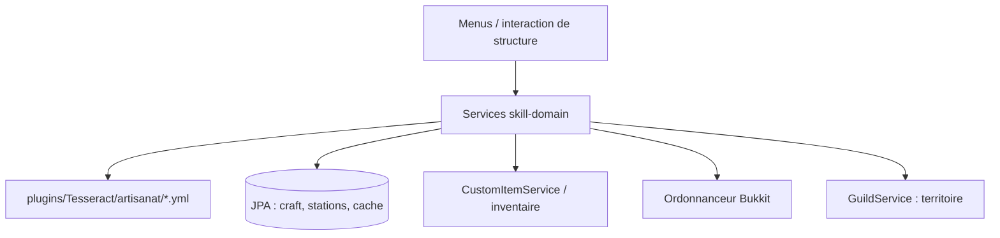

# Spécification — `skill-adapter`

## Périmètre

Ce module relie les compétences, stations et fabrications de `skill-domain` aux fichiers YAML, à la persistance JPA, aux inventaires Bukkit, aux commandes/menu du serveur et à l’ordonnanceur de ticks Bukkit.

## Configuration YAML

`YamlSkillConfigRepository` lit les fichiers `.yml` du dossier `plugins/Tesseract/artisanat`. Chaque fichier définit `name`, `structure_name` et `tiers`. Pour chaque tier numérique, le chargeur lit une section `recipes`; chaque recette porte son slot, ses composants indexés (matériau + quantité), son résultat (matériau + quantité) et une durée en secondes. Le dépôt construit les modèles `Skill`, `SkillTier` et `Recipe`, avec index des recettes par slot et par nom.

Le répertoire absent, les champs obligatoires absents, les tiers ou indices composants non numériques et les sections vides déclenchent `ConfigurationException`. `getSkills` recharge si le cache est nul ou vide; une fois non vide, aucune actualisation à chaud n’est faite.

## Persistance JPA

- Les entités `CraftingEntity`, `RecipeEmbeddable`, `ItemEmbeddable`, `PlayerSkillEmbeddable` et `CraftBonusEmbeddable` sérialisent les tâches actives, les recettes mises en file et les données de craft associées.
- `CraftingRepositoryJpaAdapter` supprime ou sauvegarde la tâche active par joueur/compétence et sauvegarde la file de recettes.
- `CacheEntity` stocke le butin de craft non récupéré. `SkillResultCacheRepositoryJpaAdapter.findAll` reconstruit la map joueur → `PlayerLootCache`; `delete` retire le cache d’une compétence. `save` est actuellement vide, donc le cache n’est pas persisté par cette implémentation.
- `StationEntity` utilise une clé composée de territoire et compétence. `StationMapper` convertit clé, stats et modèle; `StationJpaRepositoryAdapter.get` lit une station par sa clé.

## Ports Bukkit et modules voisins

- `TesseractItemRepository` délègue quantité, ajout, comptage et retrait à `CustomItemService`. Les matériaux utilisent le système d’objets commun, mais le retrait demande la qualité explicitement.
- `GuildTerritoryRepository` résout un chunk via `GuildService` et retourne l’UUID de la guilde propriétaire, ou `null` si aucune guilde n’est trouvée.
- `BukkitMessagingRepository` envoie les messages de composants insuffisants, tier de table insuffisant, démarrage et mise en file d’un craft.
- `SkillProvider` assemble `SkillService` à partir de la config, et `StationService` à partir des dépôts de territoire et de station.

## Ordonnancement des crafts

`BukkitCraftTaskScheduler` crée pour chaque couple joueur/compétence deux tâches Bukkit : `CraftRunnable` exécute le pas de craft à intervalle déterminé par la durée unitaire en millisecondes divisée par 50 (ticks); `CraftTickRunnable` met à jour le compte à rebours toutes les 20 ticks. Une nouvelle tâche annule celle du même joueur/compétence avant de l’enregistrer. L’annulation stoppe les deux tâches et tente d’envoyer un message de fin au joueur connecté.

## Interface et événements

- `CustomStructureListener` réagit au clic droit bloc de la main principale sur un meuble ItemAdder déjà présent. Il résout la compétence depuis l’identifiant namespacé du meuble, obtient la station associée et ouvre `SkillMainMenu`; l’événement est annulé seulement lorsqu’une compétence est reconnue. Le code transmet les coordonnées de bloc X et Y comme indices X/Z de `ChunkCoord`, ce qui mérite vérification.
- `SkillMainMenu` affiche le livre de recettes, les améliorations, les recettes en attente, le craft en cours et le butin à collecter; son contenu est rafraîchi à la seconde. `RecipeMenu` liste jusqu’à sept recettes par page et ouvre l’écran de lancement depuis le résultat. `CraftingMenu` règle la quantité par pas de 1/5 ou min/max, affiche ingrédients/résultat, calcule le maximum depuis les stocks de qualité `POOR` et lance le craft. `SkillUpgradeMenu` affiche tier, qualité, réussite, réduction de durée, récupération succès/échec et craft multiple; ses clics appellent `StationService.upgradeStat`. Les stats de récupération et de craft multiple restent affichées à zéro (TODO), même si les clics sont raccordés. La sélection de quantité ne retire pas les ingrédients avant le clic de lancement. Les menus ItemAdder emploient les arrière-plans et boutons graphiques partagés.
- `ItemMetaUtil` regroupe les adaptations de métadonnées d’item utilisées par ces écrans.

## Limites constatées dans le code

`SkillResultCacheRepositoryJpaAdapter.save` est actuellement vide : malgré l’appel au port depuis le service, le cache de butin n’est pas écrit par ce dépôt. `CraftingRepositoryJpaAdapter` remplace la tâche active (`queueOrder = 0`) et enregistre les recettes en attente à partir de 1, mais une file vide ne supprime pas les anciennes lignes; les recettes en attente sont enregistrées avec une durée sentinelle `Long.MAX_VALUE`.

`CustomStructureListener` réagit au clic droit bloc de la main principale sur un meuble ItemAdder déjà présent. Il résout la compétence depuis l’identifiant namespacé du meuble, obtient la station associée et ouvre `SkillMainMenu`; l’événement est annulé seulement lorsqu’une compétence est reconnue. Le code transmet les coordonnées de bloc X et Y comme indices X/Z de `ChunkCoord`, ce qui mérite vérification.

`SkillMainMenu` affiche le livre de recettes, les améliorations, les recettes en attente, le craft en cours et le butin à collecter; son contenu est rafraîchi à la seconde. `RecipeMenu` liste jusqu’à sept recettes par page et ouvre l’écran de lancement depuis le résultat. `CraftingMenu` règle la quantité par pas de 1/5 ou min/max, affiche ingrédients/résultat, calcule le maximum depuis les stocks de qualité `POOR` et lance le craft. `SkillUpgradeMenu` affiche tier, qualité, réussite, réduction de durée, récupération succès/échec et craft multiple; ses clics appellent `StationService.upgradeStat`. Les stats de récupération et de craft multiple restent affichées à zéro (TODO), même si les clics sont raccordés. La sélection de quantité ne retire pas les ingrédients avant le clic de lancement.

L’ordonnanceur calcule un intervalle entier en ticks; si la durée unitaire est inférieure à 50 ms, cet intervalle peut être nul. Le message de fin contient littéralement `${skillName}`. Les tâches utilisent l’ordonnanceur principal Bukkit, alors que les durées métier sont gérées séparément. La restauration de tâches actives au démarrage doit être confirmée dans les services et dépôts; cet adaptateur ne montre pas à lui seul de reprise automatique. Les fichiers YAML ne sont pas rechargés automatiquement après modification.
