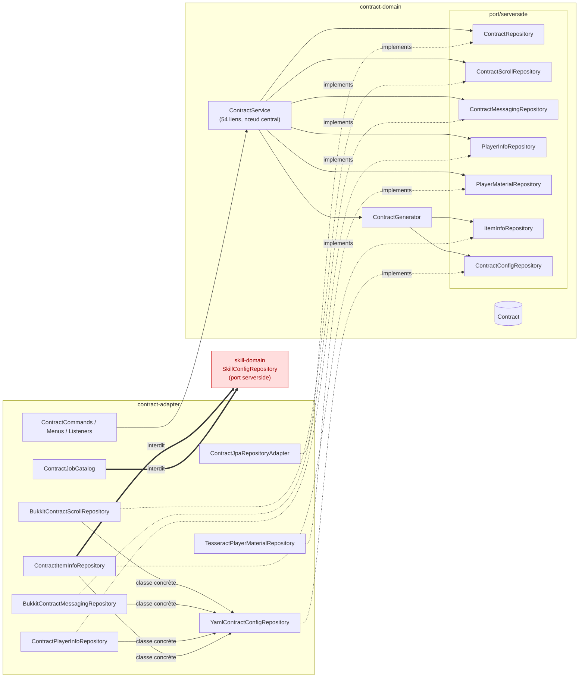

# Audit des normes : `contract-domain` et `contract-adapter`

Audit fait le 15/11/2026 à partir de [CLAUDE.md](../CLAUDE.md) et [CONTRIBUTING.md](../CONTRIBUTING.md).
Périmètre : 15 fichiers Java dans `contract-domain` et 23 dans `contract-adapter` (branche `claude/contrats-code-violations-4746ac`).

La cartographie vient de **graphify** (`graphify update`, extraction AST sans LLM) : 447 nœuds et 1 173 arêtes, dont 9 `implements`, 6 `inherits` et 291 `imports`. Chaque constat a ensuite été vérifié à la lecture du code.

> **État au 15/11/2026 : 34 violations sur 35 corrigées, plus les 3 bugs.** Seule A-1 reste ouverte, comme dette assumée. Les sections 1 à 6 décrivent l'état **avant** correction. Le détail des corrections est en section 7.

---

## 1. Cartographie

Ce que montre le graphe :

- **`ContractService` porte 54 liens** : c'est le nœud le plus connecté. Il dépend de 6 ports et sert 7 classes userside, ce qui confirme qu'il fait trop de choses (voir D-1).
- **`YamlContractConfigRepository` (25 liens)** est importé directement, en tant que classe concrète, par 4 autres adapters. L'inversion de dépendance est contournée (voir A-6).
- **2 arêtes vont vers le port serverside d'un autre domaine** (`SkillConfigRepository`). C'est la seule violation de frontière entre modules.
- **Aucune arête du domaine ne sort vers Bukkit, Spring ou JPA.** Le domaine importe seulement `common-domain`, `java.*` et Lombok.

---

## 2. Synthèse

| Sévérité | Domaine | Adapter | Total |
| --- | :---: | :---: | :---: |
| 🔴 Bloquant (architecture, interdit explicite) | 4 | 4 | **8** |
| 🟠 Majeur (contrat de nommage ou de méthode, SOLID) | 8 | 9 | **17** |
| 🟡 Mineur (commentaires, Javadoc, style) | 5 | 5 | **10** |

**Les points les plus graves :**

1. **Aucun test unitaire** dans `contract-domain` : il n'y a pas de dossier `src/test`.
2. **`SkillConfigRepository` est utilisé par deux adapters**, alors qu'un adapter ne doit jamais utiliser le repository d'un autre domaine.
3. **`Optional.get()` est appelé à 8 endroits.**
4. **Le domaine envoie lui-même les messages d'erreur au joueur** au lieu de lever des exceptions métier.
5. **`ContractJpaRepositoryAdapter`** ne suit pas la convention de nommage `<Techno><Port>`, et il n'y a pas de mapper.

---

## 3. `contract-domain`

### 🔴 Bloquant

| # | Règle | Emplacement | Constat |
| --- | --- | --- | --- |
| D-1 | Tests (§8) | module entier | Il n'y a **aucun test**. Les règles métier ne sont pas couvertes : remboursement du ticket, bonus HARVEST, tirage pondéré, refus de livraison, `renewDaily`, montant staff ≤ 0. |
| D-2 | `Optional.get()` interdit (§4.2) | [ContractService.java:78](../contract-domain/src/main/java/onl/tesseract/srp/contract/domain/port/userside/ContractService.java:78), [:108](../contract-domain/src/main/java/onl/tesseract/srp/contract/domain/port/userside/ContractService.java:108) | `draftContract.get()` et `foundContract.get()` suivent un test `isEmpty()`. CONTRIBUTING classe explicitement ce motif en « Non ». |
| D-3 | Erreurs métier (§5) | [ContractService.java](../contract-domain/src/main/java/onl/tesseract/srp/contract/domain/port/userside/ContractService.java) (`buyScroll`, `deliver`, `giveTicketsAsStaff`) | Les cas interdits (pas de ticket, inventaire plein, contrat expiré, mauvais PNJ, items manquants, montant invalide) passent par `contractMessagingRepository.sendXxx()` puis un `return`. La norme demande une **exception métier**, que l'adapter userside traduit en message. Résultat : le domaine pilote l'affichage, et l'enum `DeliveryRefusal` n'est jamais utilisée. |
| D-4 | `get…` ne renvoie jamais vide (§3.3) | [ContractService.java:89](../contract-domain/src/main/java/onl/tesseract/srp/contract/domain/port/userside/ContractService.java:89) | `getContract(long)` renvoie `Optional<Contract>`. Il faut la renommer `findContract`, ou garder `getContract` et lever `ContractNotFoundException`. |

### 🟠 Majeur

| # | Règle | Emplacement | Constat |
| --- | --- | --- | --- |
| D-5 | SRP, un service par responsabilité (§2.3) | `ContractService` | Ce service regroupe l'achat, la livraison, les tickets, les actions staff et le nettoyage des parchemins, avec 6 ports injectés. Découpage suggéré : `ContractPurchaseService`, `ContractDeliveryService`, `ContractTicketService`. |
| D-6 | ISP, ports ciblés (§2.3) | [PlayerInfoRepository.java](../contract-domain/src/main/java/onl/tesseract/srp/contract/domain/port/serverside/PlayerInfoRepository.java) | C'est le port « fourre-tout » que la norme interdit : il gère à la fois la persistance des tickets, le quota par rang, le bonus de métier et le **paiement** (`giveMoney`). Découpage suggéré : `ContractTicketRepository`, `DailyQuotaPort`, `JobBonusPort`, `PaymentPort`. |
| D-7 | ISP + nommage `<Capacité>Port` (§2.3, §3.2) | [ContractMessagingRepository.java](../contract-domain/src/main/java/onl/tesseract/srp/contract/domain/port/serverside/ContractMessagingRepository.java) | Ce port a 16 méthodes et n'a rien d'un repository. Il devrait s'appeler `…Port`, et il disparaît en grande partie si D-3 est corrigé. |
| D-8 | Nommage `<Capacité>Port` (§3.2) | `ContractScrollRepository`, `PlayerMaterialRepository` | Ces ports manipulent l'inventaire Bukkit et ne font pas de persistance. Noms suggérés : `ContractScrollPort` ou `ScrollInventoryPort`, et `PlayerMaterialPort`. |
| D-9 | `findAll…` pour une collection (§3.3) | [ItemInfoRepository.java:12](../contract-domain/src/main/java/onl/tesseract/srp/contract/domain/port/serverside/ItemInfoRepository.java:12) | `getCatalogItems()` renvoie une `List`. Nom attendu : `findAllCatalogItems()`. Le nom `ItemInfo` est vague : `ContractCatalogRepository` serait plus parlant. |
| D-10 | Préférer les value objects (§6) | [Contract.java:10](../contract-domain/src/main/java/onl/tesseract/srp/contract/domain/model/contract/Contract.java:10), `CatalogItem` | `Long id`, `String job` et `int reward` sont des types primitifs. Value objects attendus : `ContractId`, un `JobName` ou `ContractClient`, et `MoneyValue`. Les paramètres `long contractId` et `String npcJob` des services et des ports ont le même problème. |
| D-11 | Aucun `null` / `Optional` (§4) | [ContractGenerator.java:46](../contract-domain/src/main/java/onl/tesseract/srp/contract/domain/port/userside/ContractGenerator.java:46), [Contract.java:10](../contract-domain/src/main/java/onl/tesseract/srp/contract/domain/model/contract/Contract.java:10) | Un `Contract` est créé avec `id = null`, et l'adapter doit tester `contract.id() == null`. Il faut séparer le brouillon du contrat persisté, par exemple avec `ContractDraft`. |
| D-12 | Exception porteuse de données (§5) | [PaymentFailedException.java](../contract-domain/src/main/java/onl/tesseract/srp/contract/domain/model/exception/PaymentFailedException.java) | L'exception est vide : ni joueur, ni montant. En plus, elle n'est rattrapée nulle part (voir R-1). |

### 🟡 Mineur

| # | Règle | Emplacement | Constat |
| --- | --- | --- | --- |
| D-13 | Commenter le pourquoi, pas le quoi (§9) | [ContractService.java:102-125](../contract-domain/src/main/java/onl/tesseract/srp/contract/domain/port/userside/ContractService.java:102) | Les commentaires `//On récupère le contrat`, `//On vérifie qu'il est valide` et `// On vérifie si il a les items requis` paraphrasent le code. |
| D-14 | Javadoc qui ment sur le contrat (§9) | `Contract.isExpired` (« l'instant fourni » alors qu'il n'y a pas de paramètre), `PlayerMaterialRepository.removeAtLeast` et `ContractService.withdrawContractItems` (« retourne le détail » alors qu'ils renvoient `void`), `checkContractItems` (« signale le motif », ce qu'elle ne fait pas) | La Javadoc des ports décrit leur contrat, elle doit donc être exacte. |
| D-15 | Les méthodes commencent par un verbe (§3.3) | `ContractService.moneyBonus`, `noScrollInHand`, `ContractGenerator.reward` | Noms suggérés : `computeMoneyBonus`, `notifyNoScrollInHand`, `computeReward`. |
| D-16 | Préfixe `is/has` pour un booléen (§3.3) | `ContractService.checkContractItems` | Elle renvoie un `boolean`. Nom suggéré : `hasContractItems`. |
| D-17 | Pas d'abréviation (§3.1) | [ContractConfigRepository.java:8](../contract-domain/src/main/java/onl/tesseract/srp/contract/domain/port/serverside/ContractConfigRepository.java:8) | `getScrollTtl()`. Nom suggéré : `getScrollLifetime()`. |

---

## 4. `contract-adapter`

### 🔴 Bloquant

| # | Règle | Emplacement | Constat |
| --- | --- | --- | --- |
| A-1 | Pas de repository d'un autre domaine (§2.2) | [ContractItemInfoRepository.java:19](../contract-adapter/src/main/java/onl/tesseract/srp/contract/adapter/serverside/ContractItemInfoRepository.java:19), [ContractJobCatalog.java:4](../contract-adapter/src/main/java/onl/tesseract/srp/contract/adapter/userside/controller/commands/args/ContractJobCatalog.java:4) | Ces deux classes injectent `skill.domain.port.serverside.SkillConfigRepository`. Il faut passer par `SkillService`, qui n'expose aujourd'hui que `getSkillFromStructureID` : il faut lui ajouter une méthode `findAllSkills()`. |
| A-2 | Implémentation d'un port = `<Techno><Port>`, jamais suffixée (§3.2) | [ContractJpaRepositoryAdapter.java](../contract-adapter/src/main/java/onl/tesseract/srp/contract/adapter/serverside/jpa/adapter/ContractJpaRepositoryAdapter.java) | Nom attendu : `JpaContractRepository`. Le package `jpa/adapter` n'a pas lieu d'être. |
| A-3 | `Optional.get()` interdit (§4.2) | [BukkitContractScrollRepository.java:78](../contract-adapter/src/main/java/onl/tesseract/srp/contract/adapter/serverside/BukkitContractScrollRepository.java:78), [:86](../contract-adapter/src/main/java/onl/tesseract/srp/contract/adapter/serverside/BukkitContractScrollRepository.java:86), [ContractCommands.java:44](../contract-adapter/src/main/java/onl/tesseract/srp/contract/adapter/userside/controller/commands/ContractCommands.java:44), [ContractScrollCleanupListener.java:48](../contract-adapter/src/main/java/onl/tesseract/srp/contract/adapter/userside/controller/event/ContractScrollCleanupListener.java:48), [:87-88](../contract-adapter/src/main/java/onl/tesseract/srp/contract/adapter/userside/controller/event/ContractScrollCleanupListener.java:87) | Il y a 6 appels, à remplacer par `flatMap`, `filter` ou `ifPresent`. |
| A-4 | Le modèle passe par un mapper (§3.2, §6) | [ContractEntity.java:51-59](../contract-adapter/src/main/java/onl/tesseract/srp/contract/adapter/serverside/jpa/entity/ContractEntity.java:51) | La conversion est faite par `fromDomain` et `toDomain` dans l'entité JPA. Il faut créer un `ContractMapper` (`toEntity`, `toDomain`). |

### 🟠 Majeur

| # | Règle | Emplacement | Constat |
| --- | --- | --- | --- |
| A-5 | `<Techno><Port>` (§3.2) | `ContractItemInfoRepository`, `ContractPlayerInfoRepository`, `TesseractPlayerMaterialRepository` | Les deux premiers n'ont pas de préfixe de techno. Le troisième utilise le nom du projet comme « techno ». |
| A-6 | DIP, dépendre d'abstractions (§2.3) | `BukkitContractScrollRepository`, `BukkitContractMessagingRepository`, `ContractPlayerInfoRepository`, `ContractItemInfoRepository` | Ces 4 classes injectent la **classe concrète** `YamlContractConfigRepository` pour accéder à des méthodes publiques absentes du port (`getNpcName`, `getDailyTickets`, `getRarityWeight`, `getQuantityByRarity`). Il faut des interfaces dédiées, par exemple `NpcNameConfig` et `RarityConfig`. |
| A-7 | SRP (§2.3) | [ContractPlayerInfoRepository.java](../contract-adapter/src/main/java/onl/tesseract/srp/contract/adapter/serverside/ContractPlayerInfoRepository.java) | Cette classe mélange JPA, la config YAML, `JobService` et `PlayerService`. C'est la conséquence directe de D-6. |
| A-8 | Envelopper les `null` externes (§4.1.6) | `Bukkit.getPlayer(...)` dans [BukkitContractScrollRepository](../contract-adapter/src/main/java/onl/tesseract/srp/contract/adapter/serverside/BukkitContractScrollRepository.java:40) (×4) et [BukkitContractMessagingRepository:34](../contract-adapter/src/main/java/onl/tesseract/srp/contract/adapter/serverside/messaging/BukkitContractMessagingRepository.java:34), `getOfflinePlayer().getName()` (:67), `getRank()` ([ContractPlayerInfoRepository:57](../contract-adapter/src/main/java/onl/tesseract/srp/contract/adapter/serverside/ContractPlayerInfoRepository.java:57)), `customItemService.getCustomMaterial` ([ContractItemInfoRepository:85](../contract-adapter/src/main/java/onl/tesseract/srp/contract/adapter/serverside/ContractItemInfoRepository.java:85)) | Le code teste `!= null` / `== null` au lieu d'appeler immédiatement `Optional.ofNullable(...)`. |
| A-9 | `find…` pour un `Optional` (§3.3) | [BukkitContractScrollRepository.java:82](../contract-adapter/src/main/java/onl/tesseract/srp/contract/adapter/serverside/BukkitContractScrollRepository.java:82) | `getSlot` renvoie `Optional<Integer>`. Nom attendu : `findScrollSlot`. |
| A-10 | Exception métier, pas technique (§5) | [TesseractPlayerMaterialRepository.java:39](../contract-adapter/src/main/java/onl/tesseract/srp/contract/adapter/serverside/TesseractPlayerMaterialRepository.java:39) | La classe lève `IllegalStateException("Player has less items than requested")`. Il faut une exception du domaine, par exemple `NotEnoughMaterialException(player, material, missing)`. |
| A-11 | Pas de `*Utils` (§3.1) | [ContractItemUtils.java](../contract-adapter/src/main/java/onl/tesseract/srp/contract/adapter/utils/ContractItemUtils.java), package `adapter/utils` | Nom suggéré : `ContractScrollReader` (`readContractId`). Le package `utils` regroupe 3 classes sans rapport entre elles. |
| A-12 | Noms en anglais (§1) | [ContractConstantes.java](../contract-adapter/src/main/java/onl/tesseract/srp/contract/adapter/utils/ContractConstantes.java) | « Constantes » est du français et ce n'est pas un concept métier. Il s'agit en plus d'une *constant interface* (anti-pattern) : une `final class ContractScrollItems` serait préférable. |
| A-13 | Les adapters userside restent minces (§2.2) | [ContractScrollCleanupListener.java:73-94](../contract-adapter/src/main/java/onl/tesseract/srp/contract/adapter/userside/controller/event/ContractScrollCleanupListener.java:73), [ContractDeliveryMenu.java:94](../contract-adapter/src/main/java/onl/tesseract/srp/contract/adapter/userside/controller/menu/ContractDeliveryMenu.java:94) | La règle « un parchemin expiré est détruit » est appliquée dans le listener, qui parcourt l'inventaire et appelle `isExpired`, alors que le domaine a déjà `useScroll`. De même, le menu compare lui-même `count >= quantity`. |

### 🟡 Mineur

| # | Règle | Emplacement | Constat |
| --- | --- | --- | --- |
| A-14 | Javadoc (§9) | [ContractItemInfoRepository.java:27-32](../contract-adapter/src/main/java/onl/tesseract/srp/contract/adapter/serverside/ContractItemInfoRepository.java:27), `ContractEntity`, `ContractTicketEntity` | La Javadoc est placée **après** les annotations, donc l'outil Javadoc l'ignore. `ContractChatFormats` n'a aucune Javadoc. |
| A-15 | Pas d'abréviation (§3.1) | `YamlContractConfigRepository.getScrollTtl`, `ContractJobArg` | `Ttl` et `Arg` sont des abréviations. Nom suggéré : `ContractJobArgument`. |
| A-16 | Les méthodes commencent par un verbe (§3.3) | `ContractJobCatalog.names()`, `ContractItemInfoRepository.rarityOf/add`, `BukkitContractScrollRepository.lore`, `BukkitContractMessagingRepository.text/nameOf/error/success/info`, `ContractCommands.merchant/tickets` | Noms suggérés : `findAllNames`, `resolveRarity`, `addCatalogItem`, `buildLore`, etc. |
| A-17 | Nommage des commandes `<Sujet>Command` (§3.2) | `ContractCommands` | Nom attendu : `ContractCommand`, au singulier. |
| A-18 | Placement | [ContractExpirationTask.java](../contract-adapter/src/main/java/onl/tesseract/srp/contract/adapter/serverside/task/ContractExpirationTask.java) | Cette tâche *appelle* le service, c'est donc un adapter userside rangé dans `serverside`. La ligne 46 se termine par `}` en fin de ligne (formatage). |

---

## 5. Remarques hors normes, repérées pendant l'audit

Ces points ne relèvent pas des normes, mais ce sont des bugs probables :

- **R-1 : livraison sans confirmation, avec risque de perte.** Dans [`deliver`](../contract-domain/src/main/java/onl/tesseract/srp/contract/domain/port/userside/ContractService.java:130), la méthode retire le parchemin et les items, *puis* paie. Si `giveMoney` lève `PaymentFailedException`, le joueur perd tout et aucune compensation n'est faite. De plus, `sendDeliverySucceeded` n'est **jamais appelée** : le joueur ne reçoit aucun message en cas de succès.
- **R-2 : verrou optimiste inopérant.** `ContractEntity.fromDomain` remet toujours `version` à `0L`, ce qui neutralise `@Version`.
- **R-3 : testabilité.** `Contract.isExpired()` et `ContractGenerator` appellent `Instant.now()` directement. Sans `Clock` injectée, les tests de D-1 seront difficiles à écrire.

---

## 6. Plan de correction suggéré

1. Écrire les tests du domaine (D-1). Ils serviront de filet pour la suite.
2. Supprimer l'usage de `SkillConfigRepository` dans l'adapter (A-1), en ajoutant `findAllSkills()` à `SkillService`.
3. Remplacer les `Optional.get()` (D-2, A-3) et renommer `getContract` en `findContract` (D-4, A-9).
4. Introduire les exceptions métier et alléger `ContractMessagingRepository` (D-3, D-7, D-12, R-1).
5. Découper `ContractService` et `PlayerInfoRepository` (D-5, D-6, A-7).
6. Renommer et réorganiser les classes (A-2, A-4, A-5, A-11, A-12, D-8, D-9), puis traiter les points mineurs.

---

## 7. Corrections appliquées

### Décisions de conception

| Sujet | Décision |
| --- | --- |
| Service | Un service concret par cas d'usage, sans interface : `ContractPurchaseService`, `ContractDeliveryService`, `ContractTicketService`, `ContractExpirationService`. L'achat s'appuie sur `ContractTicketService`. La règle du bonus, partagée par l'achat et la livraison, vit dans le modèle (`Contract.computeMoneyBonus`). CONTRIBUTING.md et CLAUDE.md sont mis à jour en ce sens. |
| Refus métier | Une exception par cas, toutes sous la classe scellée `ContractException`. `ContractMessageFormatter`, côté adapter, les traduit avec un `switch` exhaustif. |
| Messages de succès | Envoyés par les adapters userside à partir du résultat renvoyé par le service. `ContractMessagingRepository` est supprimé. |
| Contrat non enregistré | Record `ContractDraft`. `ContractRepository.create(draft)` renvoie un `Contract` dont le `ContractId` est obligatoire. |
| Ports joueur | `PlayerInfoRepository` est découpé en `ContractTicketRepository`, `DailyTicketQuotaPort`, `JobMoneyBonusPort` et `PaymentPort`. |
| Value objects | `ContractId`, `ContractClient` (métier ou compétence), `MoneyValue` pour la récompense et le bonus. |
| Livraison | Retrait du parchemin et des items, suppression du contrat, puis paiement de la récompense et du bonus du livreur. Un échec de paiement est journalisé en erreur par `PlayerServicePaymentPort`, et le joueur reçoit un message. |
| Autres domaines | Aucun changement dans skill-domain ni customItem-domain. |

### Statut par violation

| # | Statut | Correction |
| --- | --- | --- |
| D-1 | ✅ | 55 tests JUnit 5 + Mockito : un fichier par service, plus `ContractModelTest` et `ContractGeneratorTest`. |
| D-2, A-3 | ✅ | Plus aucun `Optional.get()` : remplacés par `orElseThrow`, `flatMap`, `filter` et `ifPresentOrElse`. |
| D-3, D-7, D-12 | ✅ | Exceptions porteuses de données. Messagerie retirée du domaine. |
| D-4, A-9 | ✅ | `findContract`, `findScrollSlot`. |
| D-5 | ✅ | `ContractService` découpé en quatre services, un par cas d'usage (décision ci-dessus). |
| D-6, A-7 | ✅ | 4 ports et 4 implémentations dédiées. |
| D-8 | ✅ | `ContractScrollPort`, `PlayerMaterialPort`. |
| D-9 | ✅ | `ContractCatalogRepository.findAllCatalogItems`. |
| D-10, D-11 | ✅ | `ContractId`, `ContractClient`, `MoneyValue`, `ContractDraft`. |
| D-13 à D-17 | ✅ | Commentaires et Javadoc revus. Renommages : `computeReward`, `findMoneyBonus`, `hasEnoughItems`, `getScrollLifetime`. |
| A-1 | ⏳ dette | Isolé derrière `SkillCatalogPort`, dont la seule implémentation est `SkillConfigSkillCatalogPort`. À corriger dès que `SkillService` expose `findAllSkills()`. |
| A-2, A-4 | ✅ | `JpaContractRepository` + `ContractMapper`. L'entité ne connaît plus le domaine. |
| A-5 | ✅ | `CustomItemPlayerMaterialPort`, `JobSkillContractCatalogRepository`, `JpaContractTicketRepository`, `YamlDailyTicketQuotaPort`, `JobServiceMoneyBonusPort`, `PlayerServicePaymentPort`, `BukkitContractScrollPort`. |
| A-6 | ✅ | Interfaces `ContractNpcNameConfig`, `ContractRarityConfig` et `DailyTicketConfig`, implémentées par `YamlContractConfigRepository`. |
| A-8 | ✅ | `Optional.ofNullable` à chaque appel Bukkit, `PlayerService`, `JobService` ou `CustomItemService` qui peut renvoyer `null`. |
| A-10 | ✅ | `NotEnoughMaterialException`. |
| A-11, A-12 | ✅ | Package `utils` supprimé. Les classes deviennent `scroll/ContractScrollItems` (classe finale), `scroll/ContractScrollReader` et `userside/controller/message/ContractChatFormats`. |
| A-13 | ✅ | Le listener délègue à `isScrollValid`, et le menu à `hasEnoughItems`. |
| A-14 à A-18 | ✅ | Javadoc placée avant les annotations. `ContractJobArgument`, `ContractCommand`, méthodes renommées avec un verbe. `ContractExpirationTask` déplacée dans `userside`. |
| R-1 | ✅ | Le bonus du livreur est versé (conforme à la spec), le message de succès est envoyé, et un échec de paiement est journalisé. |
| R-2 | ✅ | Les contrats ne sont plus jamais mis à jour, seulement créés et supprimés. `@Version` est géré par JPA. |
| R-3 | ✅ | `Clock` injectée dans `ContractDeliveryService`, `ContractExpirationService` et `ContractGenerator`. |

### Changements de comportement à vérifier en jeu

- Un parchemin dont le contrat n'existe plus est maintenant détruit par le listener. Avant, seuls les contrats encore présents et expirés étaient concernés, et les parchemins des contrats purgés restaient dans les inventaires.
- `/contract deliver` avec un parchemin inconnu affiche maintenant la réplique « parchemin invalide ». Avant, il ne se passait rien.
- Le contrat est supprimé de la base après la livraison.
