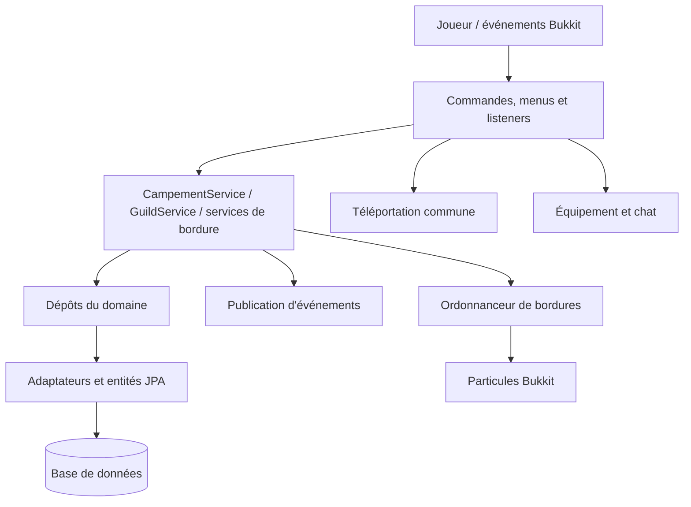

# Spécification — `territory-adapter`

## Périmètre

`territory-adapter` est la couche d’intégration entre `territory-domain` et le serveur Bukkit/Spring. Il fournit les commandes et interactions joueurs, les écouteurs d’événements Bukkit, le rendu des bordures, l’assemblage des services, les implémentations de dépôts JPA et l’adaptation du service de monnaie.

Les décisions métier (droits, validité d’une revendication, règles de guilde/campement) sont demandées aux services du domaine. L’adaptateur convertit les coordonnées Bukkit en identifiants du domaine, appelle ces services et traduit leurs résultats en messages ou effets côté serveur.

## Services assemblés

`TerritoryProvider` construit les services suivants :

- `GuildService`, avec les dépôts de guildes et chunks, l’accès aux joueurs, le port d’événements et `MoneyServiceImpl`.
- `CampementService`, avec les dépôts de campements et chunks, le port d’événements et l’accès aux joueurs.
- `GuildBorderService` et `CampementBorderService`, qui utilisent l’ordonnanceur Bukkit et le service territorial correspondant.

## Commandes de campement

La racine `/campement` est réservée aux joueurs. Les sous-commandes exposées sont :

| Commande | Fonction côté adaptateur |
|---|---|
| `/campement create` | Demande la création à `CampementService` à la position du joueur et affiche un message selon le résultat (monde invalide, proximité du spawn/d’un territoire, territoire déjà détenu, succès, etc.). Pour `RANK_TOO_LOW`, `NAME_TAKEN` et `NOT_ENOUGH_MONEY`, la méthode retourne sans afficher de message. |
| `/campement delete` | Cherche le campement du joueur, ouvre une confirmation, puis le supprime et efface ses bordures affichées. |
| `/campement spawn [joueur]` | Téléporte vers le spawn du campement du joueur ou vers celui du joueur nommé, via le service commun de téléportation. |
| `/campement setspawn` | Demande de définir le spawn à la position actuelle et traduit le résultat (succès, permission, hors territoire, campement absent). |
| `/campement claim` | Revendique le chunk courant et traduit les résultats : déjà possédé, propriété concurrente, non adjacent, trop proche, non autorisé, campement absent ou monde invalide. |
| `/campement unclaim` | Libère le chunk courant et traite notamment les refus du dernier chunk, du chunk du spawn ou d’une opération qui scinderait le territoire. |
| `/campement trust <joueur>` | Ajoute un joueur connecté à la liste de confiance ; interdit explicitement de se désigner soi-même et notifie les deux joueurs en cas de succès. |
| `/campement untrust <joueur>` | Retire un joueur de confiance, résolu comme joueur hors ligne, et affiche le résultat. |
| `/campement border` | Bascule l’affichage des bordures pour le joueur dans le monde courant. |
| `/campement stick` | Demande un bâton d’annexion de campement à `AnnexionStickService`. |

## Commandes de guilde

La racine `/guild` est enregistrée par Spring. Les commandes joueur sont :

| Commande | Fonction côté adaptateur |
|---|---|
| `/guild create <nom>` | Demande la création à la position actuelle et traduit les résultats : coût insuffisant, monde/proximité invalide, nom pris, appartenance existante, rang trop bas, autre territoire ou succès. |
| `/guild delete` | Vérifie que l’émetteur est membre et chef, demande confirmation, puis appelle la suppression en tant que chef. Affiche succès ou échec. |
| `/guild menu` | Ouvre le menu de guilde pour le joueur chef trouvé par `getGuildByLeader`; sinon indique qu’il n’a pas de guilde. |
| `/guild invite <joueur>` | Envoie une invitation ou traite une jonction immédiate selon le résultat retourné par le domaine ; notifie l’émetteur et la cible lorsque pertinent. |
| `/guild kick <membre>` | Résout un membre hors ligne et demande son exclusion. Le callback de confirmation affiche un message de départ, mais l’appel à `kickMember` a déjà eu lieu avant l’ouverture du menu de confirmation. |
| `/guild leave` | Demande le départ ; le chef reçoit le refus « doit supprimer ou transférer le leadership », les autres voient une confirmation après le résultat `SUCCESS`. |
| `/guild claim` | Revendique le chunk courant pour la guilde et traduit les refus usuels (pas adjacent, autre propriétaire, trop proche, monde invalide, permissions). |
| `/guild unclaim` | Libère le chunk courant ; affiche les refus de dernier chunk, chunk de spawn ou scission territoriale. |
| `/guild border` | Bascule l’affichage des bordures de guilde dans le monde courant. |
| `/guild setspawn [private\|visitor]` | Définit le spawn à la position courante ; le type absent signifie `PRIVATE`. Le service renvoie succès, refus de permission, position extérieure ou guilde absente. |
| `/guild spawn [guilde]` | Sans argument, téléporte au spawn privé de la guilde du joueur. Avec une guilde, utilise son spawn visiteur si défini, sinon son spawn privé. La téléportation passe par le port commun. |
| `/guild stick` | Demande un bâton d’annexion de guilde. |

Le `GuildMenu` expose la banque de guilde. Il affiche le solde, propose un dépôt au clic gauche et, pour les rôles autorisés par `GuildRole.canWithdrawMoney()`, un retrait au clic droit. Il ferme le menu, demande un montant dans le chat, rejette les chaînes non entières et les montants négatifs, puis appelle `depositMoney` ou `withdrawMoney`. En cas de succès, il rouvre le menu ; sinon il affiche un message d’erreur. Le code accepte zéro comme montant.

Les classes d’arguments convertissent les noms de joueurs, membres, guildes, rôles et types de spawn vers les valeurs attendues par les commandes. La validation complète reste dépendante de leur parseur et du domaine.

## Bâtons d’annexion

`AnnexionStickService` consulte l’équipement du joueur. Il ajoute l’objet invocable seulement si celui de ce type n’existe pas déjà, puis publie dans tous les cas `AnnexionStickGivenEvent`.

Le bâton est un item enchanté avec une description des contrôles. Un clic droit (bloc ou air) exécute `<base> claim`; un clic gauche exécute `<base> unclaim`, puis l’événement Bukkit est annulé. Le bâton de campement est un `STICK` et celui de guilde un `BREEZE_ROD`. Les événements de clic avec une autre action n’appellent aucune commande.

## Protection des zones et nature

Les trois protections spécialisées dérivent de `ChunkProtectionListener`, qui centralise l’interception des événements Bukkit. Les listeners de campement et de guilde prennent en charge un chunk si leur service trouve un territoire correspondant. Ils délèguent ensuite la décision à `canInteractInChunk`; toute réponse autre que `Deny` est autorisée par ces adaptateurs. En cas de refus, le message désigne le propriétaire ou la guilde.

Sur les territoires de campement et de guilde, les décisions de construction/casse, conteneurs, dégâts aux créatures passives, seaux, feu, redstone, pêche, selle/monture/véhicules, cadres, entités attachées (laisse), tonte, capture au seau, nommage et interaction avec les supports d’armure sont déléguées au contrôle d’interaction du service. Les coffres de l’Ender sont explicitement toujours accessibles. Les dégâts hostiles aux joueurs et les explosions sont refusés par ces deux listeners.

`NatureProtectionListener` prend en charge les chunks qui ne sont revendiqués ni par un campement ni par une guilde. Il interdit la pose/casse de blocs, l’usage de seaux, l’allumage manuel/naturel, la casse/édition des entités suspendues (dont cadres) et le nommage d’entités. Il autorise les conteneurs, dégâts d’entités, dégâts hostiles, redstone, pêche, montures/véhicules, explosions, laisses, tonte, capture d’entité au seau, édition/casse des supports d’armure.

## Affichage et événements

- `TerritoryDisplayListener` suit les changements de chunk lors du déplacement, les revendications et les libérations, puis met à jour l’affichage territorial du joueur.
- `CampementBorderDisplayListener` et `GuildBorderDisplayListener` réagissent aux événements de claim/unclaim propres au type de territoire pour actualiser les bordures concernées.
- `TerritoryBorderDisplayListener` efface l’affichage lors d’une déconnexion ou d’une expulsion Bukkit.
- `GuildListener` relaie les événements de niveau et d’invitation de guilde vers l’interface/les messages du serveur.
- `CampLevelUpdateListener` réagit à la montée de rang du joueur pour recalculer/mettre à jour son campement.

Les bordures sont dessinées avec des particules `END_ROD` sur le pourtour extérieur des chunks. `TerritoryBorderTask` omet les côtés adjacents à un autre chunk de la collection, parcourt la hauteur du monde par pas de deux blocs et échantillonne les côtés à chaque bloc. Les points à plus de 50 blocs du joueur sont ignorés. La tâche s’arrête si le joueur est hors ligne.

`TerritoryBorderTaskSchedulerImpl` garde une tâche Bukkit par UUID. Une nouvelle planification annule l’ancienne, démarre une tâche asynchrone immédiatement puis toutes les 40 ticks (2 secondes); une demande pour un joueur non connecté est ignorée. `cancel` annule et retire la tâche, `isActive` consulte la map. Le listener de bordure efface l’affichage à la déconnexion/expulsion.

## Persistance et mappings

- `ChunkEntityId` est l’identifiant composite d’un chunk : coordonnées X/Z et nom du monde. Il convertit cet identifiant vers/depuis `ChunkCoord`.
- `TerritoryChunkEntity` est une entité JPA à héritage `SINGLE_TABLE`, discriminée par `type`. Ses sous-types relient le chunk à une entité `CampementEntity` ou `GuildEntity` et reconstruisent `CampementChunk`/`GuildChunk`.
- `TerritoryChunkJpaRepository` lit les chunks dans une plage rectangulaire d’un monde et utilise l’identifiant composite pour les opérations CRUD.
- `TerritoryChunkRepositoryImpl` sait lire un chunk par identifiant, filtrer par type et rechercher par plage. **Sa méthode `save` retourne actuellement `null` sans persister**.
- `GuildJpaRepository` déclare les requêtes par nom, chef, membre, rôle et chunk. `GuildRepositoryImpl` convertit les entités en modèles et persiste/supprime les guildes. Les recherches par ID et chef gèrent l’absence; certaines recherches (nom, chunk, membre) appellent `toDomain()` sur le résultat sans vérifier s’il est `null`.
- `CampementJpaRepository` et `CampementRepositoryImpl` fournissent la conversion, lecture, sauvegarde et suppression des campements. **Dans l’implémentation actuelle, `isChunkClaimed` retourne toujours `false`, `getCampementByChunk` retourne toujours `null` et la méthode `findByPlayer` se limite à une recherche par ID.**
- `SrpPlayerRepositoryImpl` est un bouchon provisoire : `isBaron()` retourne toujours `false` et `getCampLevel()` toujours `1`.

## Adaptation de monnaie

`MoneyServiceImpl` est injecté dans `GuildService`, mais ses méthodes ne sont pas encore intégrées à un système économique : `getPlayerMoney` retourne toujours `0`, et `payCreation`, `transfertToGuild`, `transfertFromGuild` et `transfertToGuildStaff` ne font rien. La création/dépense et les transferts de banque ne sont donc pas réellement appliqués à la monnaie du joueur par cette implémentation.

## Limites de l’état actuel

Cette fiche décrit le comportement du code présent. Plusieurs ports sont encore partiellement ou non implémentés (notamment la sauvegarde/recherche de chunks, les recherches de campement par chunk, le niveau/rang joueur et la monnaie). Les commandes traduisent certains résultats en messages silencieux ou génériques, et la protection dépend des services du domaine et de l’ordre d’enregistrement des listeners Bukkit. Les règles métier complètes sont spécifiées dans `territory-domain/spec/territory-domain.md`.
